# CogniRogue

**用你的知识爬一座塔。**

一张卡就是一个知识点，卡面效果是固定的。**牌面只讲机械，不讲知识**：手牌上只有
**类别、效果、数值、消耗、解锁状态**——没有主题、没有知识点名、没有记忆度、更没有题干。
**点开这张牌，题和选项才出现**：答对，这一手就生效，这个卡种当场解锁；
答错，这一手作废——**罚多重，看你开局前选的模式**：学习模式牌回牌堆（下回合抽回来），
复习模式进弃牌堆（等洗牌），测试模式这个卡种本场作废。

六种效果让牌组真的需要取舍：**洞察**无视格挡、**巩固**伤害减半换双倍格挡、**内化**按伤害回血、
**串联**分两段结算、**专注**抽一张牌、**猛击**攻守均衡。效果写在内置卡牌库里，是这张知识点的"性格"。
牌分四类——**攻击**（猛击/洞察/串联/内化）、**防御**（巩固）、**技能**（专注）、**能力**（增益牌），
卡面徽章上就印着「攻击·洞察」这样的类别 + 效果，卡面的颜色也按这四类走。

**牌组分两半。** 开局带 **3 张基础牌**（两张基础斩击 4 伤、一张基础格挡 6 挡）：不答题、随时可打、
**无法从游戏中获取**，也不会被精炼或删除。它们是这一局的"地板"——答错锁卡之后至少还有牌能打。
另一半是**答题换来的知识卡**（83 张内置卡面）和增益牌，只有这一半能从战斗奖励、事件、精英战里拿到。
基础牌数值刻意压低：保底不等于变强。

**每张牌有自己的名字**（杀戮尖塔那套牌面读法）：「折半之刃」「三度缔约」「一瓢知江」……
牌名是游戏名，刻意不等于知识点名——它呼应主题但绝不泄露任何一道题的答案。
**知识点映射完全不露**：卡面上没有主题名、没有知识点短名，「折半之刃」背后是哪道题，
只能靠玩出来——点开它，才知道这一手要答什么。
少数牌还带**签名改动**（`mods`）：「双影逐环」打三段、「三度缔约」三连击、「禁令之刺」攻倍率 1.2、
「一瓢知江」抽两张——同一种效果原型，每一张的手感不一样。

**卡牌库和题库是分开的**：83 张卡面（名字、攻挡、效果、`card id`）内置固定，md 文件只提供题目、
可以从标题页导入替换。题库**不限制主题，只限制格式**：`## 主题` 是可选的分组名，随便怎么起、
写几个都行；导入时只校验题干、选项和答案字母。点开一张牌才抽一道本场没问过的题
（优先同名题池，该池没题就从全部题目里抽）；而且**每次点开牌，四个选项都会重新洗牌**
——要记住的应该是这件事本身，不是"这题选 B"。内置 **83 张卡 / 246 道题 / 16 个题池**。

节奏只有一条规则：**出牌 1 点行动力，答对了这一手退回来**。所以行动力买的不是"出牌次数"，
而是"犯错次数"：会的人一回合能把整把牌打完，不会的人打两张就没油了。

外层是杀戮尖塔那套：**一条能提前看见全貌的分支路线、一副越走越厚的牌组、几张改规则的增益牌**。

TypeScript + Canvas 写的，没有 UI 框架。逻辑层（`src/core`）不碰 DOM，所以同一套规则既能在浏览器里跑，
也能在 Node 里跑几千局无头模拟——仓库里的数值都是模拟出来的，不是拍脑袋定的。

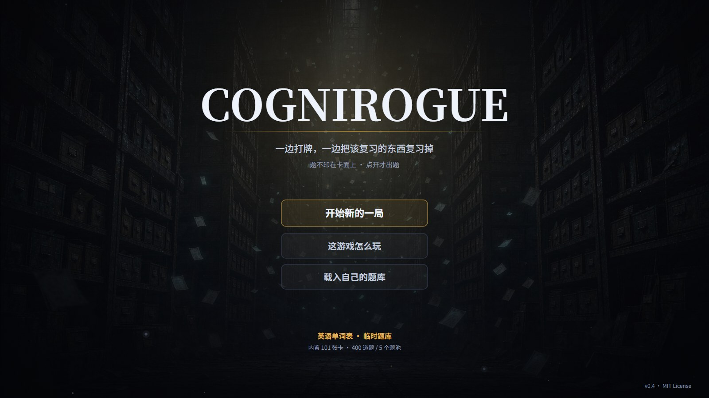

## 快速开始

```bash
git clone <this-repo>
cd CogniRogue
npm install
npm run dev          # http://localhost:5178
```

想要一个能直接双击打开的 exe 式单文件：

```bash
npm run build        # 产出 dist/index.html（约 1.1 MB，脚本、样式、美术全部内联）
```

`dist/index.html` 拷到任何地方双击就能玩，不需要服务器、不需要联网。

| 命令 | 作用 |
| --- | --- |
| `npm run dev` | 开发服务器，改代码热更新 |
| `npm run build` | 类型检查 + 依赖方向检查 + 打包成单文件 |
| `npm run sim` | 无头模拟几千局，验证数值 |
| `npm run smoke` | 开真浏览器点鼠标，验证按钮真的能按（需先跑 `npm run dev`） |
| `npm run shots` | 重拍 `docs/` 里这 19 张配图（同样需先跑 `npm run dev`） |
| `npm run check` | 类型检查 + 依赖方向检查（`tools/deps.mjs`） |

## 一局是什么样

8 层。每层 2–3 个节点，整条路开局就全部可见——你能提前规划"我要不要去拿那张增益牌"。
一局大约 10–15 分钟、50–80 道题（一种卡在一个场次里只问一次，解锁之后就免答了；
答错的话下一回合会换一道再问）。

**每回合抽 5 张**（`BAL.drawPerTurn`）。开局牌组 13 张 = 3 张基础牌 + 10 张知识卡，
所以一回合看见牌组的一半不到：牌组越厚，越可能这一回合摸不到想要的那张——
"跳过，不要卡"才真的是一个决定。

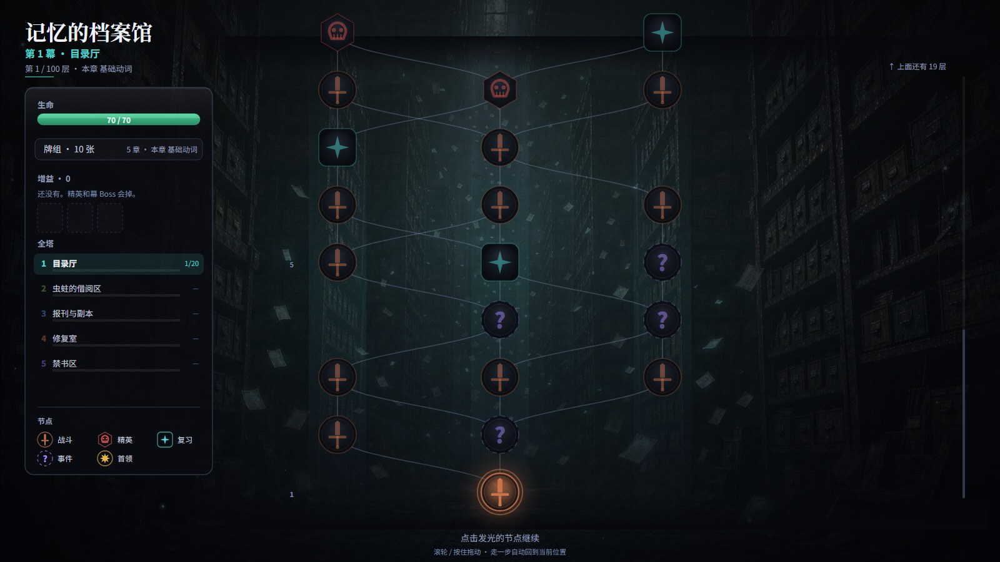

| 节点 | 内容 |
| --- | --- |
| ⚔ **战斗** | 普通敌人，赢了一场从三张卡里挑一张进牌组 |
| ☠ **精英** | 血厚、会格挡、会塞杂念。赢了给**增益牌**——它不白给，进牌组、要抽、要打 |
| ✦ **复习** | 休息回 32% 血 / 精炼一张卡（攻+3 挡+3）/ **永久删掉一张卡** |
| ? **事件** | 四段小故事：散落的索引卡、旧笔记本、守夜人、长明灯廊。都有代价 |
| ✺ **遗忘** | Boss。打你本局错得最多的主题，但你在该主题答对时它会被削弱 |

<p align="center">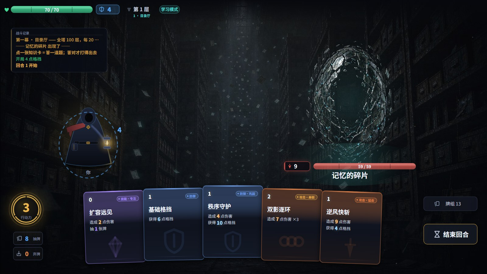</p>

<p align="center">
  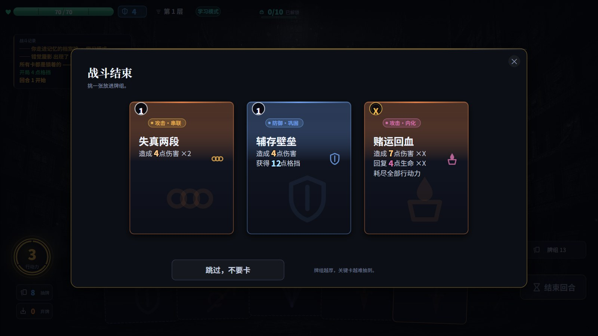
  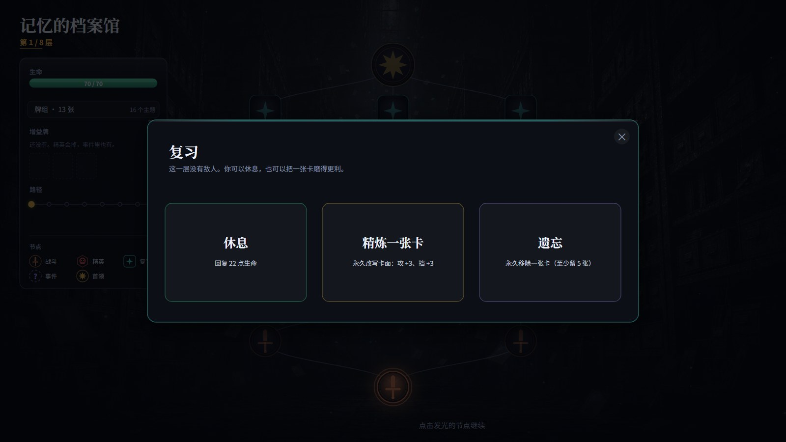
  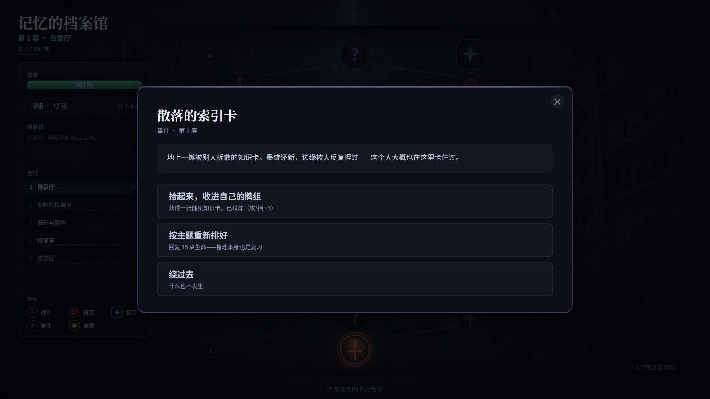
</p>

**牌组构筑是这一层最像杀戮尖塔、也最适合学习场景的地方。** 每打赢一场就往牌组里加一张知识卡，
牌组越厚，你越难抽到想要的那张——"跳过，不要卡"经常是正确选择。
复习点的**删卡**是构筑里最被低估的一步：主动放弃一个你这一局不打算碰的知识点，牌组就更好抽。
那 3 张基础牌不在可构筑的范围里：它们不可精炼、不可删除，永远占着 3 个牌位。

### 初始牌组与四类牌

牌分两个来源、四个类别：

| 来源 | 有哪些 | 能不能拿到 |
| --- | --- | --- |
| **初始牌组** | 2 张基础斩击（4 伤）、1 张基础格挡（6 挡） | 开局自带，**游戏中无法获取**，不可精炼、不可删除 |
| **游戏中获取** | 83 张知识卡、7 种增益牌 | 战后奖励、精英战、事件 |

获取的牌按"干什么"分四类（`cards/kinds.ts` 的 `cardType()`，卡面徽章上直接印着）：

| 类别 | 卡 | 它解决什么 |
| --- | --- | --- |
| **攻击** | 猛击 · 洞察 · 串联 · 内化 | 把行动力换成伤害（内化再按伤害回血） |
| **防御** | 巩固 | 把行动力换成格挡（伤害减半、格挡翻倍） |
| **技能** | 专注 | 伤害偏低但抽一张牌——处理"手上没牌了" |
| **能力** | 七种增益牌 | 本场持续改规则（沙漏、索引卡、长明灯……） |

**为什么要有基础牌。** 知识卡全都要答题，答错这一手就作废，测试模式甚至会把卡种锁掉；
于是"不会"的代价会变成"什么都不能做"——手里全是够不着的牌，这一回合就只剩快攻。
基础牌是这条下限：它不答题、随时可打，保证你**不会卡死**，但数值只有 4 伤 / 6 挡，
所以它绝不保证你**打得赢**。想赢还是得答题、解锁、用 ×1.5 的免答牌。

**基础牌只给 3 张，也是刻意的。** 它们进牌组、占抽牌位——抽到一张基础牌，就等于少抽一张知识卡。
给 5 张时每局答题量会掉到 65 道左右，牌组被稀释得更像"一半是保底牌"；3 张刚好够兜底。

### 增益牌也是牌，也要打出去

它们是原来那几件"遗物"。现在它们不是挂在右上角的图标，而是**躺在牌组里的牌**：
同样的手牌位、同样的 1 点行动力，抽到、打出去，本场战斗剩下的时间里一直生效。

| 增益牌 | 效果 |
| --- | --- |
| 记 错题本 | 答错时该主题攻击 +1（最多 +6）——**答错变成投资** |
| 时 沙漏 | 每回合行动力 +1（打出这一手立刻赚回来） |
| 索 索引卡 | 每回合多抽 1 张牌（打出时先抽 1 张） |
| 订 装订线 | 每回合第一次答错不花行动力 |
| 镜 双面镜 | 打出时随机解锁一种卡 |
| 灯 长明灯 | 每回合开始获得 3 点格挡 |
| 笔 荧光笔 | 每回合第一次答对抽 1 张 |

<p align="center">
  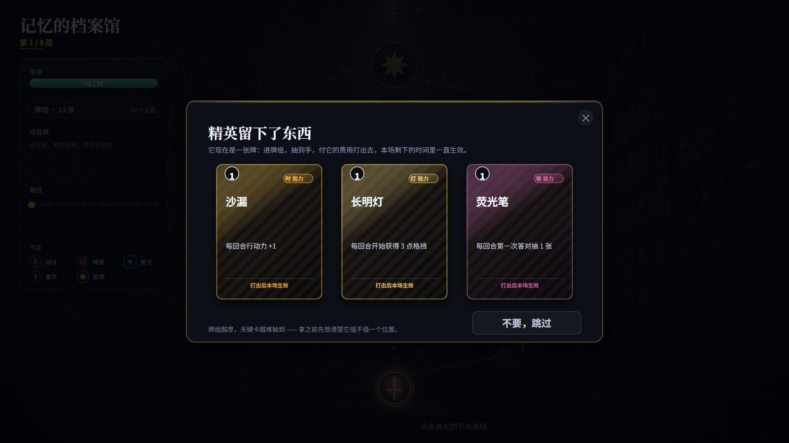
  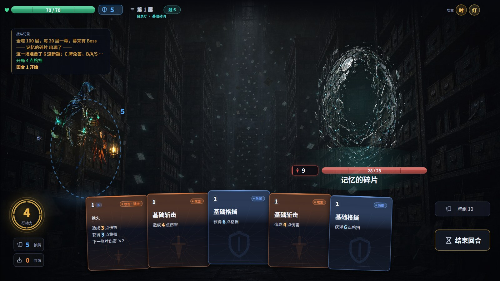
</p>

**这不是换皮，是把"局外成长"拉进牌组经济。** 遗物是白给的，所以它只影响数值上限；
牌要抽、要花行动力、要占牌位，于是"这一回合我是继续答题，还是先把灯点上"变成
一个真实的取舍，而"牌组里塞几张增益牌"（= 稀释几张知识卡）成了构筑决定。

三条规则把它和知识卡分开：

1. **没有题。** 增益牌不需要证明什么，只花行动力 —— 它不参与解锁统计，也不写记忆调度。
2. **不进弃牌堆。** 打出后它直接从牌组循环里出去（画面上是飞向右上角的增益槽）。
   洗回去的话，同一张牌每次洗牌都能再打一次，"本场持续"就变成无限叠加了。
3. **每场重置。** `G.powers` 在每场战斗开始时清空。增益牌每场都要重新抽、重新付钱，
   所以它不是"带着走的装备"，是这一场里你自己建起来的局面。

它们从哪来：精英战必给一张（三选一），普通战斗有 `BAL.powerDrop = 15%` 概率掉一张，
两个事件也能换到。一局大概见着一两次——不多，但每见一次都是一个真实的决定。

### 敌人会提前告诉你下一步

这是从杀戮尖塔搬过来最值钱的一条：**意图透明**。每个敌人有固定的招式循环，出招前就能看见——

> 意图：攻击 12×2　/　意图：获得 12 点格挡　/　意图：往你的弃牌堆塞 1 张杂念

于是随机从"被偷袭"变成了"可规划"。几种具体机制：

- **复习官**：一回合内没有真正答对任何一张卡，额外打你 3 点。专治全程快攻。
- **回声 / 镜像**：攻击**穿透一半格挡**，堆格挡这一套对它们不好使。
- **熵**：往你的弃牌堆塞**杂念**——占手牌位、打不出去、回合结束时自己散去。半懂不懂的知识就是这副样子。
- **审视者**：会格挡。想靠一回合爆发带走它，得先把那层挡住。

## 六种效果：牌不再只是数值

第一版所有卡都是"造成 X 伤害 + 获得 Y 格挡"，除了数字高低没有任何区别，一手牌读起来像一排同款。
现在每张卡挂一种**效果**，它决定底数怎么花出去：

| 效果 | 机制 | 什么样的知识点配它 |
| --- | --- | --- |
| **猛击** `strike` | 攻 ×1.0，挡 ×0.7 | 没有偏科的基准卡 |
| **洞察** `pierce` | 攻 ×0.95，**无视格挡** | 结论是"一定 / 必然"的知识，看穿表象 |
| **巩固** `guard` | 攻 ×0.6，挡 ×2.0 | 防线、稳定、不退化 |
| **内化** `drain` | 攻 ×0.85，按伤害 50% 回血 | 把知识换成自己的血，长局最耐用 |
| **串联** `chain` | 攻 ×0.52 × **2 段** | 知识点本身就是"两件事的组合" |
| **专注** `focus` | 攻 ×0.7，**抽 1 张** | 讲节奏、摊还、预留空间 |

效果不是随机贴的标签，是内置卡牌库里逐张定死的：`eff: 'pierce'` 就走洞察那套折算，导入题库改不了它；六种倍率见 `model/effects.ts`。
个别牌再挂一层 `mods`（如 `{ atkMul: 1.2 }`、`{ draw: 2 }`）做签名改动，展示和结算读同一份，卡面写的和实际发生的不会两张皮。
它把这副牌从"一条数值曲线"变成"一组取舍"——精英会格挡，洞察这时候才值钱；
血线吃紧，内化比猛击耐用；手里只剩两张牌，专注能把你这一回合接上。

<p align="center">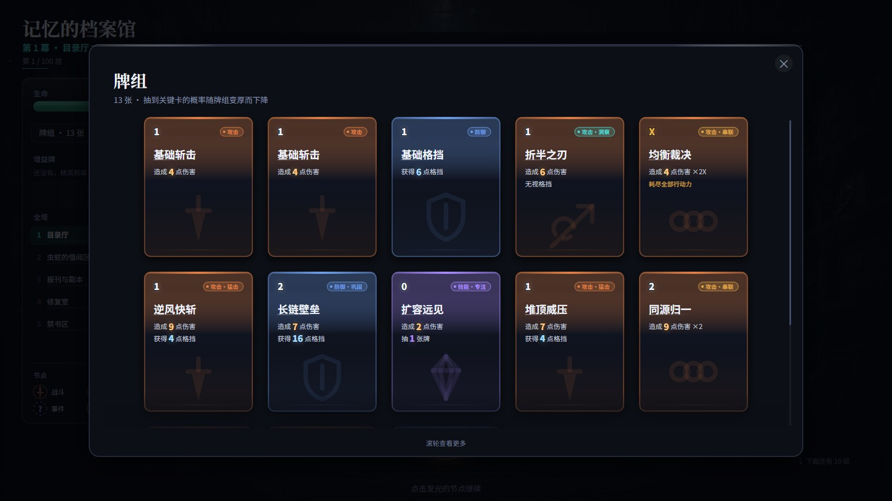</p>

### 打出去的那一下

答对之后不是"血条少了一截、然后弹个框"，而是先打完这一手：人物从提灯里甩出一道光刃，
飞过去、命中、敌人被击退，**演出演完了反馈面板才出来**。挡在面板后面演等于没演。

- 光刃的形状跟着效果走：洞察是一道连到手上的**直光束**，其余是**弧形拖尾**；
  串联的第二段会换一条更高的弧线，眼睛能数出"打了两下"。
- 命中是四件事同时发生：星芒闪白、火花四散、屏幕震动、伤害数字弹出。
  多段伤害的数字会错开位置，不然 `4` `4` 会被念成 `44`。
- 演出期间输入被锁住（`setInputLock`）——面板还没弹，但底下的牌和牌堆已经画出来了，
  不锁的话玩家能点到"还没轮到他"的东西。敌人出手时同样锁，见下一节。

<p align="center">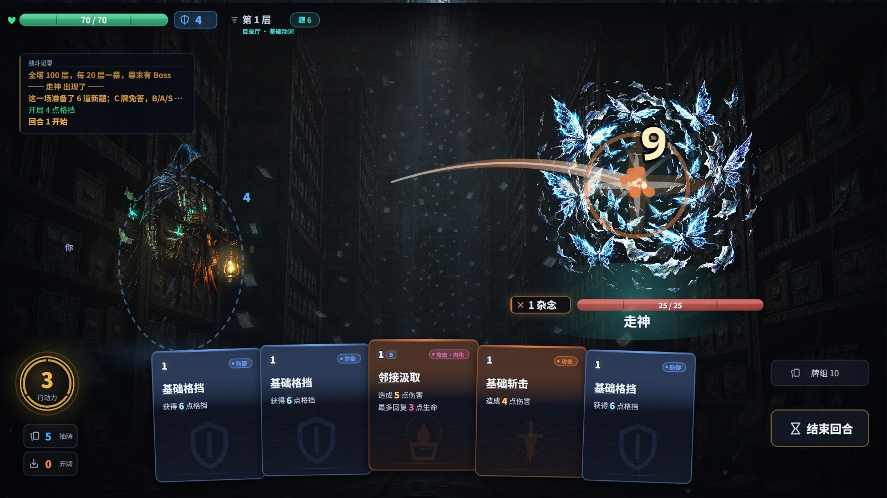</p>

### 敌人也要真的动

以前敌人回合几乎是静默的：只有**真的掉血**才发一个 `hurt` 事件。于是格挡全挡下、举盾、
塞杂念、变强、第一回合的观察期，玩家只能从左侧日志里倒推"它刚才是不是动过"。
现在 `endTurn` 的五个分支统一发一个 `enemyAct` 事件，带上动作类型和结算数值，表现层按类型编排：

| 意图 | 身体 | 看得见的东西 |
| --- | --- | --- |
| 攻击 | 后撤蓄力 → 前冲 | 红色光刃飞向你；**多段攻击分几次飞** |
| 攻击被全挡下 | 同样冲过来 | 光刃变蓝，落地是**盾环 +「全挡下」+「吸收 N」**，不爆红、不掉血数字 |
| 获得格挡 | 后缩 | 蓝色护盾从外往里收，脚下升起一层蓝雾 |
| 塞杂念 | 前倾 | N 张紫色问号牌**真的从它手里飞到左下弃牌堆** |
| 攻击变强 | 涨大、泛橙 | 两圈向外扩的红橙环 + 上升的火星 |
| 观察期 | 微微收住 | 一圈慢慢转的青色虚线 +「观察中…」 |

<p align="center">
  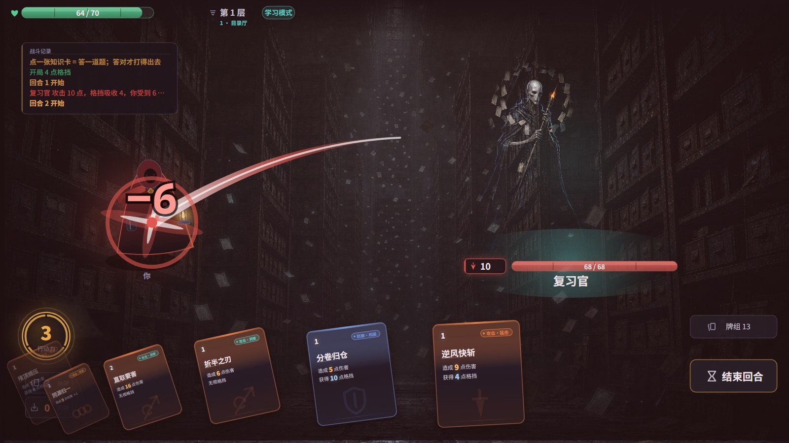
  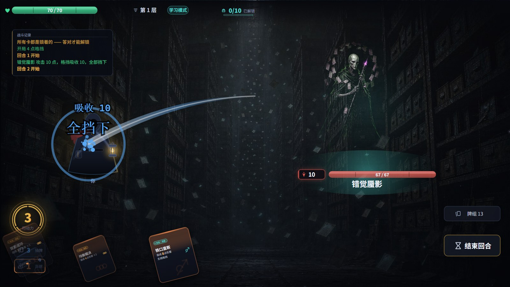
  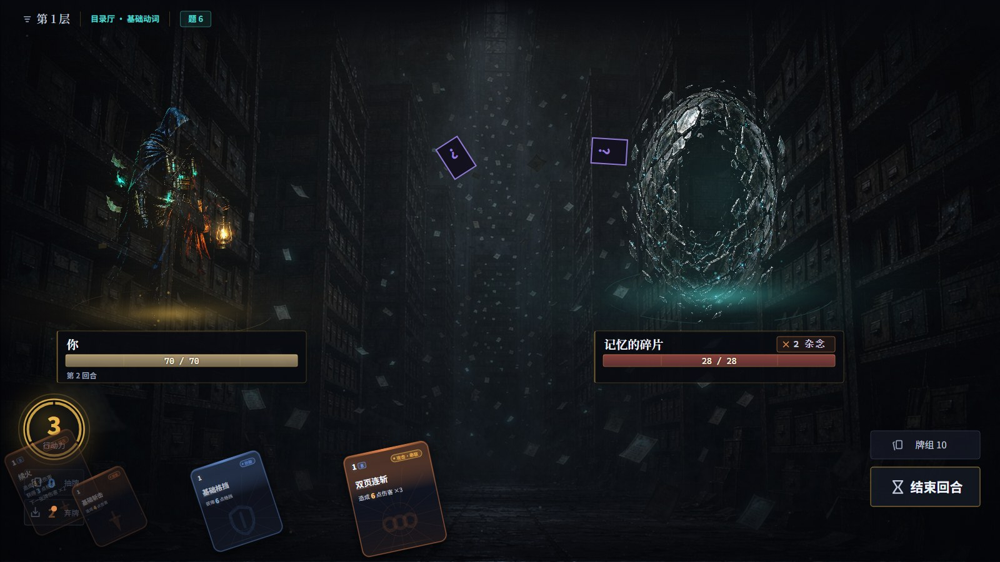
</p>

**为什么把"动作"而不是"结果"做成事件。** 结果类事件（`hurt` / `enemyBlock` / `junk`）
天然只在有数值变化时才触发，而"敌人举起盾""它忍住没出手"恰恰是**没有玩家侧数值变化**的动作——
用结果当事件，这些就永远静默。换成动作事件之后，五个分支都得发声，表现层自己决定演多大声。

还有一个时序坑：`endTurn` 是同步的，事件发出来时 `startTurn` 已经把下一回合的手牌抽好了。
不压住抽牌动画，两拨飞行物会叠成一团，玩家分不清谁在动。所以敌人演出期间**新手牌先留在牌堆**，
等这一下演完再依次飞进来；同时输入被锁住，玩家不会在光刃还在飞的时候点开下一张牌。

> 配图是 `?dev=foe:atk` 这类入口真跑一次 `endTurn` 拍的：血条、弃牌堆、头顶意图都是真的，
> 不是单独盖一层特效。招式表被固定成单招循环，所以气泡和演出是同一件事。

**答错则相反：没有任何东西朝敌人飞过去。** 这条是刻意的——只要画面上有东西冲向敌人，
玩家读到的就是"打了，只是没伤害"，那是另一件事，而且是错的。所以反馈落在**出手的地方**：
提灯的焰暗一下再回来，一小撮屑在原地散开（亮屑上飘、暗屑下坠），配一圈暗红环和轻微震屏。
朝敌人的方向必须是空的，**"什么都没飞出去"本身就是最重要的那条信息**。

## 核心机制：一道题，一次结算

卡面上的效果和数值**永远不会因为模式变化**——模式只改答错的价码，不改卡面。一次出牌只有一件事要决定：

```
手牌（类别·效果徽章 + 数值；题不印在卡面上）
   ├ 基础牌 → 点一下直接打：不答题、不退款，4 伤 / 6 挡
   └ 知识卡 → 点一下
              ▼
        答题面板：一道题、2–4 个选项（优先抽同名题池，没题就抽全部题目；本场问过的先避开）
              │ 答
              ▼
        答对 → 卡面效果立刻结算，这个卡种本场解锁，这一手不花行动力
        答错 → 效果作废，花掉 1 点行动力，这个卡种这回合不再问
               罚多重看本局模式：学习补全额格挡 + 牌回牌堆；复习补半额 + 进弃牌堆；
               测试不补格挡 + 这个卡种本场作废
```

以及一直存在的逃生口：**快攻**——不作答，半额伤害，不进复习调度，**也不退款**。
绕过去是要付钱的，只是付得少。

### 三种模式：开局前选，整局不变

**模式是开局前的决定，不是卡片进度替你做的决定。** 首页点"开始新的一局"，先选这一局怎么打：

| 模式 | 什么时候选 | 答错这一手 |
| --- | --- | --- |
| **学习** | 第一次见这些题 | 作废；补全额卡面格挡；**牌回抽牌堆**，下回合一定再抽到；稳固度 ×0.6 |
| **复习** | 学过一遍，要求稳 | 作废；补半额卡面格挡；牌**进弃牌堆**，等洗牌才回来；稳固度 ×0.35 |
| **测试** | 检验掌握程度 | 作废；**没有格挡补偿**；这个卡种**本场作废**（只能快攻）；稳固度 ×0.15 |

<p align="center">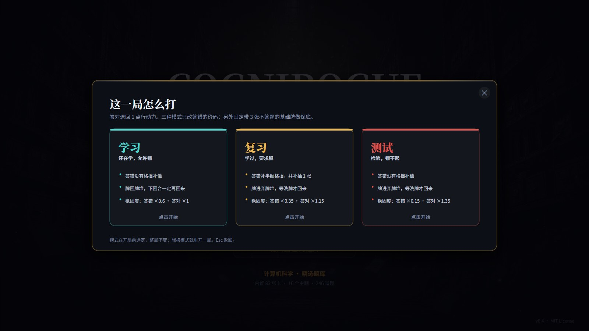</p>

三种模式都不碰血量：扣血会让人不敢碰不会的知识，正好和目的相反。它们只在"这一手作废之后，
你还要付多少"上不同；卡面数值、题库、敌人一概不动。

**为什么从"按卡分档"改成"按局选"。** 早期版本里，每张卡按自己的稳固度自动处在学习期 / 复习期：
没学会的答错便宜，学会了的答错贵。那套规则自洽，但有两个问题：

1. **它把"这一局想干什么"交给了调度器。** 玩家今天想第一次啃新题，明天想过一遍，后天想验一下——
   同一张卡在不同日子该有不同价码，而按卡分档只会给出同一个答案。
2. **越熟练的卡在局内越危险。** 进复习期没有任何战斗内收益，只有更重的答错惩罚；
   玩家把一张卡练得越熟，它在这一局越像一个陷阱。

改成开局前选之后，模式还能决定**抽哪 10 张知识卡**：学习先抽没碰过的，复习先抽逾期的，
测试先抽已经掌握的（`library/memory.ts` 的 `startDeck(mode)`）。模式因此不只是难度，
而是"这一局拿什么材料、按什么价码结算"。

**测试模式为什么还是值得选。** 答对时稳固度涨得更多（×1.35；学习 ×1.0、复习 ×1.15）——
检索练习本来就比"看着眼熟"记得牢。代价是这一局更难：答错没有格挡补偿，那个卡种当场作废。
它是给"这批题我已经有底了，来验一下"准备的，不是给第一次见面的题准备的。

<blockquote>早期按卡分档那一版的设计记录还留在「数值是怎么定的」里，作为历史对照；
现在的主线是三种模式各自一条技巧曲线。</blockquote>

<p align="center">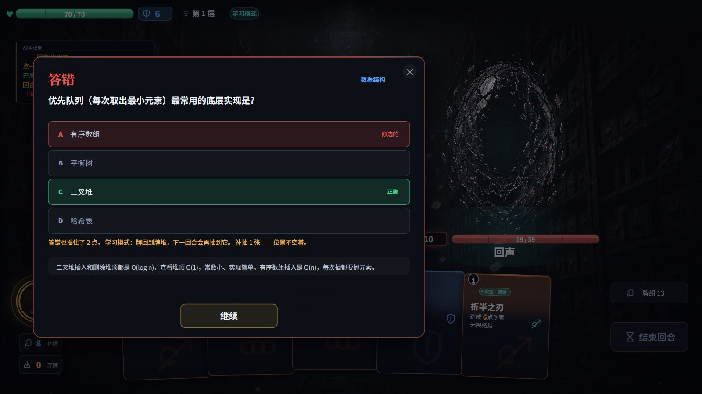</p>

<p align="center">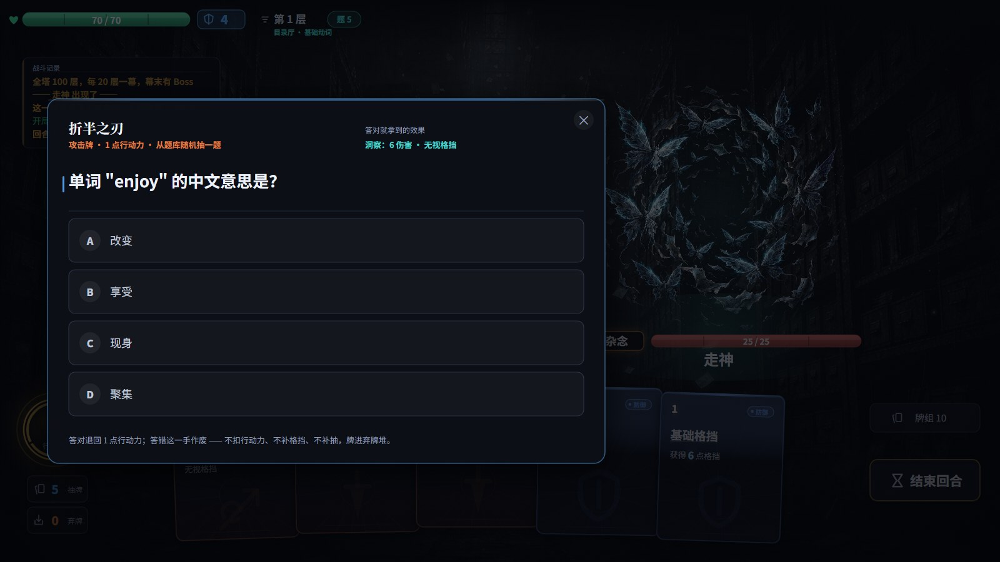</p>

### 押注机制被删掉了（v0.3）

之前这里写的是"识记 / 理解 / 迁移"三档：档位不改伤害，只改这一手的节奏收支，而且只能往上换。
那套设计是自洽的，但它是**拿节奏当赔率**，代价有两条：

1. **三档会塌成一档。** 赔率一旦不对称（曾经是净 +3 对净 −3），理性解就是"永远压满"；
   修成对称之后又是另一个问题——正确率过 50% 的人永远压迁移，另外两档只是给新手看的教学关。
2. **它把"会不会"变成了"敢不敢"。** 押注的决策点在看清题之前，玩家只能靠自己对知识点的把握猜难度；
   猜错的代价是行动力，于是"变强"的方式变成"更会估自己"，而不是"更懂这个知识点"。

删掉之后只剩一条规则：**答对了这一手不花行动力**。那一版（v0.3，卡池还只有 13 张）的技巧曲线是
5% → 28% → 56% → 67%，细节见下面的历史采样。

<p align="center">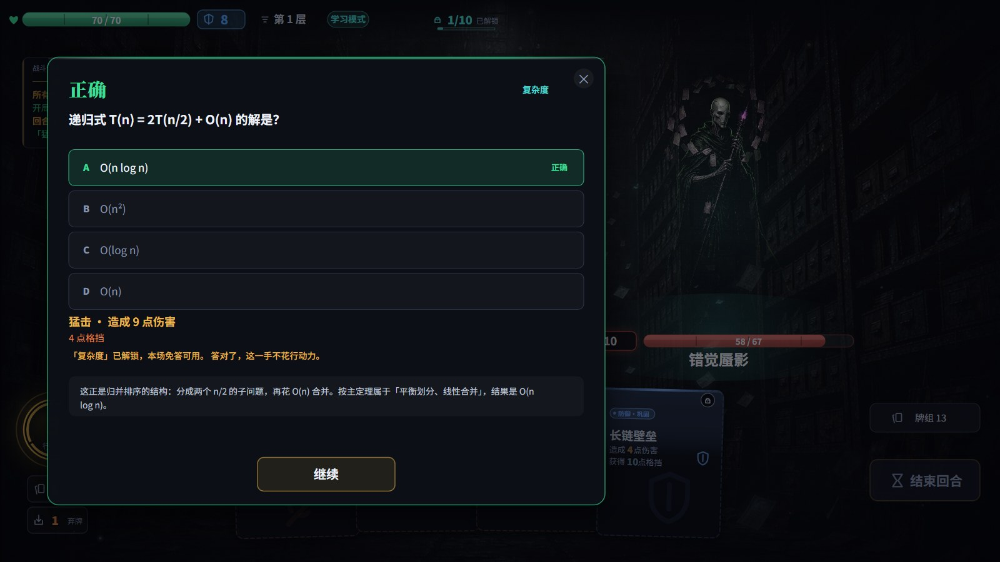</p>

死亡不会掉知识等级，只是这局的资源没了。下一局开局前选模式，按模式抽牌：学习先见新卡，
复习先收逾期的，测试先验已经掌握的。

## 解锁：答对才拿得到手

每场战斗开始时，牌组里的每一张**知识卡**都是**锁着的**（基础牌和增益牌不锁）。

锁着的卡点下去出题；答对一次，这一**种**卡就解锁——之后这场战斗里它的每一张副本都能
**免答直接打出，效果 ×1.5**。答错则这一手作废，而且这一种卡这一回合不能再试：不然看完
答案用副本重答，锁就白锁了（这也是"每回合每张卡一次机会"那条规则的由来）。

<p align="center">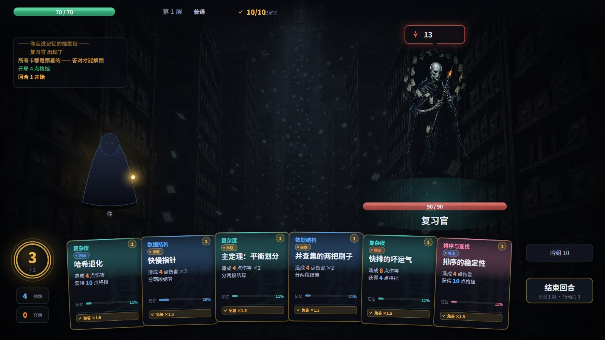</p>

这一条改掉了原来最要命的结构问题：**玩家每回合的输出是恒定的**。出几张牌 × 每张几点攻，
从头到尾不变；而敌人血量从 73 涨到 111、Boss 195。牌组变厚只增加选项，不增加输出，
所以一局的手感是"越来越难"，不是"我组出来了一个东西"。

现在输出跟着答对率走，而且两个方向同时供给：

- **一回合能打几张**：答对退还行动力，所以答得越准，这一回合越打不完（3 点行动力，抽 5 张最多打 5 张）；
- **每张打多重**：解锁覆盖率从 0 涨到 100%，同一张牌从 ×1 变成 ×1.5。

乘起来就是这条成长曲线，而它不靠加数值——**它由"你答对了多少"直接供给**。

三层解锁，各管一段：

| 层 | 触发 | 管什么 |
| --- | --- | --- |
| 本场解锁 | 答对一次 | 节奏：投资期 → 收割期 |
| 精炼解锁 | 复习点精炼一张卡（`up=1`） | 构筑：精炼从"+3 数值"升级成"之后每场开局即解锁" |
| 上限 | 同种卡最多 3 张 | 防堆单卡种：只需答一次就换来一堆免答牌，等于用更少的学习换更强的战斗 |

配套缓冲，不然解锁期就是明码标价的拿血换：每场开局白送 4 点格挡；答错时学习模式补全额卡面格挡、
复习模式补半额、测试模式不补——半懂也挡得住一点，但绝不免费。

删掉的东西也值得记一笔：**连击没了**。原来"同主题连续答对 ×1.8"是靠抽牌顺序吃饭的，
还鼓励块状练习（而交错练习在辨别类知识上明显更好）。同样是把"会"换成伤害，解锁是靠答对，
连击是靠牌发得好——所以后者让位。

## 结算面板：这一局的伤害是怎么来的

押注没了之后，结算页不再问"你押得准不准"，改问一件更硬的事：**这一局的输出里，有多少是你
记住了的，有多少是当时蒙对的那一下。**

<p align="center">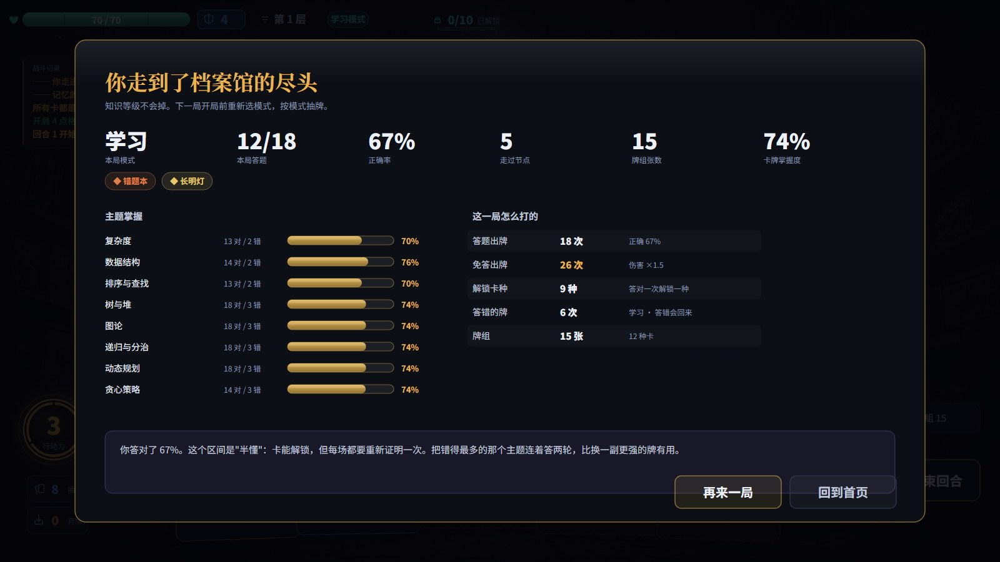</p>

- **答题出牌 / 正确率**：本局被问了几次、对了几个。
- **免答出牌**：解锁之后直接打出去的那几次，伤害 ×1.5 —— 那才是"会了"兑现成输出。
- **解锁卡种**：答对一次解锁一种。它比正确率更直接，因为它是"这一场能不能用"的开关。
- **本局模式 / 答错的牌**：这一局按学习、复习还是测试结算，以及答错了几次。三档价码不同，
  结算页直接写你刚才按哪档结的——学习模式在交学费，测试模式是当场丢卡。
- 再加上主题掌握度、牌组构成、走过的节点。

正确率 ≥80% 时结算页会直接说"后半场你不是在赌，是在用记住的东西打仗"；60–80% 是"半懂"，
提示你把错得最多的主题连着答两轮；低于 60% 则是"这副牌是借来的"。

## 数值是怎么定的

`BAL`（敌人强度、行动力、免答倍率）和 `MODES`（三档答错价码）不是拍脑袋定的。`npm run sim`
会把同一套 `src/core` 规则打包到 Node 里，完整走地图、打怪、选卡、走篝火、触发事件，一次跑几百局。
三种模式各有一条技巧曲线（800 局，跨局记忆累积）：

| 水平 | 学习 | 复习 | 测试 |
| --- | --- | --- | --- |
| 新手 35% | 18% | 4% | 0% |
| 入门 55% | 55% | 32% | 3% |
| 熟练 72% | 74% | 60% | 24% |
| 精通 88% | 82% | 76% | 60% |

学习模式把新手从 4% 抬到 18%——宽恕买来的是更多练习（新手 118 题/局），不是更高的上限。
测试模式是另一头：新手 0%，精通 60%，对低水平最不留情；它的难度来自"答错这个卡种就没了"，
而答对的人稳固度涨得最快。

**每回合抽 5 张是个调整过的默认值。** 早先抽 6 张：起手牌组只有 10 张，等于每回合看见 60% 的牌组，
牌组构筑几乎没有意义。改成 5 之后，同一份牌组一回合只看一半，跳过奖励卡、删卡这两件事才真的
开始影响手感。

**加了初始牌组之后，敌人强度又重配了一轮。** 3 张基础牌占抽牌位，等于每回合少摸 0.8 张知识卡，
所以敌人从 hp 1.45 / dmg 1.60 收到 **1.28 / 1.42**——复习模式的曲线因此几乎没动
（早先是 4 / 27 / 59 / 74，现在是 4 / 32 / 60 / 76，都在 800 局噪声里）。

中间那档（复习模式）的完整采样：

```
水平     胜率      平均到层    答题/局    实际正确率   免答/局   答题占比   答错/局
新手     4%        6.34        76.8       35%          18.3      81%        49.8
入门     32%       7.30        66.4       55%          21.9      75%        29.9
熟练     60%       7.64        58.7       72%          22.2      73%        16.4
精通     76%       7.78        53.9       88%          22.1      71%        6.4
```

**表格是一次 800 局采样，别追单个百分点**；能稳定复现的是结构性指标（答题量、免答量、
答题占比），不是某一格的胜率。

表里是 **83 张内置卡 + 主题优先抽题** 之后的采样。卡池恒定、模拟用的题库固定 246 道，
FSRS 每局按模式选 10 张知识卡（另外 3 张基础牌固定带上）：学习先抽没碰过的，复习先抽逾期的，
测试先抽已经掌握的。外部题库不限主题，但模拟始终喂同一份内置题库，所以这里采样波动
只来自随机与关卡，不来自题库规模。

（`npm run sim -- --runs=800 --mode=learn|review|test` 可以把每格样本加到 800 局；
`--hp --dmg --ap --hand --free --start --calm --rf --take` 都能从命令行扫，试一个数值不用改源码。
`--stab=4` 控制测试模式"已掌握"的门槛；`--fresh=1` 每个水平重置记忆、`--freshrun=1`
每局重置，用来模拟"第一次打开这个题库"。）

最后一列（答错/局）现在只说明这一局挨了多少次错；三种模式的价码不同，不能横着比。

判据只有一条，写进脚本最后一行自动断言：**胜率必须随水平单调上升。**

这条判据这次又救了一次设计：押注删掉之后，如果顺手把"答对退款"也删掉，5 点行动力下
72% 和 88% 水平的胜率会挤在一起（69% vs 70%）——因为"一回合能打几张"被行动力钉死了，
答得更准换不出更多输出，知识就不再是瓶颈。**行动力必须买"犯错次数"，不能买"出牌次数"**，
技巧才有地方兑现。这条是模拟跑出来的，不是想出来的。

把遗物改成增益牌之后，这条曲线掉了 7 个点（74% → 67%）**而且变平了**（熟练和精通只差 11）。
这是这类改动的固有代价：沙漏、长明灯这些原来白给，现在要花一手行动力才能拿到，
但它们给的收益并不依赖你答对多少——于是技巧的边际价值被削掉一块。

处理办法不是把增益牌改弱，而是让敌人更凶：伤害系数 1.55 → 1.60。
"一手行动力换一个持续增益"是成本，这个成本对任何水平都一样，所以门槛必须由敌人抬，
不能由"少给几张增益牌"抬（那样机制会消失在随机里）。那一版的曲线是 5 / 28 / 56 / 67，跨度 62。

> 下面这几组是 v0.3 时期、卡池还只有 13 张卡时的**历史调参采样**，
> 用来还原当时的判断过程；绝对数值和上面 83 张卡的基线不能直接比较。

把答错按学习阶段分档之后，曲线是 **2 / 27 / 57 / 70**。对照"两档都关掉、答错一律进弃牌堆"
的基线 4 / 28 / 53 / 69 —— 连跑几次 800 局，熟练那一格在 52–57 之间来回跳，
**这两条曲线在噪声里分不开**。分档没有改动胜利难度，这正合它的目的。

稳定变的是结构：新手每局答题 81 → 87（+6）、免答 16.8 → 14.3（−2.5）、答题占比 83% → 86%。
牌回牌堆会占掉下一回合一个抽牌位，回来的那张是刚答错的卡，得重新答一次；
它要是进了弃牌堆，那个位置本来会抽到一张已解锁、能免答 ×1.5 打出去的牌。
**宽恕买的是练习次数，付的是一点输出** —— 但在 800 局的分辨率上，这点输出换不出可测的胜率差，
这条规则本来也不是用来调难度的。真正会让曲线塌的是把复习期做成"整场作废"
（熟练 53% → 38%，答题 64 → 52），那个差距远大于噪声——**也就是现在的测试模式**，
所以它被放到开局前让玩家自己选，而不是默认。

顺带一提，这一版的模拟机器人学会了**快攻**：手里只剩打不出的牌（答错锁住的、作废的）时，
它会拿半额伤害把这 1 点行动力花掉。不模拟这一手，会把所有惩罚算得比实际更狠。

（这套按卡分档的规则后来被开局前的三种模式取代；上面的 2/27/57/70 只是当时的设计记录。）

> 想自己复现：`npm run sim -- --runs=800 --mode=review`。`--take=1`（战后拿卡）时是 5 / 39 / 71 / 86——
> 梯度更陡，因为会拿牌的人能把增益牌的价值吃满。`--mode=learn` / `--mode=test` 换另外两档。

还有一句该说的：**模拟能证明规则不崩，证明不了"学到了"。** 它的正确率是独立同分布的随机数，
真人不是——真人会在同一局里见到同一个知识点两三次，然后开始记答案。

## 工程结构

`src/core` 是纯逻辑：不 import 任何 DOM / canvas，Node 里能直接跑。
原来一局的全部规则挤在 `core/game.ts` 的 1364 行里（地图、战斗、抽牌、解锁、
增益、事件、结算十几个职责段落混在一起）；现在按功能拆成七个工具包，
**依赖方向单向** —— 左边的包不 import 右边的包，由 `npm run check` 里的 `tools/deps.mjs` 逐条校验（唯一的例外写在下面）：

```
src/core/
  model/       领域模型：共享类型、敌人/增益/强度数值表、六种效果倍率 —— 无依赖
  infra/       运行时底座：随机数、存档、GameEvent 总线、唯一可变状态 G
  cards/       卡牌：内置卡面表 catalog.ts、卡池常量 pack.ts、初始牌组 basics.ts
               （固定 3 张、不可获取）、身份与类别分类（kind / type）、id → 卡面注册表
  library/     知识内容：题库解析/合并/格式校验、当前题库（可换，主题不限）、
               FSRS-lite 记忆、选项视图（复习调度要读卡池，所以排在 cards 右边）
  map/         八层分支地图：拓扑生成与可达性
  combat/      战斗：本场卡种锁、牌堆循环、敌人回合、玩家出牌（点牌才去题库抽题）
  journey/     一局推进：节点收尾、战后奖励、事件、结算、开局编排
  index.ts     公共 API 汇总（tools/sim.ts 从这里整体驱动）
  builtin.ts   把 packs/ 下三份 md 合成默认题库（vite ?raw 内联，不含卡牌）
src/gfx/     渲染原语：等比缩放的画布、手绘图标、卡面、飘字、粒子
  fx.ts      打击演出：光刃飞行、命中星芒、击退、震屏；只管演，不改数值
  art/
    icons.ts 自建图标素材库：24×24 矢量 path（八种效果原型），颜色由调用方传入；
             图集预览页 ?dev=atlas 一屏质检（96px / 28px 双档 + 调色板）
src/scenes/  每个画面一屏：title / map / battle / overlay / report / packio / atlas(开发)
src/input.ts 命中区域与点击（含"同一个按钮"的跨帧判定、演出期间的输入锁）
src/main.ts  主循环：把状态画出来，把特效用事件翻译成动画
tools/
  sim.ts     无头模拟（esbuild 打包后用 node 跑，读同一组三份题库）
  smoke.mjs  真浏览器的冒烟测试（CDP 驱动）
  shots.mjs  重拍 README 里的配图（同一个 CDP 管道，`npm run shots`）
  deps.mjs   依赖方向守卫：core 七个包只许往左依赖，违规让 check 失败
packs/       三份内置题库：algorithms / advanced / systems（默认合成；单份也能单独导入）
assets/      美术资源（构建时内联）
```

这条顺序不是画给人看的口号，但眼下确实还剩**一处例外**：`combat → journey`
（敌人死亡、清场、结算的分支要从战斗里直接调 `endRun` / `openReward`）。
修法是把它们改成 journey 注册的结算钩子，让战斗只发「该结算了」——
这是下一轮重构的第一项；在那之前，它作为一条显式豁免写在 `tools/deps.mjs` 的 `EXEMPT` 里。

包内部再按职责分一层文件，例如 `combat/` 下是 `unlock.ts`（本场锁）、
`deck.ts`（牌堆循环）、`foe.ts`（敌人回合）、`play.ts`（四条出牌路径）。
每个包有自己的 `index.ts` 作公共出口；表现层**按功能引用具体包**，
从 import 就能看出这个场景用了哪些能力：

| 场景 | 引用的工具包 |
| --- | --- |
| `scenes/map.ts` | model · infra · library · cards · map · journey |
| `scenes/battle.ts` | model · infra · library · cards · combat |
| `scenes/overlay.ts` | model · infra · library · cards · combat · journey |
| `tools/sim.ts` | model + `core/index.ts`（整体驱动，用门面最省事） |

### 一张牌身上的四条轴

| 轴 | 取值 | 在哪 | 管什么 |
| --- | --- | --- | --- |
| 身份 `kind` | 基础牌 / 知识卡 / 增益牌 / 杂念 | `cards/kinds.ts` 的 `cardKind()` | 要不要答题、能不能被获取/精炼/删除、进不进记忆调度、打出后飞向弃牌堆还是增益槽 |
| 类别 `type` | 攻击 / 防御 / 技能 / 能力 | `cards/kinds.ts` 的 `cardType()` | 这一局里它干什么；**不写就按 kind + eff 自动推导**，卡面徽章和卡面颜色都按它走 |
| 效果 `eff` | 猛击 / 洞察 / 巩固 / 内化 / 串联 / 专注 | `model/effects.ts` | 攻挡底数怎么花出去 |
| 主题 `topic` | 内置卡牌库的字段（题库的 `##` 只是可选的取题偏好，不要求同名） | `model/data.ts` 的 `topicColor()` | **只在抽题与结算统计里用**：不画在牌面上，也不进卡面色 |

这四条轴互不干扰：牌面颜色只服务类别，徽章写「类别·效果」，
身份用边框与卡面结构区分（基础牌没有锁、增益牌是斜纹金面）。
**主题不进牌面**：主题名会提前告诉你"这题考哪一块"，等于漏一半答案；
记忆条也从牌面撤掉了（它只回答"我多熟"，那是结算页和调度器的信息，不是这一手的信息）。
重构前身份轴没有字段，十来处各自去翻 `card.junk` / `card.power`；
现在统一由 `cardKind()` 判定，旧 JSON 卡牌数据没写 `kind` 时按原有标记回落。

另外 `Question.level`（识记 / 理解 / 迁移）由解析层从 `? 理解:` / `? 迁移:`
这类标签存下来。**目前只存不用**，出题顺序与答错分档都和以前一样 ——
留着是为了以后能按认知层级排出题梯度。

### 调试用的捷径

不想每次都点进去看某一屏，可以给 URL 加 `?dev=`：

| 参数 | 落在哪 |
| --- | --- |
| `?dev=title` | 标题 |
| `?dev=map` | 地图 |
| `?dev=battle` | 一场普通战斗 |
| `?dev=question` | 战斗 + 点开一张牌后的答题面板 |
| `?dev=answer` | 答题结果反馈 |
| `?dev=wrong` | 故意答错一次，停在"答错"那一屏 |
| `?dev=mode` | 开局前的模式选择面板 |
| `?dev=battle&mode=test` | 用指定模式开一场战斗（`learn` 是默认） |
| `?dev=power` / `powerpick` | 手牌里有增益牌 / 精英战后的增益三选一 |
| `?dev=foe:atk` / `jam` / `def` / `buff` | 把敌人固定成这一招，配 `cog.endTurn()` 拍敌人动作 |
| `?dev=reward` / `rest` / `event` / `deck` / `pack` / `help` / `report` | 对应弹层 |

这只是入口，规则仍然是同一套 `src/core`。另外 `window.cog` 挂着 `state`（当前局面）、
`hots()`（这一帧所有可点区域）、`toScreen()`，冒烟测试就是靠这三个驱动真实点击的。
`cog.fx()` 报告此刻还在飞的单元（抽牌 / 弃牌 / 敌人动作），用来盯"飞行单元漏清"；
`cog.locked()` 报告输入是不是正被演出锁住。

想单独看演出而不打一局：`cog.strike(kind, target)` 放一次打击光刃，
`cog.enemyAct(kind, taken)` 演一次敌人动作（`taken=0` 是"被全挡下"），两者都不碰任何数值。
想看真回合就用 `cog.endTurn()`——血量、格挡、弃牌堆和头顶意图都会跟着变，
`?dev=foe:atk` 这类入口会把敌人的招式表固定成单招循环，截图才能复现。

### 为什么是 Canvas，而不是 DOM/React

卡牌游戏的核心手感在**连续动画**：手牌扇形排布、抽牌飞入、弃牌飞向牌堆、受击抖动、意图气泡浮动。
用 DOM 做这套要么上 framer-motion 这类库，要么和 CSS transition 的时序打架；
Canvas 里这些都是一行 `g.translate`。

代价是**所有交互都要手写命中区域**——这也是本项目唯一出过"看起来正常但完全点不动"的地方，
所以有了下面这个测试。

## 测试：两种，各管一半

**`npm run sim` 管规则。** 它跑的是 `src/core` 本身，不是复制一份逻辑；改数值、改公式，模拟立刻反映出来。
它回答"这套数值成不成立"。

**`npm run smoke` 管手感。** 它开一个真的 Chrome，用 CDP 发真的鼠标按下/抬起，按标签找到按钮点下去，
再断言游戏状态确实变了：标题→选模式→地图→进节点→点手牌→出题→答对→看反馈→继续→结束回合→
打出增益牌→免答出牌→答错→走复习点→选卡→事件→结算重开，一共 **21 步**。
答对那一步会专门断言**反馈面板在打击演出期间还没画出来**（状态是 feedback，但按钮不在命中表里），
免得哪天"推迟面板"改坏了、把按钮一起吞掉却看不出来。

模式规则另有四步真浏览器断言：答错时敌人不掉血、学习模式答错的牌**只回抽牌堆不进弃牌堆**、
把这一局切到复习模式再答错则**只进弃牌堆**、切到测试模式再答错则**不补格挡且卡种本场作废**。
这些走向在 `core` 里是同一段 `answer()` 的分支，最容易在改动画时把飞行方向一起改错——
所以表现层（飞回左上还是左下）也一起测了。

敌人演出也钉了三步：结束回合时**演出单元必须真的存在且输入被锁住**、五种意图各演一遍都要产生
可见单元、演完之后**演出单元清零、输入解锁、新回合手牌飞回来**。最后那条是专门防"冻结了抽牌
动画却忘了解冻"——那种 bug 不会报错，只会让手牌永久消失。

写它是因为踩过一个很隐蔽的坑：命中区域每帧都会重建（`last = building`），而按下时记下的是**上一帧的对象**。
早期版本在抬起时用 `h === downHot` 判断"是不是同一个按钮"，结果真实浏览器里几乎每次点击都被判成
"手指移出了按钮"，什么都不发生——但截图完全正常，因为截图不点。修法是不比对象、比几何：
按下时记矩形，抬起时用当前帧新的矩形比对位置和尺寸，再调用当前帧的回调。

这个 bug 只在"按下和抬起之间隔了几帧"时才出现，所以冒烟测试里特意在 down 和 up 之间 sleep 70ms。

## 题库格式（md 可外部输入，卡牌库不可）

**卡牌库和题库是两样东西，只有后者能从外面换。**

| | 在哪 | 外部能改吗 |
| --- | --- | --- |
| 卡牌库 | `src/core/cards/catalog.ts` 的 `CATALOG` | ❌ 内置常量。83 张卡的卡名、主题、攻挡、效果、`card id` 全部固定 |
| 题库 | `packs/*.md`，或标题页导入的任意 md / JSON | ✅ 只换题目，卡池一个字节不变 |

**主题不限，只限制格式。** `## 主题` 只是可选的题池名 —— 随便怎么起、写几个都行，
不写就进「未分类」；`###` 和 `?` 都是一道题。导入时只校验格式（非空题干、
2–4 个选项、`= 答案字母` 且不越过选项数），不合规会列出第几行并整体拒绝，
**不会静默丢题**。`topics()`（`cards/pack.ts`）返回的只是给写题人参考的清单，不是白名单。

**点开一张牌时**才去题库取题：优先抽与卡面 `topic` 同名的池，该池没题
（或压根没写 `##`）就回退到全部题目，抽一道本场没问过的。所以只写一个主题、
主题名随便起、甚至只有几道题的题库，照样能喂饱全部 83 张卡 —— 没有哪张牌
会变成点不开的死牌。题目和卡不是一一绑定的，写题人不需要知道 83 张卡
分别叫什么，也改不了数值平衡。

```markdown
# 我的算法题库

## 复杂度

### 二分查找在 n 个有序元素上的最坏时间复杂度是？
A) O(1)
B) O(log n)
C) O(n)
D) O(n log n)
= B
+ 每次比较把搜索区间折半，最多约 log2(n) 次。

? 理解: 为什么无序数组上不能直接用二分查找？
A) 无序数组不具备"折半后目标仍在某一侧"的性质
B) 无序数组算不出中间下标
C) 无序数组按下标访问是 O(n)
D) 无序数组元素太多，递归会爆栈
= A
+ 二分的关键不是"有序"，而是有序带来的可判定性。
```

| 标记 | 含义 |
| --- | --- |
| `# ` | 题库名（标题页显示），可选 |
| `## ` | **可选**的题池名，任意字符串、数量不限；省略则题目进「未分类」 |
| `### ` / `? ` | 一道题。`? 理解:` / `? 迁移:` 这类前缀存成 `Question.level`（识记 / 理解 / 迁移，目前只存不用） |
| `A)` `B)` `C)` `D)` | 选项，**2–4 个**（格式硬要求） |
| `= X` | 这道题的正确答案字母，**必须存在且不越过选项数** |
| `+ ` | 解析，答完显示，可选 |
| `@ ` / `% ` | 旧知识包的卡面行，**现在直接忽略**：卡名和攻挡效果已经内置 |

**导入是「全通过或全不动」，但只校验格式。** 任何一道题缺题干、选项数不是 2–4、
答案字母缺失或越界，解析器就把它记进 `QuestionBank.issues`，载入时整体拒绝、
面板列出前几处（带行号），当前题库原封不动。主题名、主题数量、每个池几道题
一概不检查 —— 写一份只有 3 道题的题库也照常载入。

`topics()` 里的 16 个名字（复杂度、数据结构、排序与查找、树与堆、图论、
递归与分治、动态规划、贪心策略、字符串匹配、回溯与搜索、随机化与概率、
操作系统、计算机网络、数据库、并发与同步、体系结构与编译）只是**建议**：
同名时该主题的卡会优先抽这个池，不同名的题会进全局兜底池，一样会被问到。

内置题库由三份 md 合成，共 **246 道题 / 16 个题池**：

| 文件 | 题池 | 题数 |
| --- | --- | --- |
| `packs/algorithms.md` | 复杂度、数据结构、排序与查找、树与堆、图论、递归与分治 | 90 |
| `packs/advanced.md` | 动态规划、贪心策略、字符串匹配、回溯与搜索、随机化与概率 | 78 |
| `packs/systems.md` | 操作系统、计算机网络、数据库、并发与同步、体系结构与编译 | 78 |

三份都能**单独导入**（只是题池薄一些，其余主题走全局兜底）；默认由 `core/builtin.ts`
用 `library/bank.ts` 的 `mergePacks()` 剥掉各自的一级标题、挂一个合集名，
拼成题池最厚的题库。`tools/sim.ts` 用同一个函数读同样三份，
浏览器和模拟看到的题池完全一致。

卡池恒定 83 张：开局按模式 + FSRS 调度取前 **10** 张知识卡（全新存档首局是 `CATALOG` 的前 10 张），
再叠上 3 张固定的基础牌；其余 **73 张**在战后奖励的随机池里，`rewardPool(3)` 优先没进过牌组的新卡，
且三张必须来自不同主题。基础牌永远不进这个池——它们**无法从游戏中获取**。
`card id` 固化在 catalog 里、**不再由题干生成**，所以换题库不会让本地存下的复习记忆失效，
也不会把旧牌组实例解析成杂念。

JSON 也支持：`{ "name": "...", "byTopic": { "复杂度": [{ "q", "options", "answer", "explain" }] } }`，
`answer` 是 0 起始下标。老格式 `{ "cards": [{ "topic", "qs": [...] }] }` 也认：
按 `topic` 汇总题目，卡面字段一律丢弃，老字段名 `tiers` 仍兼容。

### 选项乱序

写题人给的 `= B` 只是**原始答案位置**。内置题库里 140 道题答案是 A、只有 15 道是 D，
照着摆几局之后玩家背下来的就是字母而不是知识。所以 `library/question.ts` 的
`shuffleOptions()` 在**每次点开牌**时用 Fisher-Yates 重排四个选项，正确答案索引跟着换算；
这份 `QView` 挂在 `G.panel.view` 上，题面渲染、`answer()` 判定、反馈面板、键盘数字键、
无头模拟和冒烟测试全部读同一份，绝不回头读 `q.answer`。
含「以上都对」这类依赖位置的选项会自动跳过乱序 —— 写题时也别写这种选项。

## 用 LLM 写题库

游戏里没有内置调模型的入口（Key 不该经手任何第三方）。做法是：把下面这段贴给任意模型，
生成后存成 `.md`，或者直接复制、在游戏里「载入自己的题库 → 从剪贴板粘贴」。
**它写的是题目，不是卡牌**：卡面 83 张是内置的，模型改不了攻挡和效果。

```text
把下面这段笔记做成一份 CogniRogue 题库，严格按这个格式输出，不要多余的解释。
主题随便起、写几个都行（也可以完全不写 ## 那一行）；每道题的格式必须写全，
否则整份文件会被拒绝载入。

# 题库名

## 主题名（可选；省略的题会进全局题池，一样会被问到）

### 一道题的题干？
A) 选项
B) 选项
C) 选项
D) 选项
= B
+ 解析

? 理解: 换个角度问机制、反例或边界？
（同样 4 个选项 + 答案 + 解析）

硬性要求：
1. 同一个主题里的题必须问不同的东西：一道问定义/结论，一道问机制/区别，一道换场景。
   三道都问"是什么"等于只有一道题。
2. 干扰项必须是"真的会搞混"的错误，不能是凑数的荒谬项。
3. 解析讲原理，不许复述答案。
4. 不要写「以上都对」「以上都不对」这类依赖位置的选项（选项会被打乱）。
5. 不要写 @ 卡名或 % 攻挡效果：卡面是内置的，写了也会被忽略。
6. 每道题 2–4 个选项，必须有 = 答案行，字母不能越过选项数（3 个选项不能写 = D）。
```

这些硬要求不是洁癖：

- **题库不真分层**，三道题只是同一句话换个说法，这个知识点就等于只有一道题，而玩家会背答案。
- **干扰项太好排除**，答题就退化成识字游戏，正确率不再反映掌握程度。
- **解析复述答案**，等于放弃了这个产品唯一真正的教学时刻——答错之后那两行字。
- **格式残缺**，整份题库会被拒绝载入并列出第几行，游戏继续用原来的题库，等于白写。
  主题写多写少、叫什么名字都不会被拒绝。

## 调度：FSRS-lite

每张卡维护一个简化状态 `{ stab, due, reps, lapses }`：

- 答对：`stab = min(60, max(stab × (1 + 0.8 × 模式倍率), stab + 模式倍率))`，`due = round(stab)`
  （学习倍率 1.0、复习 1.15、测试 1.35：检索练习记得更牢）
- 答错：`stab *= 模式跌幅`（学习 0.6 / 复习 0.35 / 测试 0.15，下限 1），`due = 1`（测试为 0）
- 每开一局，所有 `due -= 1`；开局按模式选 10 张：**学习先收没碰过的，复习先收逾期的，
  测试先收已经掌握的**

最后这条以前写错过：只按 `due` 升序取前 10 时，新卡的 `due` 一直是 0 并随局数一起递减，
于是永远排在学过的卡前面——**掌握得越好的卡越不会再出现**，和"该复习的必须出现"正好相反。
现在按模式分桶，三种意图各自拿到自己需要的材料。

`stab` 的另一个用途是「掌握门槛」（`BAL.reviewStab = 4`，大约连续答对三次）：测试模式用它挑
"已经会了"的卡，结算页的主题掌握度也按它算。**它不再决定答错价码**——价码是开局前选好的模式；
**它也不再画在牌面上**——记忆度是"我多熟"，不是"这一手怎么打"。

这只是个占位实现，够用来验证「调度 → 牌序 → 手感」这条链路。**欢迎把它换成真正的 FSRS**，
状态字段和接口都留好了（`MemEntry` 在 `core/model/types.ts`，读写在 `core/library/memory.ts`）。

## 设计取舍

做这个东西时我放弃了八件事，理由写在这里，免得后来的人重新踩一遍：

1. **随机不碰调度。** Roguelike 的灵魂是随机，学习工具的灵魂是"该复习的必须出现"。所以随机只作用于**地图结构、敌人组合、招式循环**，抽哪张知识卡由模式 + `due` / `stab` 决定。随机是皮肤，调度是骨骼。
2. **地图是分支的，但不是无限的。** 整条路一次全画出来，玩家能提前看见"第 4 层有个精英、第 6 层有个复习点"。看不见的随机是赌博，看得见的随机是决策。
3. **死亡不惩罚学习。** Permadeath 挪到学习场景，等于让人体验"我努力了一周，一局归零"。所以死亡只清空当局资源，知识等级永久保留。
4. **难度不碰数值。** 卡面效果恒定，题目只决定这一手成不成立。这样玩家才能算账：同一张牌，换哪道题、答得对不对，卡面都还是那张卡面。**精炼（攻+3 挡+3）是唯一会改写卡面的东西，所以它只能在复习点发生，而且是一次性、可见、需要取舍的决定。** 接上解锁系统之后它还多了第二重身份：精炼过的卡之后每场开局就是解锁的——一局只够精炼两三次，所以每次都在选"我要把哪个知识点变成不用再证明的武器"。
5. **答错不扣血，也不罚款，价码由玩家开局前选。** 早期版本答错扣 2 点血，中间版本答错再赔行动力——两条都废掉了，因为扣血和罚款都会让人不敢碰不会的知识，正好和目的相反。现在答错的代价落在**牌还在不在你手里**，分三档：学习模式回牌堆、复习模式进弃牌堆、测试模式这个卡种本场作废。早期版本按卡片稳固度自动分「学习期 / 复习期」——那套规则自洽，但它把"这一局想学还是想测"交给了调度器，而且越熟练的卡在局内越危险。现在改成开局前选模式：**同一个错误该多贵，由玩家这一局的意图决定，不由卡片进度替他决定。**
6. **牌面上不出现任何知识。** 早先的版本把题干直接印在卡上，结果战场像一张试卷，而且玩家出牌前就把题看完了，
   "出牌"这个动作就没有任何悬念。后来卡面只留知识点名，但那样手牌就成了复习提纲；
   再后来学杀戮尖塔给每张牌起**游戏名**（「折半之刃」「三度缔约」），却仍把知识点短名挂在牌组列表里。
   现在彻底切开：牌面只有**类别、牌名、效果、数值、消耗、解锁状态**，主题名、知识点名、记忆度
   一概不出现，颜色也改成按类别而不是按主题——同一主题的牌不会再因为长得像而被认出。
   要知道「折半之刃」对应哪道题，只有点开它一条路。
7. **效果由知识决定，不由稀有度决定。** 六种效果不是"金卡紫卡"那套稀有度包装，而是知识点性格的投影：
   一条"必然成立"的结论配洞察，一套"守住顺序"的规矩配巩固，一个"两件事的组合"配串联。
   这也意味着它不能随机分配、也不能由外部题库改写——六种效果逐张写在内置卡牌库的 `eff` 字段里。
8. **牌组不是越大越好。** 这一条是杀戮尖塔教的，在学习场景里反而更成立：牌组就是你这一局愿意面对的知识边界。加卡是扩张，删卡是聚焦，两者都得有代价。

## 美术资源

| 文件 | 用途 |
| --- | --- |
| `assets/arena.jpg` | 战斗场景背景，无限延伸的记忆档案馆 |
| `assets/shard.jpg` | 记忆的碎片 / 回声 / 镜像（同一张，靠 `hue-rotate` 区分） |
| `assets/examiner.jpg` | 复习官 / 熵 / 审视者 |
| `assets/oblivion.jpg` | Boss「遗忘」 |

三张立绘都是**纯黑底**：绘制时先 `contrast(1.5)` 把底色压成纯黑，再用 `screen` 混合叠上去——
黑色直接消失，只剩发光的轮廓。这样换立绘不用抠图，也不会有方形色块边缘。想换成自己的图，保持黑底、
放进 `assets/`、改 `FOES` 里的 `art` 字段即可。换色变体只加一个 `hue` 字段（如 `hue:'130deg'`），不用新图。

UI 里的图标（剑、盾、骷髅、星星、锁、勾）全部是 Canvas 手画的，不用 emoji——
emoji 在 Windows / macOS / 手机上会变成完全不同的彩色贴纸，甚至方框。

美术由 AI 生成（WorkBuddy / 混元），按 MIT 随项目分发。

## Roadmap

未做的事，欢迎认领：

- [x] ~~让"会得多"跑赢"打得狠"~~：赔率改过两轮都对不上，最后干脆把押注整个删掉（v0.3），
      技巧曲线反而从 69/70 拉到 55/75
- [x] ~~按局选模式~~：学习 / 复习 / 测试在开局前选，答错价码和起手牌组都按模式走，
      不再由卡片稳固度自动切档
- [x] ~~初始牌组 + 四类牌~~：3 张不可获取的基础牌做保底；可获取的牌分成攻击 / 防御 / 技能 / 能力
- [x] ~~牌面去知识化~~：主题、知识点名、记忆度全部撤出牌面，颜色改按四类
- [x] ~~扩题库~~：内置 **83 张卡 / 246 道题 / 16 个主题**（三份 md 合成）
- [x] ~~题库与卡牌库解耦~~：卡面固化在 `cards/catalog.ts`，md 只供题、主题优先抽题 +
      全局兜底；导入只校验格式、不限制主题；`card id` 不再由题干生成，老存档不受影响
- [x] ~~选项乱序~~：每次点开牌用 Fisher-Yates 重排选项，答案索引同步换算到 `G.panel.view`，
      判定 / 反馈 / 键盘 / 模拟 / 冒烟测试统一读它
- [ ] 真正的 FSRS 实现，替换掉现在的权重
- [ ] 商店节点：用某种局内货币买卖卡——现在只有精英和事件给增益牌，构筑的选择还不够密
- [ ] 多敌人战斗：现在一场只有一个敌人，杀戮尖塔的乐趣有一半在"先杀哪个"
- [ ] 跨局累积的掌握曲线：现在只统计本局，应该按主题长期跟踪"第几次才真的记住"
- [ ] 知识图谱：主题之间的前置关系变成 combo 规则，答对前置卡才能解锁后继卡
- [ ] 错因诊断：不只是对错，用 LLM 分析"你选了 B，说明你把 X 和 Y 搞混了"，再据此生成下一个敌人
- [ ] 从 Anki / Obsidian / CSV 导入
- [ ] 每日同种子挑战：种子固定就能比对成绩，不需要服务器

## 更新记录

按版本记的改动清单在 [CHANGELOG.md](CHANGELOG.md)：v0.4 是模式 / 初始牌组 / 牌面重做，
v0.3 删掉了押注机制，v0.2 是七包重构与表现层重绘。

## License

MIT。题库内容归各自作者所有。
