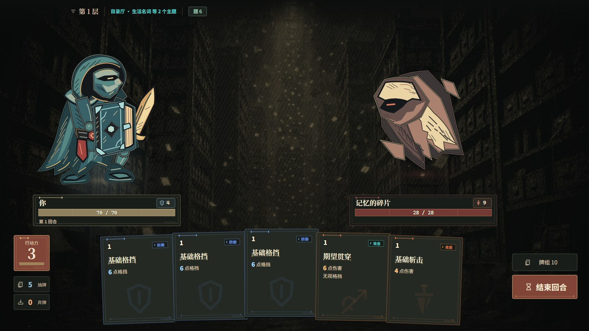

# CogniRogue

CogniRogue 是一款结合题库复习的单机 Roguelike 卡牌游戏。内置英语题库，支持导入题库以及从 PDF 或 Markdown 文档生成题目。


## 从源码一键启动

克隆仓库，不需要先构建 ZIP：

```powershell
git clone https://github.com/eggmushroom/CogniRogue.git
cd CogniRogue
.\Start-CogniRogue.cmd
```

Windows x64 也可以直接双击仓库根目录的 [Start-CogniRogue.cmd](Start-CogniRogue.cmd)。无需提前安装 Node.js、uv 或 Python：缺少兼容版本时，启动器会在仓库的 `.cache/` 中准备工具，不修改系统 PATH。macOS、Linux 或已装好 Node.js 22+ 和 uv 0.11.7+ 的 Windows 可运行 `npm start`；uv 会按需准备 Python。

首次启动需要联网准备锁定的 npm/Python 依赖；之后会复用本地环境。构建和后端就绪后会打开 `http://127.0.0.1:7777/`，启动窗口按 Ctrl+C 退出。如果已在运行 `npm run dev`，先停掉旧服务，避免两个进程同时写同一份数据。无需打开浏览器时，可运行 `.\Start-CogniRogue.cmd --no-browser` 或 `npm start -- --no-browser`。

源码版的文档、题库和答题记录继续保存在仓库的 `data/service/`。可以直接游玩或导入资料；模型分章、出题及审核需要在「设置 → 出题模型」填写自己的接口。
战斗音效以玩家动作为主：选牌、抽牌、弃牌落堆、挥刃、受伤和碰盾各有不同反馈；怪物出手或受击只做视觉反馈。可在「设置 → 战斗音效」关闭；离线 HTML 也支持。[卡牌音效设计](docs/card-audio.md) · [音效素材与许可](assets/sfx/SOURCES.md)

如果 Windows 导入 PDF 时提示缺少 DLL，请安装 [Microsoft Visual C++ v14 x64 运行库](https://learn.microsoft.com/cpp/windows/latest-supported-vc-redist)。

## 其他运行方式

### 不克隆仓库：离线试玩

从 [v0.1.0 发布页](https://github.com/eggmushroom/CogniRogue/releases/tag/v0.1.0) 下载 `CogniRogue-v0.1.0.html`，用浏览器打开即可离线使用内置题库。

### 可选：Windows 分发包

完整解压 `CogniRogue-Windows-x64.zip` 后双击 `Start-CogniRogue.cmd`，游戏会在默认浏览器打开。本地服务只监听 `127.0.0.1:17777`；重复启动会打开现有实例。在启动窗口按 Ctrl+C 退出，只关浏览器不会中断后台任务。

- 不用安装 Node.js、Python 或 uv，也不用手动启动服务。可导入题库、PDF 和 Markdown；模型分章、出题及审核仍需要自己在「设置 → 出题模型」配置接口。
- 文档、题库、答题记录、模型设置与启动日志保存在 `%LOCALAPPDATA%\CogniRogue`，不在解压目录里。升级前先退出，再解压新版并启动。浏览器内的偏好使用同一浏览器配置；源码版和离线 HTML 的数据不会自动迁移。
- 本仓库可在 Windows x64 上用 `npm run package:windows` 构建该 ZIP（输出到 `release/`）；`npm run packagecheck:windows` 可验证解压直跑和重启持久化，不使用真实模型额度。已有的单文件 HTML 仍适合离线试玩，不是完整版。

PyMuPDF 的 Windows 版需要 [Microsoft Visual C++ v14 x64 运行库](https://learn.microsoft.com/cpp/windows/latest-supported-vc-redist)。默认 ZIP 使用系统已安装的运行库；若维护者具备再分发许可，可在打包前将 `COG_WINDOWS_REDIST_DIR` 指向 Visual Studio 的 x64 CRT Redist 目录，把运行库随包分发。对外发布 ZIP 前也应核对随包组件的许可证要求。

## 本地开发与热更新

需要 Node.js 22+、Python 3.11+ 和 uv。

```powershell
npm ci
uv sync --frozen
npm run dev
```

打开终端显示的本地地址。生成题目或使用模型分章前，可在「设置 → 出题模型」填写配置，也可设置 `GEN_BASE_URL`、`GEN_API_KEY` 和 `GEN_MODEL` 环境变量。

```powershell
npm run build
npm run serve
```

构建产物位于 `dist/index.html`。导入题库、上传文档和生成题目需要本机服务。

## 题库

- 在「题库 → 导入题库文件」选择 Markdown 或 JSON 文件。Markdown 格式可参考项目自带的示例。[内置题库](packs/words.md)
- 在「题库 → 从文档建题库」选择 PDF 或 Markdown，确认主题划分后勾选主题，点击「生成所选主题」。在首页「任务」中查看进度。
- 展开题库中的单题，点击「查看原文」可查看出题审核引用的小节和节选，再点「阅读本节全文」可滚动阅读该小节。PDF 只显示已提取的正文及其可定位页码；没有保存出处的题目显示「暂无原文出处」。
- PDF 导入提取已有文字层，不执行 OCR。混合 PDF 会保留可读页并提示未提取正文的页码；没有可用正文的扫描件请先 OCR 或转为 Markdown。空白页不计为漏读。



## 出题失败与链路排查

- 在「后台任务」查看失败阶段和处理建议。处理余额、鉴权或网络问题后，点「重试这个主题」；它只补跑该主题，沿用原计划和出题数量，并使用当前模型配置。重试是显式操作，不会替用户自动发起一轮新的模型请求。
- 每次任务有独立的 Trace ID。可以在任务详情复制 ID、下载 JSONL；新任务关联上一次失败任务，服务重启后自动恢复仍使用原 Trace ID。
- 用 `uv run --frozen python -m server.trace_report <trace.jsonl>` 查看排队时间、阶段耗时、模型请求状态和已报告的 token 用量。并发阶段的耗时之和不是总耗时；未报告的 token 不计入用量。任务与 Trace 保存在本地，按近期任务保留，不需要外部追踪平台。

## 开发命令

| 命令 | 用途 |
| --- | --- |
| `npm start` | 从源码自动准备依赖、构建并启动游戏 |
| `npm run start:check` | 验证源码启动、游戏页面和本地 API，无需浏览器 |
| `npm run verify` | 运行项目检查 |
| `npm run smoke` | 在开发服务运行时执行浏览器冒烟测试 |
| `npm run sim` | 运行无头模拟 |
| `npm run gencheck` | 离线检查题库生成流程 |
| `npm run jobcheck` | 用本地模拟接口验证真实任务进程的失败、重试、入库与追踪 |
| `npm run reviewcheck` | 调用审核模型运行回归样例 |
| `npm run sources` | 按语料清单重新提取来源文档 |

提交与 PR 会在 Linux、Windows 运行不调用真实模型的构建检查。浏览器冒烟可在本地开发服务运行时单独执行。

## 许可

项目采用 MIT 许可证。题库语料遵循各自来源的许可。[项目许可证](LICENSE) · [语料来源](data/sources/SOURCES.md)
