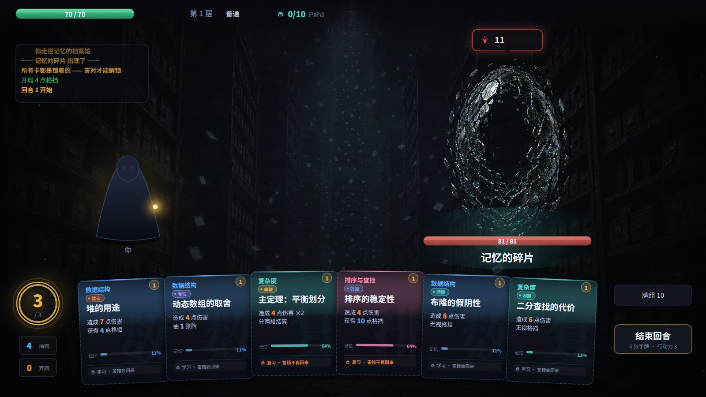

# CogniRogue

**用你的知识爬一座塔。**

一张卡就是一个知识点，卡面效果是固定的。卡面上只有**知识点名字、效果、数值、消耗、记忆度**——
题目一个字都不露。**点开这张牌，题和选项才出现**：答对，这一手就生效，这个卡种当场解锁；
答错，这一手作废——**牌去哪，看这张卡还在不在学**：学习期退回牌堆（下回合抽回来），
复习期进弃牌堆（这一场不再自动回来）。

六种效果让牌组真的需要取舍：**洞察**无视格挡、**巩固**伤害减半换双倍格挡、**内化**按伤害回血、
**串联**分两段结算、**专注**抽一张牌、**猛击**攻守均衡。效果写在知识包里，是这张知识点的"性格"。

每张卡背后是一个**题库**（知识包里用 `?` 追加，最多 5 道）。同一场战斗里同一个知识点会被从
不同角度问几次，问过的不再问——要记住的应该是这件事本身，不是"这题选 B"。

节奏只有一条规则：**出牌 1 点行动力，答对了这一手退回来**。所以行动力买的不是"出牌次数"，
而是"犯错次数"：会的人一回合能把整把牌打完，不会的人打两张就没油了。

外层是杀戮尖塔那套：**一条能提前看见全貌的分支路线、一副越走越厚的牌组、几张改规则的增益牌**。

TypeScript + Canvas 写的，没有 UI 框架。逻辑层（`src/core`）不碰 DOM，所以同一套规则既能在浏览器里跑，
也能在 Node 里跑几千局无头模拟——仓库里的数值都是模拟出来的，不是拍脑袋定的。


## 快速开始

```bash
git clone <this-repo>
cd CogniRogue
npm install
npm run dev          # http://localhost:5178
```

想要一个能直接双击打开的 exe 式单文件：

```bash
npm run build        # 产出 dist/index.html（约 600 KB，脚本、样式、美术全部内联）
```

`dist/index.html` 拷到任何地方双击就能玩，不需要服务器、不需要联网。

| 命令 | 作用 |
| --- | --- |
| `npm run dev` | 开发服务器，改代码热更新 |
| `npm run build` | 类型检查 + 打包成单文件 |
| `npm run sim` | 无头模拟几千局，验证数值 |
| `npm run smoke` | 开真浏览器点鼠标，验证按钮真的能按（需先跑 `npm run dev`） |
| `npm run shots` | 重拍 `docs/` 里这 19 张配图（同样需先跑 `npm run dev`） |
| `npm run check` | 只做类型检查 |

## 一局是什么样

8 层。每层 2–3 个节点，整条路开局就全部可见——你能提前规划"我要不要去拿那张增益牌"。
一局大约 10–15 分钟、60–90 道题（一种卡在一个场次里只问一次，解锁之后就免答了；
答错的话下一回合会从它的题库里换一道再问）。


| 节点 | 内容 |
| --- | --- |
| ⚔ **战斗** | 普通敌人，赢了一场从三张卡里挑一张进牌组 |
| ☠ **精英** | 血厚、会格挡、会塞杂念。赢了给**增益牌**——它不白给，进牌组、要抽、要打 |
| ✦ **复习** | 休息回 32% 血 / 精炼一张卡（攻+3 挡+3）/ **永久删掉一张卡** |
| ? **事件** | 四段小故事：散落的索引卡、旧笔记本、守夜人、长明灯廊。都有代价 |
| ✺ **遗忘** | Boss。打你本局错得最多的主题，但你在该主题答对时它会被削弱 |

<p align="center"></p>

<p align="center">
  
  
  
</p>

**牌组构筑是这一层最像杀戮尖塔、也最适合学习场景的地方。** 每打赢一场就往牌组里加一张卡，
牌组越厚，你越难抽到想要的那张——"跳过，不要卡"经常是正确选择。
复习点的**删卡**是构筑里最被低估的一步：主动放弃一个你这一局不打算碰的知识点，牌组就更好抽。

### 增益牌也是牌，也要打出去

它们是原来那几件"遗物"。现在它们不是挂在右上角的图标，而是**躺在牌组里的牌**：
同样的手牌位、同样的 1 点行动力，抽到、打出去，本场战斗剩下的时间里一直生效。

| 增益牌 | 效果 |
| --- | --- |
| 记 错题本 | 答错时该主题攻击 +1（最多 +6）——**答错变成投资** |
| 时 沙漏 | 每回合行动力 +1（打出这一手立刻赚回来） |
| 索 索引卡 | 每回合多抽 1 张牌（打出时先抽 1 张） |
| 订 装订线 | 每回合第一次答错不花行动力 |
| 镜 双面镜 | 打出时随机解锁一种卡 |
| 灯 长明灯 | 每回合开始获得 3 点格挡 |
| 笔 荧光笔 | 每回合第一次答对抽 1 张 |

<p align="center">
  
  
</p>

**这不是换皮，是把"局外成长"拉进牌组经济。** 遗物是白给的，所以它只影响数值上限；
牌要抽、要花行动力、要占牌位，于是"这一回合我是继续答题，还是先把灯点上"变成
一个真实的取舍，而"牌组里塞几张增益牌"（= 稀释几张知识卡）成了构筑决定。

三条规则把它和知识卡分开：

1. **没有题。** 增益牌不需要证明什么，只花行动力 —— 它不参与解锁统计，也不写记忆调度。
2. **不进弃牌堆。** 打出后它直接从牌组循环里出去（画面上是飞向右上角的增益槽）。
   洗回去的话，同一张牌每次洗牌都能再打一次，"本场持续"就变成无限叠加了。
3. **每场重置。** `G.powers` 在每场战斗开始时清空。增益牌每场都要重新抽、重新付钱，
   所以它不是"带着走的装备"，是这一场里你自己建起来的局面。

它们从哪来：精英战必给一张（三选一），普通战斗有 `BAL.powerDrop = 15%` 概率掉一张，
两个事件也能换到。一局大概见着一两次——不多，但每见一次都是一个真实的决定。

### 敌人会提前告诉你下一步

这是从杀戮尖塔搬过来最值钱的一条：**意图透明**。每个敌人有固定的招式循环，出招前就能看见——

> 意图：攻击 12×2　/　意图：获得 12 点格挡　/　意图：往你的弃牌堆塞 1 张杂念

于是随机从"被偷袭"变成了"可规划"。几种具体机制：

- **复习官**：一回合内没有真正答对任何一张卡，额外打你 3 点。专治全程快攻。
- **回声 / 镜像**：攻击**穿透一半格挡**，堆格挡这一套对它们不好使。
- **熵**：往你的弃牌堆塞**杂念**——占手牌位、打不出去、回合结束时自己散去。半懂不懂的知识就是这副样子。
- **审视者**：会格挡。想靠一回合爆发带走它，得先把那层挡住。

## 六种效果：牌不再只是数值

第一版所有卡都是"造成 X 伤害 + 获得 Y 格挡"，除了数字高低没有任何区别，一手牌读起来像一排同款。
现在每张卡挂一种**效果**，它决定底数怎么花出去：

| 效果 | 机制 | 什么样的知识点配它 |
| --- | --- | --- |
| **猛击** `strike` | 攻 ×1.0，挡 ×0.7 | 没有偏科的基准卡 |
| **洞察** `pierce` | 攻 ×0.95，**无视格挡** | 结论是"一定 / 必然"的知识，看穿表象 |
| **巩固** `guard` | 攻 ×0.6，挡 ×2.0 | 防线、稳定、不退化 |
| **内化** `drain` | 攻 ×0.85，按伤害 50% 回血 | 把知识换成自己的血，长局最耐用 |
| **串联** `chain` | 攻 ×0.52 × **2 段** | 知识点本身就是"两件事的组合" |
| **专注** `focus` | 攻 ×0.7，**抽 1 张** | 讲节奏、摊还、预留空间 |

效果不是随机贴的标签，是写知识包的人自己定的：`% 6 5 pierce` 和 `% 6 5 洞察` 等价，不写就是猛击。
它把这副牌从"一条数值曲线"变成"一组取舍"——精英会格挡，洞察这时候才值钱；
血线吃紧，内化比猛击耐用；手里只剩两张牌，专注能把你这一回合接上。

<p align="center"></p>

### 打出去的那一下

答对之后不是"血条少了一截、然后弹个框"，而是先打完这一手：人物从提灯里甩出一道光刃，
飞过去、命中、敌人被击退，**演出演完了反馈面板才出来**。挡在面板后面演等于没演。

- 光刃的形状跟着效果走：洞察是一道连到手上的**直光束**，其余是**弧形拖尾**；
  串联的第二段会换一条更高的弧线，眼睛能数出"打了两下"。
- 命中是四件事同时发生：星芒闪白、火花四散、屏幕震动、伤害数字弹出。
  多段伤害的数字会错开位置，不然 `4` `4` 会被念成 `44`。
- 演出期间输入被锁住（`setInputLock`）——面板还没弹，但底下的牌和牌堆已经画出来了，
  不锁的话玩家能点到"还没轮到他"的东西。敌人出手时同样锁，见下一节。

<p align="center"></p>

### 敌人也要真的动

以前敌人回合几乎是静默的：只有**真的掉血**才发一个 `hurt` 事件。于是格挡全挡下、举盾、
塞杂念、变强、第一回合的观察期，玩家只能从左侧日志里倒推"它刚才是不是动过"。
现在 `endTurn` 的五个分支统一发一个 `enemyAct` 事件，带上动作类型和结算数值，表现层按类型编排：

| 意图 | 身体 | 看得见的东西 |
| --- | --- | --- |
| 攻击 | 后撤蓄力 → 前冲 | 红色光刃飞向你；**多段攻击分几次飞** |
| 攻击被全挡下 | 同样冲过来 | 光刃变蓝，落地是**盾环 +「全挡下」+「吸收 N」**，不爆红、不掉血数字 |
| 获得格挡 | 后缩 | 蓝色护盾从外往里收，脚下升起一层蓝雾 |
| 塞杂念 | 前倾 | N 张紫色问号牌**真的从它手里飞到左下弃牌堆** |
| 攻击变强 | 涨大、泛橙 | 两圈向外扩的红橙环 + 上升的火星 |
| 观察期 | 微微收住 | 一圈慢慢转的青色虚线 +「观察中…」 |

<p align="center">
  
  
  
</p>

**为什么把"动作"而不是"结果"做成事件。** 结果类事件（`hurt` / `enemyBlock` / `junk`）
天然只在有数值变化时才触发，而"敌人举起盾""它忍住没出手"恰恰是**没有玩家侧数值变化**的动作——
用结果当事件，这些就永远静默。换成动作事件之后，五个分支都得发声，表现层自己决定演多大声。

还有一个时序坑：`endTurn` 是同步的，事件发出来时 `startTurn` 已经把下一回合的手牌抽好了。
不压住抽牌动画，两拨飞行物会叠成一团，玩家分不清谁在动。所以敌人演出期间**新手牌先留在牌堆**，
等这一下演完再依次飞进来；同时输入被锁住，玩家不会在光刃还在飞的时候点开下一张牌。

> 配图是 `?dev=foe:atk` 这类入口真跑一次 `endTurn` 拍的：血条、弃牌堆、头顶意图都是真的，
> 不是单独盖一层特效。招式表被固定成单招循环，所以气泡和演出是同一件事。

**答错则相反：没有任何东西朝敌人飞过去。** 这条是刻意的——只要画面上有东西冲向敌人，
玩家读到的就是"打了，只是没伤害"，那是另一件事，而且是错的。所以反馈落在**出手的地方**：
提灯的焰暗一下再回来，一小撮屑在原地散开（亮屑上飘、暗屑下坠），配一圈暗红环和轻微震屏。
朝敌人的方向必须是空的，**"什么都没飞出去"本身就是最重要的那条信息**。

## 核心机制：一道题，一次结算

卡面上的效果和数值**永远不会因为难度变化**——难度不再是一个选项。一次出牌只有一件事要决定：

```
手牌（只有知识点名、效果和数值）
   │ 点一下
   ▼
答题面板：一道题、四个选项（从这张卡的题库里挑，本场没问过的那几道优先）
   │ 答
   ▼
答对 → 卡面效果立刻结算，这个卡种本场解锁，这一手不花行动力
答错 → 效果作废，花掉 1 点行动力，这个卡种这回合不再问；按卡面格挡的一半替你挡一下
       牌的去处按学习阶段分：学习期回抽牌堆，复习期进弃牌堆
```

以及一直存在的逃生口：**快攻**——不作答，半额伤害，不进复习调度，**也不退款**。
绕过去是要付钱的，只是付得少。

### 答错不是一档：学习期 / 复习期

一张卡在哪个阶段，看的是**它自己的**记忆稳固度，不是一个全局开关：

| 阶段 | 什么时候 | 答错的代价 |
| --- | --- | --- |
| 学习期 | 记忆条还没到 1/3（稳固度 < 门槛） | 这一手作废、花 1 点行动力；**牌回抽牌堆**，下一回合抽回来 |
| 复习期 | 连续答对之后（记忆条过了 1/3） | 牌**进弃牌堆**，这一场不再自动回来，得等牌堆洗过一轮 |

<p align="center"></p>

**为什么不做成一个"学习模式 / 复习模式"的开关。** 一副牌里永远同时有学过的和没学过的。
整局统一放宽，老玩家会觉得游戏在哄他；整局统一收紧，新手第一层就在拿血换知识。
按卡分档才有那个效果：**你在学的东西被宽容，你学过的东西被要求**——而且同一局里
前半场（都在学）和后半场（开始复习）会自动换挡。

**为什么学习的代价要更轻。** 学习阶段犯错是学费。答错本来就扣了 1 点行动力和一次出手机会，
再顺手把牌收走，等于告诉玩家"别碰你不会的东西"——正好和这个产品的目的相反。
"牌回抽牌堆"这句话的含金量比听起来大：10 张牌、6 张手牌，回合结束整把手牌都会进弃牌堆，
所以被保证的不是"没进弃牌堆"，而是**下一回合它一定在你手里**。实测新手每局答题量
从 81 涨到 87（+7%），答题占比 83% → 86%——宽恕买来的是更多的练习，不是更低的难度。

**复习期那一档特意没做得更狠。** 试过"答错就整场作废"（`BAL.reviewStrict`），800 局实测：
熟练胜率 53% → 38%，每局答题量 64 → 52。作废的牌不能再被问，于是"答错的惩罚"变成了
"少答五分之一的题"——惩罚的是学习本身。所以它停在一句"这一场它不再自动回来"，
那个开关留着，默认关。

还有一条自限：稳固度会掉（复习期答错 ×0.25），一张牌顶多坑你一次，之后它自己退回学习期。

<p align="center"></p>

<p align="center"></p>

### 押注机制被删掉了（v0.3）

之前这里写的是"识记 / 理解 / 迁移"三档：档位不改伤害，只改这一手的节奏收支，而且只能往上换。
那套设计是自洽的，但它是**拿节奏当赔率**，代价有两条：

1. **三档会塌成一档。** 赔率一旦不对称（曾经是净 +3 对净 −3），理性解就是"永远压满"；
   修成对称之后又是另一个问题——正确率过 50% 的人永远压迁移，另外两档只是给新手看的教学关。
2. **它把"会不会"变成了"敢不敢"。** 押注的决策点在看清题之前，玩家只能靠卡名猜难度；
   猜错的代价是行动力，于是"变强"的方式变成"更会估自己"，而不是"更懂这个知识点"。

删掉之后只剩一条规则：**答对了这一手不花行动力**。技巧曲线反而更干净——
水平 35% → 88%，胜率 5% → 28% → 56% → 67%（见下面「数值是怎么定的」）。

<p align="center"></p>

死亡不会掉知识等级，只是这局的资源没了。下一局的牌序由调度器决定，该复习的卡会自己排到前面。

## 解锁：答对才拿得到手

每场战斗开始时，牌组里的每一张卡都是**锁着的**。

锁着的卡点下去出题；答对一次，这一**种**卡就解锁——之后这场战斗里它的每一张副本都能
**免答直接打出，效果 ×1.5**。答错则这一手作废，而且这一种卡这一回合不能再试：不然看完
答案用副本重答，锁就白锁了（这也是"每回合每张卡一次机会"那条规则的由来）。

<p align="center"></p>

这一条改掉了原来最要命的结构问题：**玩家每回合的输出是恒定的**。出几张牌 × 每张几点攻，
从头到尾不变；而敌人血量从 73 涨到 111、Boss 195。牌组变厚只增加选项，不增加输出，
所以一局的手感是"越来越难"，不是"我组出来了一个东西"。

现在输出跟着答对率走，而且两个方向同时供给：

- **一回合能打几张**：答对退还行动力，所以答得越准，这一回合越打不完（3 点行动力，最多打 6 张）；
- **每张打多重**：解锁覆盖率从 0 涨到 100%，同一张牌从 ×1 变成 ×1.5。

乘起来就是这条成长曲线，而它不靠加数值——**它由"你答对了多少"直接供给**。

三层解锁，各管一段：

| 层 | 触发 | 管什么 |
| --- | --- | --- |
| 本场解锁 | 答对一次 | 节奏：投资期 → 收割期 |
| 精炼解锁 | 复习点精炼一张卡（`up=1`） | 构筑：精炼从"+3 数值"升级成"之后每场开局即解锁" |
| 上限 | 同种卡最多 3 张 | 防堆单卡种：只需答一次就换来一堆免答牌，等于用更少的学习换更强的战斗 |

配套两条缓冲，不然解锁期就是明码标价的拿血换：每场开局白送 4 点格挡；答错的卡按卡面格挡的
一半替你挡一下——半懂也挡得住一点，但绝不免费。

删掉的东西也值得记一笔：**连击没了**。原来"同主题连续答对 ×1.8"是靠抽牌顺序吃饭的，
还鼓励块状练习（而交错练习在辨别类知识上明显更好）。同样是把"会"换成伤害，解锁是靠答对，
连击是靠牌发得好——所以后者让位。

## 结算面板：这一局的伤害是怎么来的

押注没了之后，结算页不再问"你押得准不准"，改问一件更硬的事：**这一局的输出里，有多少是你
记住了的，有多少是当时蒙对的那一下。**

<p align="center"></p>

- **答题出牌 / 正确率**：本局被问了几次、对了几个。
- **免答出牌**：解锁之后直接打出去的那几次，伤害 ×1.5 —— 那才是"会了"兑现成输出。
- **解锁卡种**：答对一次解锁一种。它比正确率更直接，因为它是"这一场能不能用"的开关。
- **答错的牌**：分成"学习期 N 次 / 复习期 M 次"。同一个错误两种价码，得分开数才知道
  这一局是在交学费，还是在为手滑付账。
- 再加上主题掌握度、牌组构成、走过的节点。

正确率 ≥80% 时结算页会直接说"后半场你不是在赌，是在用记住的东西打仗"；60–80% 是"半懂"，
提示你把错得最多的主题连着答两轮；低于 60% 则是"这副牌是借来的"。

## 数值是怎么定的

`BAL`（敌人强度、行动力、免答倍率）不是拍脑袋定的。`npm run sim` 会把同一套 `src/core` 规则
打包到 Node 里，完整走地图、打怪、选卡、走篝火、触发事件，一次跑几百局：

```
水平     基础正确率   胜率      平均到层    答题/局    实际正确率   免答/局   答题占比   答错 学/复
新手     35%          2%        5.41        87.4       35%          14.3      86%        学53.5/复3.4
入门     55%          27%       7.13        76.6       55%          25.4      75%        学24.2/复10.3
熟练     72%          57%       7.68        64.6       72%          31.0      68%        学5.1/复12.9
精通     88%          70%       7.82        55.0       88%          32.5      63%        学0.2/复6.3
```

同一套数值连跑几次 800 局，熟练会在 52–57 之间跳，两端也只在几个百分点内漂：**表格是一次采样，
别追单个百分点**。能稳定复现的是结构性指标（答题量、免答量、答题占比），不是某一格的胜率。

（`npm run sim -- --runs=800` 可以把每格样本加到 800 局；`--hp --dmg --ap --hand --free --miss
--start --calm --rf --take` 都能从命令行扫，试一个数值不用改源码。学习期/复习期那两档也各有
开关：`--learn=0`、`--strict=1`、`--stab=4`；`--fresh=1` 每个水平重置记忆、`--freshrun=1`
每局重置，用来模拟"第一次打开这个知识包"。）

最后一列值得单独看一眼：**它是"谁在被罚"的分布图**。新手 53 次错在学、3 次错在复习；
精通反过来，0.2 对 6.3。分档要起作用，就得是这个形状——不会的人在交学费，
会的人在为手滑付账。

判据只有一条，写进脚本最后一行自动断言：**胜率必须随水平单调上升。**

这条判据这次又救了一次设计：押注删掉之后，如果顺手把"答对退款"也删掉，5 点行动力下
72% 和 88% 水平的胜率会挤在一起（69% vs 70%）——因为"一回合能打几张"被行动力钉死了，
答得更准换不出更多输出，知识就不再是瓶颈。**行动力必须买"犯错次数"，不能买"出牌次数"**，
技巧才有地方兑现。这条是模拟跑出来的，不是想出来的。

把遗物改成增益牌之后，这条曲线掉了 7 个点（74% → 67%）**而且变平了**（熟练和精通只差 11）。
这是这类改动的固有代价：沙漏、长明灯这些原来白给，现在要花一手行动力才能拿到，
但它们给的收益并不依赖你答对多少——于是技巧的边际价值被削掉一块。

处理办法不是把增益牌改弱，而是让敌人更凶：伤害系数 1.55 → 1.60。
"一手行动力换一个持续增益"是成本，这个成本对任何水平都一样，所以门槛必须由敌人抬，
不能由"少给几张增益牌"抬（那样机制会消失在随机里）。那一版的曲线是 5 / 28 / 56 / 67，跨度 62。

把答错按学习阶段分档之后，曲线是 **2 / 27 / 57 / 70**。对照"两档都关掉、答错一律进弃牌堆"
的基线 4 / 28 / 53 / 69 —— 连跑几次 800 局，熟练那一格在 52–57 之间来回跳，
**这两条曲线在噪声里分不开**。分档没有改动胜利难度，这正合它的目的。

稳定变的是结构：新手每局答题 81 → 87（+6）、免答 16.8 → 14.3（−2.5）、答题占比 83% → 86%。
牌回牌堆会占掉下一回合一个抽牌位，回来的那张是刚答错的卡，得重新答一次；
它要是进了弃牌堆，那个位置本来会抽到一张已解锁、能免答 ×1.5 打出去的牌。
**宽恕买的是练习次数，付的是一点输出** —— 但在 800 局的分辨率上，这点输出换不出可测的胜率差，
这条规则本来也不是用来调难度的。真正会让曲线塌的是把复习期做成"整场作废"
（熟练 53% → 38%，答题 64 → 52），那个差距远大于噪声。

顺带一提，这一版的模拟机器人学会了**快攻**：手里只剩打不出的牌（答错锁住的、作废的）时，
它会拿半额伤害把这 1 点行动力花掉。不模拟这一手，会把所有惩罚算得比实际更狠。

> 想自己复现：`npm run sim -- --runs=800`。`--take=1`（战后拿卡）时会变成 1 / 24 / 64 / 78——
> 梯度更陡，因为会拿牌的人能把增益牌的价值吃满。`--learn=0 --strict=0` 就是上面那条基线。

还有一句该说的：**模拟能证明规则不崩，证明不了"学到了"。** 它的正确率是独立同分布的随机数，
真人不是——真人会在同一局里见到同一个知识点两三次，然后开始记答案。

## 工程结构

```
src/
  core/          纯逻辑，不 import 任何 DOM / canvas，Node 里能直接跑
    game.ts        一局的全部规则：地图、战斗、抽牌、出牌结算、解锁、增益牌、调度
    data.ts        数值表：敌人、增益牌、全局强度 BAL
    content.ts     知识包解析（Markdown DSL / JSON）
    types.ts       共享类型
  gfx/           渲染原语：等比缩放的画布、手绘图标、卡面、飘字、粒子
    fx.ts          打击演出：光刃飞行、命中星芒、击退、震屏；只管演，不改数值
  scenes/        每个画面一屏：title / map / battle / overlay / report / packio
  input.ts       命中区域与点击（含"同一个按钮"的跨帧判定、演出期间的输入锁）
  main.ts        主循环：把状态画出来，把特效用事件翻译成动画
tools/
  sim.ts         无头模拟（esbuild 打包后用 node 跑）
  smoke.mjs      真浏览器的冒烟测试（CDP 驱动）
  shots.mjs      重拍 README 里的配图（同一个 CDP 管道，`npm run shots`）
packs/           知识包
assets/          美术资源（构建时内联）
```

### 调试用的捷径

不想每次都点进去看某一屏，可以给 URL 加 `?dev=`：

| 参数 | 落在哪 |
| --- | --- |
| `?dev=title` | 标题 |
| `?dev=map` | 地图 |
| `?dev=battle` | 一场普通战斗 |
| `?dev=question` | 战斗 + 点开一张牌后的答题面板 |
| `?dev=answer` | 答题结果反馈 |
| `?dev=wrong` | 故意答错一次，停在"答错"那一屏 |
| `?dev=phase` | 一半牌在复习期、一半在学习期，并排看两档卡面 |
| `?dev=review` | 全部卡都在复习期 |
| `?dev=power` / `powerpick` | 手牌里有增益牌 / 精英战后的增益三选一 |
| `?dev=foe:atk` / `jam` / `def` / `buff` | 把敌人固定成这一招，配 `cog.endTurn()` 拍敌人动作 |
| `?dev=reward` / `rest` / `event` / `deck` / `pack` / `help` / `report` | 对应弹层 |

这只是入口，规则仍然是同一套 `src/core`。另外 `window.cog` 挂着 `state`（当前局面）、
`hots()`（这一帧所有可点区域）、`toScreen()`，冒烟测试就是靠这三个驱动真实点击的。
`cog.fx()` 报告此刻还在飞的单元（抽牌 / 弃牌 / 敌人动作），用来盯"飞行单元漏清"；
`cog.locked()` 报告输入是不是正被演出锁住。

想单独看演出而不打一局：`cog.strike(kind, target)` 放一次打击光刃，
`cog.enemyAct(kind, taken)` 演一次敌人动作（`taken=0` 是"被全挡下"），两者都不碰任何数值。
想看真回合就用 `cog.endTurn()`——血量、格挡、弃牌堆和头顶意图都会跟着变，
`?dev=foe:atk` 这类入口会把敌人的招式表固定成单招循环，截图才能复现。

### 为什么是 Canvas，而不是 DOM/React

卡牌游戏的核心手感在**连续动画**：手牌扇形排布、抽牌飞入、弃牌飞向牌堆、受击抖动、意图气泡浮动。
用 DOM 做这套要么上 framer-motion 这类库，要么和 CSS transition 的时序打架；
Canvas 里这些都是一行 `g.translate`。

代价是**所有交互都要手写命中区域**——这也是本项目唯一出过"看起来正常但完全点不动"的地方，
所以有了下面这个测试。

## 测试：两种，各管一半

**`npm run sim` 管规则。** 它跑的是 `src/core` 本身，不是复制一份逻辑；改数值、改公式，模拟立刻反映出来。
它回答"这套数值成不成立"。

**`npm run smoke` 管手感。** 它开一个真的 Chrome，用 CDP 发真的鼠标按下/抬起，按标签找到按钮点下去，
再断言游戏状态确实变了：标题→地图→进节点→点手牌→出题→答对→看反馈→继续→结束回合→
打出增益牌→免答出牌→答错→走复习点→选卡→事件→结算重开，一共 **20 步**。
答对那一步会专门断言**反馈面板在打击演出期间还没画出来**（状态是 feedback，但按钮不在命中表里），
免得哪天"推迟面板"改坏了、把按钮一起吞掉却看不出来。

分档规则另有三步真浏览器断言：答错时敌人不掉血、学习期答错的牌**只回抽牌堆不进弃牌堆**、
把同一张卡调成复习期再答错则**只进弃牌堆**。这三种走向在 `core` 里是同一段 `answer()`
的两个分支，最容易在改动画时把飞行方向一起改错——所以表现层（飞回左上还是左下）也一起测了。

敌人演出也钉了三步：结束回合时**演出单元必须真的存在且输入被锁住**、五种意图各演一遍都要产生
可见单元、演完之后**演出单元清零、输入解锁、新回合手牌飞回来**。最后那条是专门防"冻结了抽牌
动画却忘了解冻"——那种 bug 不会报错，只会让手牌永久消失。

写它是因为踩过一个很隐蔽的坑：命中区域每帧都会重建（`last = building`），而按下时记下的是**上一帧的对象**。
早期版本在抬起时用 `h === downHot` 判断"是不是同一个按钮"，结果真实浏览器里几乎每次点击都被判成
"手指移出了按钮"，什么都不发生——但截图完全正常，因为截图不点。修法是不比对象、比几何：
按下时记矩形，抬起时用当前帧新的矩形比对位置和尺寸，再调用当前帧的回调。

这个 bug 只在"按下和抬起之间隔了几帧"时才出现，所以冒烟测试里特意在 down 和 up 之间 sleep 70ms。

## 知识包格式

一个 `###` 开一张卡并带第一道题；再用 `?` 往这张卡的**题库**里加题，最多 5 道。战斗里每次点开只问一道，
本场问过的不再问。

```markdown
# 知识包名

## 主题名

### 二分查找在 n 个有序元素上的最坏时间复杂度是？
@ 二分查找的代价
A) O(1)
B) O(log n)
C) O(n)
D) O(n log n)
= B
+ 每次比较把搜索区间折半，最多比较约 log2(n) 次。
% 6 5 pierce

? 理解: 为什么无序数组上不能直接用二分查找？
A) 无序数组不具备"折半后目标仍在某一侧"的性质
B) 无序数组算不出中间下标
C) 无序数组按下标访问是 O(n)
D) 无序数组元素太多，递归会爆栈
= A
+ 二分的关键不是"有序"，而是有序带来的可判定性。

? 迁移: n = 1024 的有序数组，二分查找最多比较几次？
A) 10
B) 32
C) 512
D) 1024
= A
+ 2 的 10 次方是 1024，区间从 1024 缩到 1 需要 10 次折半。
```

| 标记 | 含义 |
| --- | --- |
| `# ` | 知识包名 |
| `## ` | 主题（决定卡面配色，也是结算页的分组） |
| `### ` | 开一张卡，下一行起是它的第一道题 |
| `@ 知识点名` | 印在卡面上的短名（可省略；不写就从题干里截前 14 个字） |
| `? [标签:] 问题` | 往题库里再加一道题（标签只是写题人看的，会剥掉），最多 5 道 |
| `A)` `B)` `C)` `D)` | 选项，2–4 个都行 |
| `= X` | 这道题的正确答案字母 |
| `+ ` | 这道题的解析 |
| `% 攻击 格挡 [效果]` | 可选项，默认 `6 5 strike`，作用于整张卡 |
| 效果 | `strike` `pierce` `guard` `drain` `chain` `focus`，写中文名（猛击/洞察/巩固/内化/串联/专注）也认 |

卡面上的名字是玩家唯一能看到的线索：**他得靠"二分查找的代价"这几个字认出这是哪个知识点**，而这几个字
不能把答案泄出来。所以 `@` 值得认真写，写不出就留空让它自动截——自动截出来的往往太长、太像题目。

**题库不是必须的**：只写 `###` 不写 `?` 也能玩，那张卡就只有一道题，问完这个知识点就"背下来了"。
题越多，同一个知识点被戳得越透，也越难靠记答案过关。
`packs/algorithms.md` 是内置示例包（13 张卡 / 36 道题），可以直接拿来改。
开局按调度取前 **10** 张组牌，剩下 3 张会作为战后奖励出现——所以一个包至少要有 13 张卡才玩得开。

JSON 也支持，`qs` 是题库数组：`{ "topic", "atk", "blk", "qs": [{ "q", "options", "answer", "explain" }] }`，`answer` 是 0 起始下标。老字段名 `tiers` 仍然认。

## 用 LLM 写知识包

游戏里没有内置调模型的入口（Key 不该经手任何第三方）。做法是：把下面这段贴给任意模型，
生成后存成 `.md`，或者直接复制、在游戏里「载入自己的知识包 → 从剪贴板粘贴」。

```text
把下面这段笔记做成 13 张卡，严格按这个格式输出，不要多余的解释：

### 一个问题
@ 知识点短名（6 个字以内，像卡牌名字，不能泄露答案）
A) 选项
B) 选项
C) 选项
D) 选项
= B
+ 解析
% 攻 挡 效果

? 同一知识点换一个角度问：问机制、问反例、问边界
（同样 4 个选项 + 答案 + 解析）

? 再换一个场景问：换个没见过的材料还成立吗
（同样 4 个选项 + 答案 + 解析）

硬性要求：
1. 每个知识点 2–3 道题，必须问不同的东西：一道问定义/结论，一道问机制/区别，一道换场景。
   三道都问"是什么"等于只有一道题。
2. 干扰项必须是"真的会搞混"的错误，不能是凑数的荒谬项。
3. 解析讲原理，不许复述答案。
4. @ 那行只写知识点名，绝不能把答案写进去——玩家第一眼看到的就是它。
5. 效果从 strike / pierce / guard / drain / chain / focus 里按知识点性质挑一个：
   结论是"必然"的用 pierce，讲防线和稳定性的用 guard，讲两件事组合的用 chain，
   讲节奏和摊还的用 focus，剩下的用 strike。不要 13 张全给同一个。
```

这些硬要求不是洁癖：

- **题库不真分层**，三道题只是同一句话换个说法，这个知识点就等于只有一道题，而玩家会背答案。
- **干扰项太好排除**，答题就退化成识字游戏，正确率不再反映掌握程度。
- **解析复述答案**，等于放弃了这个产品唯一真正的教学时刻——答错之后那两行字。

## 调度：FSRS-lite

每张卡维护一个简化状态 `{ stab, due, reps, lapses }`：

- 答对：`stab *= 1.8`，`due = round(stab)`
- 学习期答错：`stab *= 0.4`（下限 1），`due = 1`
- 复习期答错：`stab *= 0.25`（下限 1），`due = 0` —— "忘了"要掉得更多、排得更靠前
- 每开一局，所有 `due -= 1`；开局组牌**先收逾期的，再收没碰过的，最后是还没到期的**

最后这条以前写错了：只按 `due` 升序取前 10 时，新卡的 `due` 一直是 0 并随局数一起递减，
于是永远排在学过的卡前面——**掌握得越好的卡越不会再出现**，和"该复习的必须出现"正好相反。
分桶之后，一张卡会随着年龄自己回到牌组里，复习期那档惩罚才有地方落地。

`stab` 同时是「学习期 / 复习期」的判据（`BAL.reviewStab = 4`，大约连续答对三次）。
之所以用会掉的稳固度、而不是"答对过几次"：累积次数只说明这套题你做过多少遍，新手做多了
也会被算成复习期——那正好把分档的意思弄反了。

这只是个占位实现，够用来验证「调度 → 牌序 → 手感」这条链路。**欢迎把它换成真正的 FSRS**，
状态字段和接口都留好了（`MemEntry` 在 `src/core/types.ts`，读写在 `src/core/game.ts`）。

## 设计取舍

做这个东西时我放弃了八件事，理由写在这里，免得后来的人重新踩一遍：

1. **随机不碰调度。** Roguelike 的灵魂是随机，学习工具的灵魂是"该复习的必须出现"。所以随机只作用于**地图结构、敌人组合、招式循环**，抽哪张知识卡由 `due` 决定。随机是皮肤，调度是骨骼。
2. **地图是分支的，但不是无限的。** 整条路一次全画出来，玩家能提前看见"第 4 层有个精英、第 6 层有个复习点"。看不见的随机是赌博，看得见的随机是决策。
3. **死亡不惩罚学习。** Permadeath 挪到学习场景，等于让人体验"我努力了一周，一局归零"。所以死亡只清空当局资源，知识等级永久保留。
4. **难度不碰数值。** 卡面效果恒定，题目只决定这一手成不成立。这样玩家才能算账：同一张牌，换哪道题、答得对不对，卡面都还是那张卡面。**精炼（攻+3 挡+3）是唯一会改写卡面的东西，所以它只能在复习点发生，而且是一次性、可见、需要取舍的决定。** 接上解锁系统之后它还多了第二重身份：精炼过的卡之后每场开局就是解锁的——一局只够精炼两三次，所以每次都在选"我要把哪个知识点变成不用再证明的武器"。
5. **答错不扣血，也不罚款，但价码分档。** 早期版本答错扣 2 点血，中间版本答错再赔行动力——两条都废掉了，因为扣血和罚款都会让人不敢碰不会的知识，正好和目的相反。现在答错的代价落在**牌还在不在你手里**：学习期（还没学会）作答错，这一手作废、牌回牌堆，你下一回合还能再试一次；复习期（学会了的）答错，牌进弃牌堆，这一场不再自动回来。**同一个错误，对还在学的人该便宜，对学过的人该贵**——这是这套系统里唯一按学习进度自动调档的地方，也是它不需要"难度选择"的原因。
6. **题目不上牌面。** 早先的版本把题干直接印在卡上，结果战场像一张试卷，而且玩家出牌前就把题看完了，
   "出牌"这个动作就没有任何悬念。现在卡面只留知识点名，点开才出题——点开的那一下就是这一手的价格。
7. **效果由知识决定，不由稀有度决定。** 六种效果不是"金卡紫卡"那套稀有度包装，而是知识点性格的投影：
   一条"必然成立"的结论配洞察，一套"守住顺序"的规矩配巩固，一个"两件事的组合"配串联。
   这也意味着它不能随机分配——写题库的人得自己判断，所以 `%` 那一行才给了第三列。
8. **牌组不是越大越好。** 这一条是杀戮尖塔教的，在学习场景里反而更成立：牌组就是你这一局愿意面对的知识边界。加卡是扩张，删卡是聚焦，两者都得有代价。

## 美术资源

| 文件 | 用途 |
| --- | --- |
| `assets/arena.jpg` | 战斗场景背景，无限延伸的记忆档案馆 |
| `assets/shard.jpg` | 记忆的碎片 / 回声 / 镜像（同一张，靠 `hue-rotate` 区分） |
| `assets/examiner.jpg` | 复习官 / 熵 / 审视者 |
| `assets/oblivion.jpg` | Boss「遗忘」 |

三张立绘都是**纯黑底**：绘制时先 `contrast(1.5)` 把底色压成纯黑，再用 `screen` 混合叠上去——
黑色直接消失，只剩发光的轮廓。这样换立绘不用抠图，也不会有方形色块边缘。想换成自己的图，保持黑底、
放进 `assets/`、改 `FOES` 里的 `art` 字段即可。换色变体只加一个 `hue` 字段（如 `hue:'130deg'`），不用新图。

UI 里的图标（剑、盾、骷髅、星星、锁、勾）全部是 Canvas 手画的，不用 emoji——
emoji 在 Windows / macOS / 手机上会变成完全不同的彩色贴纸，甚至方框。

美术由 AI 生成（WorkBuddy / 混元），按 MIT 随项目分发。

## Roadmap

未做的事，欢迎认领：

- [x] ~~让"会得多"跑赢"打得狠"~~：赔率改过两轮都对不上，最后干脆把押注整个删掉（v0.3），
      技巧曲线反而从 69/70 拉到 55/75
- [ ] **扩题库**（现在最该做的一条）：一局 60 题、题库 36 道、进牌组 30 道，同一个知识点一局要见两三次。
      玩家到第四层记的是"这题选 B"。现在每张卡最多 5 道题，先把量堆到 80 张卡以上才有意义
- [ ] **选项乱序**：答案位置固定，和上一条是同一个病
- [ ] 真正的 FSRS 实现，替换掉现在的权重
- [ ] 商店节点：用某种局内货币买卖卡——现在只有精英和事件给增益牌，构筑的选择还不够密
- [ ] 多敌人战斗：现在一场只有一个敌人，杀戮尖塔的乐趣有一半在"先杀哪个"
- [ ] 跨局累积的掌握曲线：现在只统计本局，应该按主题长期跟踪"第几次才真的记住"
- [ ] 知识图谱：主题之间的前置关系变成 combo 规则，答对前置卡才能解锁后继卡
- [ ] 错因诊断：不只是对错，用 LLM 分析"你选了 B，说明你把 X 和 Y 搞混了"，再据此生成下一个敌人
- [ ] 从 Anki / Obsidian / CSV 导入
- [ ] 每日同种子挑战：种子固定就能比对成绩，不需要服务器

## License

MIT。知识包内容归各自作者所有。
