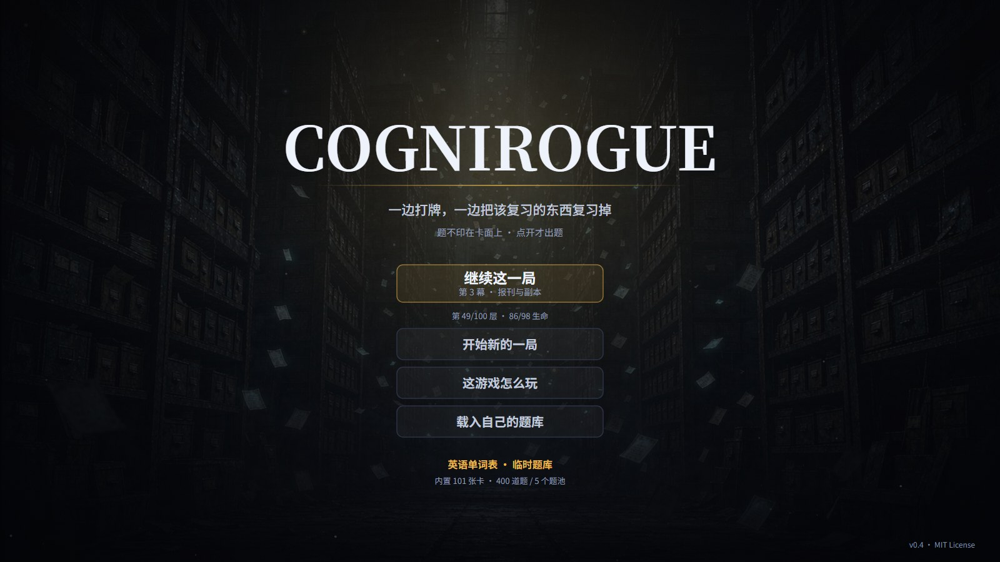
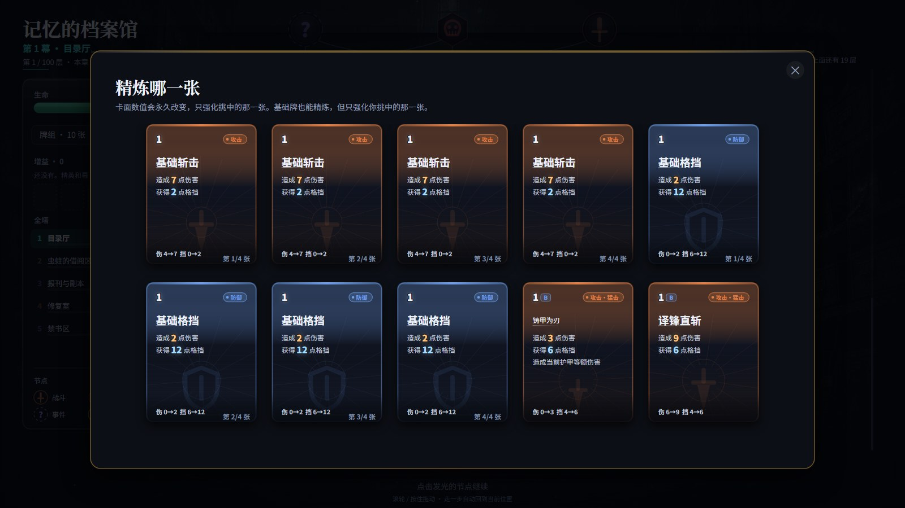
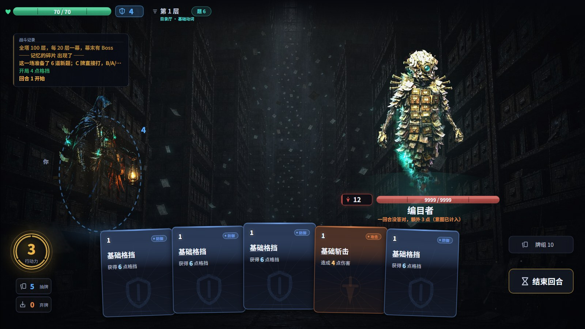
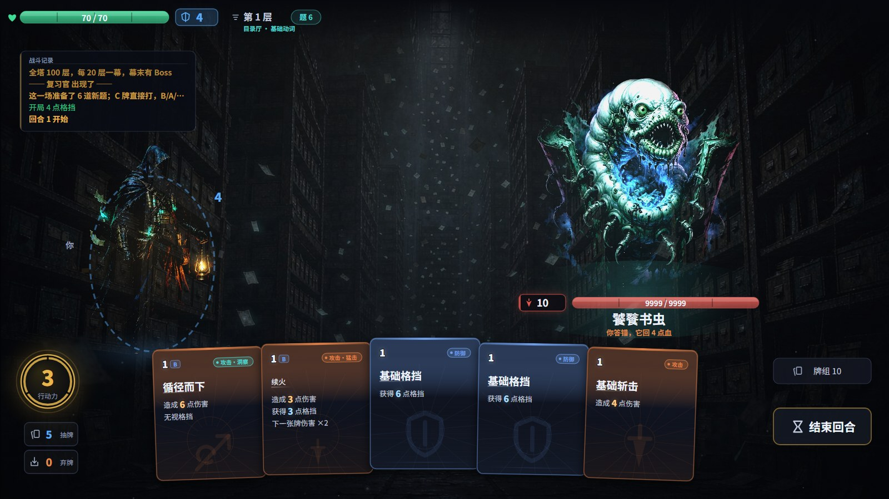
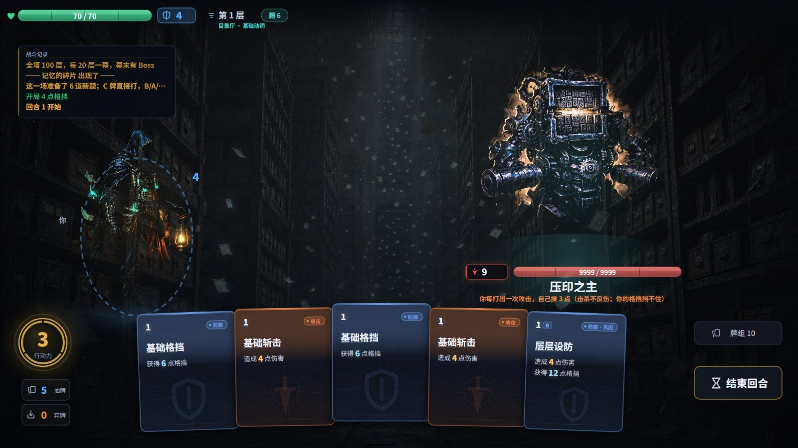
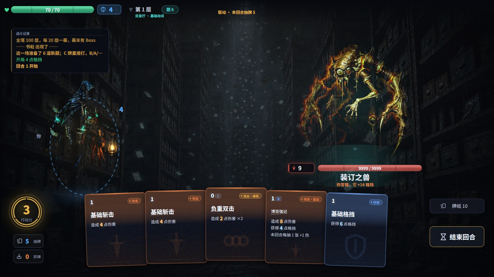

# CogniRogue

**用你的知识爬一座塔。**

一张卡是一张战斗牌，**不是一道题**。卡面效果是固定的。**牌面只讲机械，不讲知识**：
手牌上只有**费用、类别、效果、数值**（费用是左上角那个数：0–3 点，或 X = 花光剩下的全部行动力）——
没有主题、没有知识点名、没有记忆度、更没有题干。
**点开一张需要答题的知识卡，题和选项才出现**：抽的是**当前这一章的题池**，抽到哪道题这一刻才确定。
C 级牌没有答题这一步，点一下直接结算；其余牌答对，这一手按卡面原值结算，并给这张牌攒一次免答；
如果这一局有「借书证」，再退回 1 点行动力。
答错，这一手作废，**但一分行动力都不扣** —— 代价是本场的新题少一道（新题用完会复用问得最少的题）。
答错只有一套价码；开局模式和路上捡到的增益决定你能多顺，不改卡面数值。

**卡牌分四级：C / B / A / S。** 等级不是稀有度，是"这张牌这一场要答对几次才免答"：
C 不用答、B 一次、A 两次、S 三次。等级按费用推导（0 费=C、1 费=B、2 费=A、3 费与 X 费=S），
答对一次攒一次，**攒满之后这一场剩下的时间里它直接打、不再出题**；计数每场战斗清零。
卡面费用右边那个字母就是等级。

六种效果让牌组真的需要取舍：**洞察**无视格挡、**巩固**伤害减半换双倍格挡、**内化**按伤害回血、
**串联**分两段结算、**专注**抽一张牌、**猛击**攻守均衡。效果写在内置卡牌库里，是这张知识点的"性格"。
牌分三类——**攻击**（猛击/洞察/串联/内化）、**防御**（巩固）、**技能**（专注），
卡面徽章上就印着「攻击·洞察」这样的类别 + 效果，卡面的颜色也按这三类走。
（第四类「能力」曾经是增益牌，现在增益不是牌了，见下面「增益是掉落」。）

**牌组分两半。** 开局 **10 张**：**4 张基础斩击（4 伤）+ 4 张基础格挡（6 挡）+ 2 张随机知识卡**。
基础牌不答题、随时可打、**无法从游戏中获取**，但可以在复习点精炼或遗忘。它们是这一局的"地板"——
答错作废之后至少还有牌能打。另一半是**答题换来的知识卡**（101 张内置卡面），
只有这一半能从战斗奖励、事件里拿到；**奖励池里没有斩击和格挡**。
（增益是第三条线：精英掉、整局生效、不进牌组。）
基础牌数值刻意压低：保底不等于变强。
起手那 2 张知识卡限定在 **C / B 两档**（0–1 费）：A / S 只在战后奖励和精英掉落里出现，
否则"开局掷到一张 S 牌"就能一路平推前十几层，难度曲线会被开局那一次随机决定。

**每张牌有自己的名字**（杀戮尖塔那套牌面读法）：「折半之刃」「三度缔约」「一瓢知江」……
牌名是游戏名，刻意不等于知识点名——它呼应卡牌分类但绝不泄露任何一道题的答案。
**卡和题没有映射**：同一个「折半之刃」在这一章可能问到「基础动词」，下一章可能问到
「生活名词」；要知道这一手问什么，只有点开它一条路。
少数牌还带**签名改动**（`mods`）：「双影逐环」打三段、「三度缔约」三连击、「禁令之刺」攻倍率 1.2、
「一瓢知江」抽两张——同一种效果原型，每一张的手感不一样。

**卡牌库和题库是分开的**：101 张卡面（名字、攻挡、效果、`card id`）内置固定，md 文件只提供题目、
可以从标题页导入替换。题库**不限制主题，只限制格式**：`## 主题` 是章节分组，
随便怎么起、写几个都行；导入时只校验题干、选项和答案字母。课程表把来源题库切成五章，
**点开一张需要答题的知识卡，才从当前章的 BANK 抽一道本场没问过的题**（章节名对不上时回退到全部题目）；
而且**每次点开，四个选项都会重新洗牌** —— 要记住的应该是这件事本身，不是"这题选 B"。
内置 **101 张卡 / 400 个单词题 / 5 个题池**（临时单词表），默认课程取其中五章。

节奏由两样东西定价：**每张牌标的费用（0–3 点，或吃光行动力的 X），和「借书证」答对退回的那 1 点**。
有借书证时，1 费牌答对等于免费，2 费净花 1 点、3 费净花 2 点 —— 所以贵牌不是"更强的一手"，
是"更大的一张票"：打对，用一次答题换掉三次答题的输出；打错，这一手白费、还消耗一道新题，
但不扣行动力。没有借书证时，答对只让这一手不白打，不会额外退还行动力。
会的人一回合能把 1 费牌打完，不会的人打两张就没油。

外层是杀戮尖塔那套：**一条能提前看见全貌的分支路线、一副越走越厚的牌组、一串整局生效的增益**。

TypeScript + Canvas 写的，没有 UI 框架。逻辑层（`src/core`）不碰 DOM，所以同一套规则既能在浏览器里跑，
也能在 Node 里跑几千局无头模拟——仓库里的数值都是模拟出来的，不是拍脑袋定的。


## 快速开始

```bash
git clone <this-repo>
cd CogniRogue
npm install
npm run dev          # http://localhost:5178
```

想要一个能直接双击打开的 exe 式单文件：

```bash
npm run build        # 产出 dist/index.html（约 1.8 MB，脚本、样式、美术全部内联）
```

`dist/index.html` 拷到任何地方双击就能玩，不需要服务器、不需要联网。

| 命令 | 作用 |
| --- | --- |
| `npm run dev` | 开发服务器，改代码热更新 |
| `npm run build` | 类型检查 + 依赖方向检查 + 打包成单文件 |
| `npm run sim` | 无头模拟几千局，验证数值 |
| `npm run smoke` | 开真浏览器点鼠标，验证按钮真的能按（需先跑 `npm run dev`） |
| `npm run shots` | 重拍 `docs/` 里这 24 张配图（同样需先跑 `npm run dev`） |
| `npm run check` | 类型检查 + 依赖方向检查（`tools/deps.mjs`） |
| `npm run stage` | 过幕与规则的结构检查（换图/回血/上限/能力作用域，跑一次几百毫秒） |
| `npm run words` | 从词表重生成 `packs/words.md`（改题库只改 `tools/words.mjs` 里那张表） |

## 文档导航

这个仓库的文档分四层，先看哪份取决于你要做什么：

| 文档 | 写什么 | 什么时候看 |
| --- | --- | --- |
| **README.md** | 玩家视角的玩法、当前数值、题库格式、工程入口 | 第一次打开仓库 / 想知道现在怎么玩 |
| **[DESIGN.md](DESIGN.md)** | 机制为什么这样定、哪些东西被删掉、验收标准 | 要改规则、卡牌或增益之前 |
| **[CHANGELOG.md](CHANGELOG.md)** | 按版本记录改动与当时的采样 | 查某个设计是哪一版来的 |
| **[AGENTS.md](AGENTS.md)** | 贡献边界：无后端、无遥测、依赖方向、验证门槛 | 准备提交代码之前 |

README 里标着“旧采样 / 历史”的小节是设计过程记录，**不是当前基线**；当前基线以
「中间那档的完整采样」和 `npm run sim` 的输出为准。

## 一局是什么样

**100 层，5 幕，每 20 层一幕。** 每层 2–3 个节点，一幕之内的路开局就全部可见——
你能提前规划"我要不要绕去那个复习点"。地图一屏显示 8 层，默认把当前层放在下面三分之一，
上面那几行就是接下来能选的路；想看更远就**滚轮往上滚，或者按住地图拖** ——
手动动过镜头之后，它就不会再被"回到当前层"抢回去（右上角会一直提示"上面还有 N 层"，
右侧还有一条进度条）。换幕换一张全新地图。

一局 40 场上下、约 170–275 道题（随水平浮动；每打出一张**需要答题**的知识卡都要现答一道，
C 级和本场已免答的牌除外；答错的那张牌立刻离开手牌，同名的另一张如果还在手里，仍然可以打 —— 它会问另一道题）。
这是长局：打完一局 ≈ 一小时，中途倒下不用重来一遍答题记录 —— 掌握度存在本地，跨局累积。

一局一小时的直接后果是**断点**：每走完一个节点，地图、牌组、血、幕都写进 localStorage，
首页那条带金边的「继续这一局」就是它。只存节点之间（战斗中途的手牌和敌人不存），
存档结构对不上就当没有 —— 关掉标签页不算输。



| 幕 | 场地 | 这一带的规矩 | 幕末 Boss |
| --- | --- | --- | --- |
| 1 | 目录厅 | 什么机制都没有，只教"一张牌 = 一道题" | 编目者 |
| 2 | 虫蛀的借阅区 | 塞杂念、少抽牌 —— 它让你没牌可打 | 饕餮书虫 |
| 3 | 报刊与副本 | 反伤 + 多段轻击 —— 薄刀是在给自己放血 | 压印之主 |
| 4 | 修复室 | 你答错它就叠甲，而且每回合更硬 | 装订之兽 |
| 5 | 禁书区 | 它知道你哪块最弱，每次都往那儿打 | 遗忘 |

每幕的怪是**一整套新物种**（4 普通 / 2 精英 / 1 Boss，共 35 种），不是同一只怪加血。
立绘按幕换色相，Boss 各有专属图。

**每回合抽 5 张**（`BAL.drawPerTurn`）。开局牌组 10 张 = 8 张基础牌 + 2 张随机知识卡，
所以起手那一回合几乎一定能摸到能打的牌；牌组越厚，越可能这一回合摸不到想要的那张——
"跳过，不要卡"才真的是一个决定。


| 节点 | 内容 |
| --- | --- |
| ⚔ **战斗** | 普通敌人，赢了一场从三张卡里挑一张进牌组 |
| ☠ **精英** | 血厚、会格挡、会塞杂念。赢了从三张卡里挑一张，**再掉一个增益**（拾取即生效、整局亮着） |
| ✦ **复习** | 休息回 62% 血 / 精炼一张卡（攻/挡底数 +3，只改挑中的那一张）/ **永久删掉一张卡** |
| ? **事件** | 四段小故事：散落的索引卡、旧笔记本、守夜人、长明灯廊。有的要付代价，有的只是给你一个选择 |
| ✺ **Boss** | 每幕一只，打赢换幕：新地图、血回满、上限 +14、再掉一个增益。第五幕那只打完才通关 |

<p align="center"></p>

<p align="center">
  
  
  
</p>

复习点的精炼面板是**按张**列的：牌组里四张基础斩击就是四个格子，卡面底下写着"伤 4→7"，
点哪一格就只有那一张变成 7 伤：

<p align="center"></p>

五幕的 Boss 各有一张专属立绘，而且**体量比普通怪大一圈**（512px vs 430px）——
幕末那只必须在第一眼就和别处不一样：

<p align="center">
  
  
  
  
</p>

**牌组构筑是这一层最像杀戮尖塔、也最适合学习场景的地方。** 每打赢一场就往牌组里加一张知识卡，
牌组越厚，你越难抽到想要的那张——"跳过，不要卡"经常是正确选择。
复习点的**删卡**是构筑里最被低估的一步：主动放弃一个你这一局不打算碰的知识点，牌组就更好抽。
那 8 张基础牌**可以精炼、也可以遗忘**：它们是这一局的地板，不是圣物。
把一次精炼花在基础斩击上（4 → 7 伤）、或者丢掉一张基础格挡去换知识卡，
都是合法的构筑决定 —— 只是那次机会就没有花在知识卡上。
**精炼是按"张"算的，不是按牌名**：牌组里四张基础斩击是四张独立的牌，挑哪一张就只改哪一张，
另外三张还是白板。面板上每一份副本各占一格，卡面上直接写着"伤 4→7"（选完之后的数值），
所以点下去之前就知道买到了什么。精炼过的那一张在牌组里带一个 `+`。
唯一的硬底线是**牌组不能删到 4 张以下**：再少，每回合抽 5 张就只是在重复抽同一批牌。
它们**无法从游戏中获取**：奖励池、事件、精英/Boss 奖励都不会产出斩击和格挡。

### 初始牌组与三类牌

牌分两个来源、三个类别：

| 来源 | 有哪些 | 能不能拿到 |
| --- | --- | --- |
| **初始牌组** | 4 张基础斩击（1 费 4 伤）、4 张基础格挡（1 费 6 挡）、2 张随机知识卡 | 开局自带；基础牌**游戏中无法获取**，但可以精炼 / 遗忘 |
| **游戏中获取** | 101 张知识卡 | 战后奖励、事件；**不会产出基础斩击 / 基础格挡** |

增益不在这张表里：它不进牌组，见下面的「增益是掉落」。

获取的牌按"干什么"分三类（`cards/kinds.ts` 的 `cardType()`，卡面徽章上直接印着）：

| 类别 | 卡 | 它解决什么 |
| --- | --- | --- |
| **攻击** | 猛击 · 洞察 · 串联 · 内化 | 把行动力换成伤害（内化再按伤害回血） |
| **防御** | 巩固 | 把行动力换成格挡（伤害减半、格挡翻倍） |
| **技能** | 专注 | 伤害偏低但抽一张牌——处理"手上没牌了" |

（曾经还有第四类「能力」＝增益牌。增益现在不进牌组，所以这一类没了。）

**这一版新增的 14 张牌不问“数字够不够大”，而问“现在付不付”。** 其中七张带
**自伤**：伤害/格挡高于同费，但打出后自己失去 2–5 点生命（`mods.selfHp`，卡面单独写
「失去 X 点生命」，不塞进费用栏）。另外七张是 0 费过牌、低费高挡、三连段和一张
高费收尾：它们让“先打哪张、留哪张、这回合要不要空过”变成真实的排序问题，
而不是把 87 张牌扩成 101 张同效果的数值表。

**为什么要有基础牌。** 知识卡大多要答题（0 费 C 级除外），答错这一手就作废；于是"不会"的代价会变成
"什么都不能做"——手里全是答不对的牌，这一回合一张都打不出去。基础牌是这条下限：
它不答题、随时可打，保证你**不会卡死**，但数值只有 4 伤 / 6 挡，所以它绝不保证你**打得赢**。
想赢还是得答对题，把知识卡打出去。

**基础牌为什么是 4+4。** 起手 10 张、每回合抽 5 张，抽到基础牌就等于少抽一张知识卡。
少于 8 张，开局几回合会频繁出现"手里全是够不着的知识卡"；多于 8 张，牌组会被稀释成
"一半是保底牌"，构筑就没有空间。4 斩击 + 4 格挡是"够兜底、但不替你赢"的那一档。

### 增益是掉落，不是牌

它们是原来那几件"遗物"。中间做过一版"变成牌"（要抽到、要付费用、要占牌位），
这一版又收了回来：**精英和幕 Boss 各掉一张，捡起来就整局生效** —— 不进牌组、不花行动力、
也不需要抽到。右上角那一排，就是这一局已经会了什么。

| 增益 | 效果 |
| --- | --- |
| 借 借书证 | 每次答对，退回 1 点行动力 |
| 时 沙漏 | 每场战斗的第一回合，行动力 +1 |
| 索 索引卡 | 手牌少于 3 张时，每回合多抽 2 张 |
| 镜 双面镜 | 每回合第一次答对，抽 1 张 |
| 灯 长明灯 | 每回合开始获得 1 点格挡 |
| 镇 镇纸 | 每场战斗开局多 2 点格挡 |
| 折 折角 | 每场战斗第一回合多抽 2 张 |
| 课 课表 | 每回合第一次打出基础牌，获得 1 点格挡 |
| 贴 便签 | 战后选卡多一个选项 |
| 角 护角 | 精英 / 首领战开局多 4 点格挡 |
| 胶 修书胶 | 复习点回复量 +18% |
| 压 压书石 | 每张牌的伤害 +1 |
| 规 校规 | 每张牌的格挡 +1 |
| 夜 夜灯 | 每次受到攻击，伤害 -1 |
| 板 板书 | 每回合多抽 1 张 |
| 页 索引贴 | 回合结束时保留 2 点格挡 |
| 印 藏书印 | 每击杀一个敌人，回复 3 点生命 |
| 茶 茶 | 过幕时最大生命额外 +10 |
| 挡 书挡 | 同一种卡的上限 +1 |
| 羽 羽毛 | 回合结束时若没有格挡，获得 2 点格挡 |
| 墨 墨水瓶 | 每回合第 3 张牌打出时，抽 1 张 |
| 档 档案盒 | 每次洗牌，获得 2 点格挡 |

每场一次（17）：

| 增益 | 效果 |
| --- | --- |
| 订 装订线 | 每场战斗第一次答错，伤害和格挡按一半结算 |
| 笔 荧光笔 | 每场战斗第一次答对，退回的行动力 +1 |
| 签 书签 | 每场战斗第一次答对，获得 2 点格挡 |
| 擦 橡皮 | 每场战斗第一次答错，补 3 点格挡 |
| 套 书套 | 每场战斗第一次答错，稳固度不降 |
| 稿 草稿纸 | 每场战斗第一次答错，补抽 1 张 |
| 镜 放大镜 | 每场战斗第一次答题，去掉一个错误选项 |
| 注 批注 | 每场战斗第一次答对，稳固度额外 +2 |
| 壶 胶水壶 | 每场战斗第一次答错，那张牌回手牌 |
| 蜡 封蜡 | 每场战斗第一次受到攻击，伤害减半 |
| 针 回形针 | 每场战斗第一次打出 3 费及以上的牌，退回 2 点行动力 |
| 哨 口哨 | 每场战斗第一回合，敌人的第一次攻击落空 |
| 毡 毡垫 | 每场战斗第一次洗牌时，清掉弃牌堆里的 2 张杂念 |
| 毫 毛笔 | 每场战斗第一次答对，这张牌额外结算一次 |
| 拍 节拍器 | 每场战斗第一次一回合打出 3 张牌，退回 1 点行动力 |
| 油 亮油 | 每场战斗第一次打出 0 费牌，抽 1 张 |
| 种 种纸 | 每场战斗第一次打出攻击牌，获得 2 点格挡 |

每幕一次 / 整局一次 / 拾取即结算（8）：

| 增益 | 效果 |
| --- | --- |
| 账 账本 | 每幕第一次战后奖励多一个选项，并让选中的牌直接精炼 |
| 图 地图册 | 每幕第一次复习，额外回复 15 点生命 |
| 愿 许愿条 | 整局一次：致死时以 35% 生命活下来 |
| 脊 书脊 | 最大生命 +18，并立即回复 18 点 |
| 票 藏书票 | 立即获得 2 张随机知识卡 |
| 刀 裁纸刀 | 立即移除 2 张基础牌 |
| 脂 树脂 | 所有基础牌立即精炼 |
| 亮 抛光布 | 精炼一张牌的加成 +2 |

<p align="center">
  
  
</p>

**为什么又变回白给。** 上一版把它们做成牌，是想让"这一回合先答题、还是先点灯"成为取舍。
实测结果是一局只落地两三个，而玩家经常整局没见过自己挑的那一个 —— 抽不到、付不起，
或者这一场打完它就没了。掉落版的取舍换了位置：**精英打不打**成了唯一的门槛，
打下来就是你的，一直亮到这一局结束。

**四十七条，但难点不在数量上。** 一局会走过十来个精英 / Boss，池子按这个数量配。
数量上去之后单条的强度必须下来，否则一堆白拿的增益等于一条额外的血条：
长明灯只给 1 点格挡、沙漏只在第一回合给 1 点行动力、索引只在你上一回合打空了才补牌。
不带增益的 800 局是 0/1/2/2，带满是 2/9/23/28 —— 掉落不是锦上添花，
而是长局的续航；也正因为如此，增益不能继续无上限地加，单条强度要按总量除回来。

十八条的时候有一个更麻烦的问题：**一半的牌挂在"每场战斗第一次答对 / 答错"上**。
一局捡到八九张，同一个瞬间会有两三张抢着响，玩家根本听不出是哪一张在起作用。
所以扩到四十七条时不是往里继续加，而是按**作用域**分五档（见 `PowerScope`）：

| 作用域 | 多久兑现一次 | 张数 | 加牌时要改的地方 |
| --- | --- | --- | --- |
| `always` | 每张牌 / 每回合 | 22 | `powers.ts` 的 `rulesOf` 一行 |
| `fight` | 每场一次 | 17 | 在结算点调 `onceThisFight(id)` |
| `stage` | 每幕一次 | 2 | 调 `onceThisStage(id)` |
| `run` | 整局一次 | 1 | 调 `onceThisRun(id)` |
| `instant` | 拾取那一刻 | 5 | `powers.ts` 的 `applyInstant` 一个分支 |

这张表不是文档，是**守门依据**：`npm run stage` 会逐张验"声明了 `always` 的牌是否真的
改了 `rulesOf` 的某一项""声明了 `fight` 的是否真的第一次 true、第二次 false"
"声明了 `instant` 的是否真的改了这一局的底盘"。一条定义写得再漂亮，
结算层没读它，构建就会当场红 —— 那才是"扩充到四十七张"最容易出的错。

三条规则把它和牌分开：

1. **不进牌组。** 它不占牌位、不稀释抽牌，所以"拿不拿"不是一个决定 —— 面板上也就没有「不要」。
2. **不等抽牌。** 掉落那一刻就生效，面板只是把刚才掉的东西念给你听。
3. **整局有效。** `G.powers` 只在开新局时清空；一场打完不会失效，这是它和"本场增益"的区别。

它们从哪来：**精英和幕 Boss 各掉一个**，一种只有一个。池子空了就不再掉（不叠层、不塞重复的），
精英奖励仍然保留那张知识卡，不会静默跳过。

### 敌人会提前告诉你下一步

这是从杀戮尖塔搬过来最值钱的一条：**意图透明**。每个敌人有固定的招式循环，出招前就能看见——

> 意图：攻击 12×2　/　意图：获得 12 点格挡　/　意图：往你的弃牌堆塞 1 张杂念

于是随机从"被偷袭"变成了"可规划"。几种具体机制：

- **复习官**：一回合内没有真正答对任何一张卡，额外打你 3 点 —— 不答题就没有输出。
- **回声 / 镜像**：攻击**穿透一半格挡**，堆格挡这一套对它们不好使。
- **熵**：往你的弃牌堆塞**杂念**——占手牌位、打不出去、回合结束时自己散去。半懂不懂的知识就是这副样子。
- **审视者**：会格挡。想靠一回合爆发带走它，得先把那层挡住。

## 六种效果：牌不再只是数值

第一版所有卡都是"造成 X 伤害 + 获得 Y 格挡"，除了数字高低没有任何区别，一手牌读起来像一排同款。
现在每张卡挂一种**效果**，它决定底数怎么花出去：

| 效果 | 机制 | 什么样的知识点配它 |
| --- | --- | --- |
| **猛击** `strike` | 攻 ×1.0，挡 ×0.7 | 没有偏科的基准卡 |
| **洞察** `pierce` | 攻 ×0.95，**无视格挡** | 结论是"一定 / 必然"的知识，看穿表象 |
| **巩固** `guard` | 攻 ×0.6，挡 ×2.0 | 防线、稳定、不退化 |
| **内化** `drain` | 攻 ×0.85，按伤害 50% 回血 | 把知识换成自己的血，长局最耐用 |
| **串联** `chain` | 攻 ×0.52 × **2 段** | 知识点本身就是"两件事的组合" |
| **专注** `focus` | 攻 ×0.7，**抽 1 张** | 讲节奏、摊还、预留空间 |

效果不是随机贴的标签，是内置卡牌库里逐张定死的：`eff: 'pierce'` 就走洞察那套折算，导入题库改不了它；六种倍率见 `model/effects.ts`。
个别牌再挂一层 `mods`（如 `{ atkMul: 1.2 }`、`{ draw: 2 }`）做签名改动，展示和结算读同一份，卡面写的和实际发生的不会两张皮。
它把这副牌从"一条数值曲线"变成"一组取舍"——精英会格挡，洞察这时候才值钱；
血线吃紧，内化比猛击耐用；手里只剩两张牌，专注能把你这一回合接上。

<p align="center"></p>

### 打出去的那一下

答对之后不是"血条少了一截、然后弹个框"，而是先打完这一手：人物从提灯里甩出一道光刃，
飞过去、命中、敌人被击退，**演出演完了反馈面板才出来**。挡在面板后面演等于没演。

- 光刃的形状跟着效果走：洞察是一道连到手上的**直光束**，其余是**弧形拖尾**；
  串联的第二段会换一条更高的弧线，眼睛能数出"打了两下"。
- 命中是四件事同时发生：星芒闪白、火花四散、屏幕震动、伤害数字弹出。
  多段伤害的数字会错开位置，不然 `4` `4` 会被念成 `44`。
- 演出期间输入被锁住（`setInputLock`）——面板还没弹，但底下的牌和牌堆已经画出来了，
  不锁的话玩家能点到"还没轮到他"的东西。敌人出手时同样锁，见下一节。

<p align="center"></p>

### 敌人也要真的动

以前敌人回合几乎是静默的：只有**真的掉血**才发一个 `hurt` 事件。于是格挡全挡下、举盾、
塞杂念、变强、第一回合的观察期，玩家只能从左侧日志里倒推"它刚才是不是动过"。
现在 `endTurn` 的五个分支统一发一个 `enemyAct` 事件，带上动作类型和结算数值，表现层按类型编排：

| 意图 | 身体 | 看得见的东西 |
| --- | --- | --- |
| 攻击 | 后撤蓄力 → 前冲 | 红色光刃飞向你；**多段攻击分几次飞** |
| 攻击被全挡下 | 同样冲过来 | 光刃变蓝，落地是**盾环 +「全挡下」+「吸收 N」**，不爆红、不掉血数字 |
| 获得格挡 | 后缩 | 蓝色护盾从外往里收，脚下升起一层蓝雾 |
| 塞杂念 | 前倾 | N 张紫色问号牌**真的从它手里飞到左下弃牌堆** |
| 攻击变强 | 涨大、泛橙 | 两圈向外扩的红橙环 + 上升的火星 |
| 观察期 | 微微收住 | 一圈慢慢转的青色虚线 +「观察中…」 |

<p align="center">
  
  
  
</p>

**为什么把"动作"而不是"结果"做成事件。** 结果类事件（`hurt` / `enemyBlock` / `junk`）
天然只在有数值变化时才触发，而"敌人举起盾""它忍住没出手"恰恰是**没有玩家侧数值变化**的动作——
用结果当事件，这些就永远静默。换成动作事件之后，五个分支都得发声，表现层自己决定演多大声。

还有一个时序坑：`endTurn` 是同步的，事件发出来时 `startTurn` 已经把下一回合的手牌抽好了。
不压住抽牌动画，两拨飞行物会叠成一团，玩家分不清谁在动。所以敌人演出期间**新手牌先留在牌堆**，
等这一下演完再依次飞进来；同时输入被锁住，玩家不会在光刃还在飞的时候点开下一张牌。

> 配图是 `?dev=foe:atk` 这类入口真跑一次 `endTurn` 拍的：血条、弃牌堆、头顶意图都是真的，
> 不是单独盖一层特效。招式表被固定成单招循环，所以气泡和演出是同一件事。

**答错则相反：没有任何东西朝敌人飞过去。** 这条是刻意的——只要画面上有东西冲向敌人，
玩家读到的就是"打了，只是没伤害"，那是另一件事，而且是错的。所以反馈落在**出手的地方**：
提灯的焰暗一下再回来，一小撮屑在原地散开（亮屑上飘、暗屑下坠），配一圈暗红环和轻微震屏。
朝敌人的方向必须是空的，**"什么都没飞出去"本身就是最重要的那条信息**。

## 核心机制：一道题，一次结算

卡面上的效果和数值**永远不会因为模式变化**——模式只决定开局带几个增益，不改卡面，也不改答错价码。一次出牌只有一件事要决定：

```
手牌（类别·效果徽章 + 数值；题不印在卡面上）
   ├ 基础牌 → 点一下直接打：不答题、不退款，4 伤 / 6 挡
   ├ C 级 / 本场已免答的知识卡 → 点一下直接结算
   └ 其他知识卡 → 点一下
              ▼
        答题面板：一道题、2–4 个选项（从当前章的 BANK 抽一道本场还没问过的新题；
                  新题用完再复用问得最少的题）
              │ 答
              ▼
        答对 → 卡面效果按原值结算；有借书证时费用退回 1 点（1 费牌 = 免费）
        答错 → 效果作废，这一手不花行动力也不退行动力（它只是没打出去），
               代价是本场的新题少一道；新题用完会复用问得最少的题
```

**点开一张需要答题的牌，就是承诺问一道题。** C 级牌和本场已免答的牌不在这条路上。
中途退出只能取消（Esc / 面板右上角的 ×），
但那道题已经从新题池里划掉，取消不是免费换题 —— 牌还在手里，题已经少了一道。

### 唯一的一套答错规则，开局选一个模式

答错只有一种价码，不再由模式决定：

- 这一手**作废**：不出伤害、不扣行动力
- **不补格挡、不补抽** —— 手牌真的少一张
- 牌**进弃牌堆**，要等洗牌才回来
- 稳固度按 ×0.35 掉；答对按 ×1.15 涨

不扣行动力是明确的选择：错的代价已经落在"本场少一道新题"上，再扣一次等于同一个错误收两次钱，
而且会让人不敢碰不会的知识 —— 正好和这个游戏的目的相反。

**开局选的不是一个单张增益，是一个模式。** 首页点"开始新的一局"，三个模式里挑一个：

<p align="center"></p>

| 模式 | 初始增益 | 个数 | 定位 |
| --- | --- | --- | --- |
| **学习** | 借书证 + 课表 | 2 | 有退款、有基础牌格挡，最稳；基础牌不答题也能打 |
| **复习** | 借书证 | 1 | 只保留经济地基，没有额外防御 |
| **测试** | 无 | 0 | 退款和防御都要靠路上捡，最高难度 |

这些增益直接进 `G.powers`，和路上捡到的增益走同一条通道 —— 战斗顶栏、增益列表、结算页
都会一直显示。模式本身不改答错规则：答错永远是这一手作废、不扣行动力、消耗一道本场新题。

**为什么又回到三模式。** 早期那套三模式改的是"答错补多少格挡、补不补抽、牌去哪"，规则分散，
而且选完就消失。现在三模式只回答一个问题：**这一局开局给你几个增益**。学习 2 个、复习 1 个、
测试 0 个，难度靠这个数量递进，不靠改卡面或改结算。

零初始增益的测试模式不是"不能玩"：基础牌不答题、随时可打，行动力仍然每回合 3 点；
只是没有退款和防御兜底，得靠路上捡到的增益把这一局搭起来。

<p align="center"></p>

<p align="center"></p>

### 押注机制被删掉了（v0.3）

之前这里写的是"识记 / 理解 / 迁移"三档：档位不改伤害，只改这一手的节奏收支，而且只能往上换。
那套设计是自洽的，但它是**拿节奏当赔率**，代价有两条：

1. **三档会塌成一档。** 赔率一旦不对称（曾经是净 +3 对净 −3），理性解就是"永远压满"；
   修成对称之后又是另一个问题——正确率过 50% 的人永远压迁移，另外两档只是给新手看的教学关。
2. **它把"会不会"变成了"敢不敢"。** 押注的决策点在看清题之前，玩家只能靠自己对知识点的把握猜难度；
   猜错的代价是行动力，于是"变强"的方式变成"更会估自己"，而不是"更懂这个知识点"。

删掉之后只剩一条规则：**答对了这一手不花行动力**（后来精确成"有借书证时退回 1 点"，1 费牌仍然是免费）。
那一版（v0.3，卡池还只有 13 张）的技巧曲线是
5% → 28% → 56% → 67%，细节见下面的历史采样。

<p align="center"></p>

死亡不会掉知识等级，只是这局的资源没了。下一局开局前选学习 / 复习 / 测试；起手固定 10 张
（8 基础 + 2 随机知识卡）。

## 答题：只接在三个接口上

知识卡**不锁**。从第一回合起，它们和基础牌一样摊在你手上，区别只有一条：
**除了 0 费 C 级牌，打出去要答一道题**；A/B/S 攒满免答后，这一场剩下的时间也直接打。

- **答对** → 卡面效果按原值结算；有借书证时退回 1 点行动力。
- **答错** → 这一手作废，不扣也不退行动力，消耗掉本场的一道新题；**不补格挡、不补抽**，
  牌进弃牌堆 —— 手牌会真的少一张。

<p align="center"></p>

答题不是"这张牌的开关"，它只改三样已经存在的机制：**行动力**（退回 1 点）、**手牌**
（答错少一张、不补位）、**敌人**（书蛀吃失误回血、忘川吞遗忘加攻、复习官罚整回合没答对、遗忘 Boss
抓你错最多的主题）。**没有第四样：卡面之外不再乘任何倍率。**

带机制的怪，血条下方常驻一行说明（"你答错，它回 4 点血"）。触发条件和数值都写在
玩家做决定的位置上 —— 机制不靠战斗日志考古，也不该让人打到一半才发现血条在往上走。

这一版删掉了三样东西，理由是同一条——它们不在机制里：

| 删掉的 | 它曾经是什么 | 为什么删 |
| --- | --- | --- |
| 本场解锁 | 答对一次，这个卡种本场都能免答打 | 一场只有 2–3 回合，收割窗口比洗一次牌还短：实测免答 1.8 次/场，这个承诺几乎从不兑现 |
| 免答 ×1.5 | 卡面之外的第二层倍率 | 它让卡面数值变成"某状态下的值"，整张表失真，最后得靠压低敌人血量去补 |
| 卡种作废 | 答错一次，这个卡种本场都打不出去 | 没收工具。玩家唯一的应对是"别碰不会的牌"，正好和这个游戏的目的相反 |

失去 ×1.5 之后，"答对率 → 输出"这条线只剩一条腿：**行动力**（现在由借书证提供）。这带来一个更陡的曲线，
也带来一个更干净的关系——答对率高的人一回合能把牌打完，答对率低的人两张就没油。
实测曲线见「数值是怎么定的」。

**唯一的缓冲是开局那 4 点格挡。** 第一回合手里全是没答过的牌，那 4 点是给"还没开始挡"垫的；
答错本身一格挡都不补 —— 连本身带格挡的牌也不补。理由和上面删掉 ×1.5 是同一条：
补偿一旦按"这张牌自己能产生多少格挡"算，每张卡身上那个 `blk` 档位（同价位牌的格挡底数）
就会悄悄变成白送的甲，而卡面上看不出它是哪来的。

删掉的东西也值得记一笔：**连击没了**。原来"同主题连续答对 ×1.8"是靠抽牌顺序吃饭的，
还鼓励块状练习（而交错练习在辨别类知识上明显更好）。同样是把"会"换成伤害，退款是靠答对，
连击是靠牌发得好——所以后者让位。

## 结算面板：这一局的伤害是怎么来的

押注没了之后，结算页不再问"你押得准不准"，改问一件更硬的事：**这一局你答了多少题、
对了几成、答错了几次。**

<p align="center"></p>

- **答题出牌 / 正确率**：本局被问了几次、对了几个。
- **本章答题**：最后一章打到现在答了几道 —— 题从这一章的题库抽，和牌组无关。
- **答对抽牌**：双面镜在场时，答对后多抽到的那几张 —— 知识变成"看见更多可能"的证明。
- **开局模式 / 答错的牌**：这一局选的是学习、复习还是测试，以及答错了几次。价码只有一套，
  结算页不再需要解释"你是按哪档结的"。
- 再加上**章节掌握度**（五章平均）、牌组构成、走过的节点。

正确率 ≥80% 时结算页会直接说"后半场你不是在赌，是在用记住的东西打仗"；60–80% 是"半懂"，
提示你把错得最多的章节连着答两轮；低于 60% 则是"这副牌是借来的"。

## 数值是怎么定的

`BAL`（敌人强度、行动力、答对退款、回血比例）和 `MISS_RULE`（唯一答错价码里的稳固度系数）不是拍脑袋定的。
`npm run sim` 会把同一套 `src/core` 规则打包到 Node 里，默认走**玩家真实路径**：完整五幕、
战后拿卡（挑一张最划算的，牌组到 14 张就停）、血线够就进精英、事件选收益项。
旧路径（跳过奖励、绕开精英、事件一律离开）用 `--path=old` 复现；
只关掉战后拿卡用 `--take=0`。

**当前基线：800 局真实路径，2% / 9% / 23% / 28%，四档仍然单调。**
复现用 `SIM_SEED=42 npm run sim -- --runs=800`；不设种子时每格会有几个百分点的采样漂移
（熟练这一档实测在 19–23% 之间跳过），所以判断"有没有变"要同种子对比。
平均到层是 28 / 45 / 59 / 66；新手到入门差 17 层，入门到熟练差 14 层，
熟练到精通差 7 层。`BAL.hp = 0.55`、`BAL.hpType = 1.10`、`BAL.dmg = 1.24`；
`hpType` 只给精英 / Boss 加厚，普通战斗仍按普通血线走，目的是让 A/S 免答有足够长的战斗兑现
（当前 A/S 免答 2.6–2.9 次/局，约 1.25 次/场）。

**新手 2% 不是回归，是规则形状。** 答错不补垫子、也不补抽，低正确率的人两回合就把手牌打空；
一旦基础正确率过 55%（入门），退回的行动力开始滚起来。中间这道陡坡是"答对 → 多打一张"
这条唯一杠杆造成的。`npm run sim` 的验收断言盯的是"上两档必须高于下两档"，而不是绝对高度。

**100 层把"绝对值"整体压低了，这是有意的。** 8 层时精通档能赢 90%，现在真实路径是二十多个点。
一局近四十场，任何一次失误都会被后面的路放大；赢一次是一座塔，不是一场架。
如果觉得太难，先调 `BAL.restPct`（回血）而不是敌人血量 —— 后者会把"挡"这个动作变成摆设。

**答错的格挡补偿被整条拿掉了。** 8 层时"答错补全额格挡"没问题，但 100 层之后它变成永动机：
答错不仅不亏，还白得一层甲，技巧曲线在熟练 / 精通之间直接反转。先降到六成、再按档分比例，
都只是把问题往后拖；现在**一格挡都不补**，连本身带格挡的牌也不补。
代价改由"手牌真的少一张 + 错牌进弃牌堆"承担 —— 这两项不会自己滚成永动机。

**每回合抽 5 张是个调整过的默认值。** 早先抽 6 张：起手牌组只有 10 张，等于每回合看见 60% 的牌组，
牌组构筑几乎没有意义。改成 5 之后，同一份牌组一回合只看一半，跳过奖励卡、删卡这两件事才真的
开始影响手感。

**一百层这一轮：伤害 1.42 → 1.24，回血 32% → 62%，Boss 血线 −15%，复习点变密。**
四条改动是同一次调整，理由见 DESIGN.md 的「一百层的血量账」：玩家一侧的格挡是常数
（一张巩固 6–8 点），而一局多了五倍战斗，所以敌人**伤害**不能跟着涨，
否则中后期"挡"这件事直接失效。强度改由**每一幕自己的血线**承担（普通怪 50 → 110），
层号再叠一条 `BAL.growth` 的开方缓坡（见 DESIGN.md「强度必须跟着层号走」）。

**删掉"免答 ×1.5"那一轮留下的结论仍然成立**：卡面数值第一次真正等于打出来的数值，
所以补偿项可以收手。这一轮唯一新增的旋钮是 `restPct`（复习点回复比例），它只改"这段路
能走多远"，不改任何一张牌的数字。

### 费用是怎么定的

几条旋钮，一条一条试出来的（现行基线取上面 800 局；其余行是旧基线采样，每组 40 局，仅作方向对照）：

| 改动 | 新手 | 入门 | 熟练 | 精通 | 结论 |
| --- | --- | --- | --- | --- | --- |
| **现行数值**（hp 0.55 + hpType 1.10 + 开方血线曲线，3 点行动力，答对退 1 点） | 2% | 9% | 23% | 28% | 基线（800 局，真实路径，统一规则） |
| 旧基线：敌人血量 0.26（`--hp=0.26`） | 13% | 15% | 23% | 22% | 熟练反超精通 |
| 旧基线：敌人血量 0.14（`--hp=0.14`） | 31% | 40% | 41% | 46% | 四档挤在一起，技巧不再区分 |
| 旧基线：敌人血量 0.09（`--hp=0.09`） | 46% | 60% | 64% | 70% | 太松，塔失去了分量 |
| 答对**不**退（`--rf=0`） | 0% | 0% | 0% | 0% | 全线归零，平均到层 10/24/34/32 |
| 行动力 4 点（`--ap=4`） | 8% | 55% | 45% | 65% | 几乎必胜，而且不单调 |

（后两行是**旧血线**下的采样，只作方向对照 —— 趋势和结论没有变，绝对值不可直接比。）

- **血量那三行是旧基线采样**：当时 `BAL.hp` 还是 0.20。现行基线是 **0.55**，
  和 `hpType 1.10`、开方血线一起把四档拉开（见上表第一行）。
  扫一格只需 `npm run sim -- --hp=0.22 --runs=400`，不必改源码；`--hp` 是绝对值，不是倍率。

- **退款那 1 点是承重墙，所以学习 / 复习开局直接带「借书证」，测试不带。** 没有它时，
  四个水平是 1% / 9% / 19% / 26%（400 局，测试模式），平均到层 26 / 46 / 60 / 66；
  只带借书证（复习模式）是 4% / 25% / 47% / 59%，再加课表（学习模式）是
  7% / 29% / 53% / 66%（400 局）。没有"答对 → 多打一张"这条路，一回合只能打三张，
  四十多场之后必然崩 —— 这正是测试模式会成为最高难度的原因。
  它不是一张普通随机掉落，而是学习 / 复习两个模式的初始能力。
- **行动力只能给 3 点。** 4 点时入门就能赢 55%（比熟练还高，因为长局里"多打一张"的
  收益被随机性盖住了）；2 点时谁都过不了 50 层。3 点刚好让"1 费牌答对免费"能连打三张，
  而"3 费牌"必须拿掉一整回合。
- **8 张基础牌 + 分级免答，要补的是血线，不是伤害。** 起手 10 张里 8 张不答题，
  每回合能答的题少了一半；C/B/A/S 攒满直接打又把后半程的答题量再压一层。
  敌人血量还是按"每回合 2–3 道题"定的，所以 0.55 才拉得开四档。
  **这一档只动 `BAL.hp`，`BAL.dmg` 保持 1.24。**

- **X 费牌不多给倍数。** 它按当前行动力结算，3 点就是三倍——和 3 费牌同价同效，
  区别是**它把剩余行动力一次性变现**，适合回合末尾的"清零"，不适合开局。
  这是"1 费 ×3"做不到的事：三张 1 费牌要抽到三张，X 费牌只要一张。

### 中间那档的完整采样

`npm run sim` 一局到底长什么样（800 局，当前构建）：

```
水平     基础正确率   胜率      平均到层    答题/局    答对抽牌/局   答错/局
新手     35%          2%        28.3        169.1      2.8           110.2
入门     55%          9%        45.4        237.0      13.3          107.0
熟练     72%          23%       59.0        271.5      21.9          75.4
精通     88%          28%       66.0        272.6      27.4          32.5
```

**「平均到层」是 28 / 45 / 59 / 66。** 新手到入门差 17 层，入门到熟练差 14 层，
熟练到精通差 7 层；扩容后四档仍然单调，低档爬坡更陡，高档把差距收在 Boss 前。

**「答错/局」从 110 掉到 33，是四列里拉得最开的一列。** 规则合并之后答错不再有垫子、
也不再补抽，所以答错次数直接决定你能站多久 —— 它比胜率更早地说明了"水平差在哪"。

**「答题/局」在 169–273 之间，随水平升高而增加。** 新手更早倒下，答题总量自然少；
高水平的牌组更厚、走得更远，答题量反而更大。这是"活得久"和"答得多"的同一件事。

表里是 **101 张内置卡 + 每幕一套章节题库 + C/B/A/S 分级** 之后的采样。卡池恒定、
模拟用的来源题库固定 400 道，每一幕只抽当前章的题；起手固定为 8 张基础牌 + 2 张随机知识卡，
这条曲线只在答错价码和稳固度上被量过；外部题库不限主题，但模拟始终喂同一份内置题库，
所以这里采样波动只来自随机与关卡。

（`npm run sim -- --runs=800` 可以把每格样本加到 800 局；
`--hp --dmg --ap --hand --start --calm --rf --take --deck` 都能从命令行扫，试一个数值不用改源码。
`--take=0` 只关掉战后拿卡；`--path=old` 复现旧路径（绕开精英、事件离开），`--deck=20` 控制牌组目标厚度；
`--fresh=1` 每个水平重置记忆、`--freshrun=1` 每局重置，用来模拟"第一次打开这个题库"。）

最后一列（答错/局）只说明这一局挨了多少次错，不跨组比较。

判据只有一条，写进脚本最后一行自动断言：**上两档的胜率必须高于下两档**。
底部低（新手 2%）是规则形状，不是回归 —— 但它不能成为"整条曲线是平的"的借口。

这条判据这次又救了一次设计：押注删掉之后，如果顺手把"答对退款"也删掉，**当时每回合 5 点行动力**下
72% 和 88% 水平的胜率会挤在一起（69% vs 70%）——因为"一回合能打几张"被行动力钉死了，
答得更准换不出更多输出，知识就不再是瓶颈。**行动力必须买"犯错次数"，不能买"出牌次数"**，
技巧才有地方兑现。这条是模拟跑出来的，不是想出来的。

增益的历史改动（遗物 → 增益牌 → 掉落即生效）和当时采样见 [CHANGELOG.md](CHANGELOG.md)；
README 只保留当前结论：掉落不进牌组、不花行动力，池子是 47 个，强度按“总量除回来”控制。

> 下面这几组是 v0.3 时期、卡池还只有 13 张卡时的**历史调参采样**，
> 用来还原当时的判断过程；绝对数值和上面 101 张卡的基线不能直接比较。

把答错按学习阶段分档之后，曲线是 **2 / 27 / 57 / 70**。对照"两档都关掉、答错一律进弃牌堆"
的基线 4 / 28 / 53 / 69 —— 连跑几次 800 局，熟练那一格在 52–57 之间来回跳，
**这两条曲线在噪声里分不开**。分档没有改动胜利难度，这正合它的目的。

稳定变的是结构：新手每局答题 81 → 87（+6）、免答 16.8 → 14.3（−2.5）、答题占比 83% → 86%。
牌回牌堆会占掉下一回合一个抽牌位，回来的那张是刚答错的卡，得重新答一次；
它要是进了弃牌堆，那个位置本来会抽到一张已解锁、能免答 ×1.5 打出去的牌。
**宽恕买的是练习次数，付的是一点输出** —— 但在 800 局的分辨率上，这点输出换不出可测的胜率差，
这条规则本来也不是用来调难度的。真正会让曲线塌的是把复习期做成"整场作废"
（熟练 53% → 38%，答题 64 → 52），那个差距远大于噪声——**也就是后来叫"测试"的那一档**，
所以它当时被放到开局前让玩家自己选，而不是默认。

顺带一提，那一版的模拟机器人学会了**快攻**：手里只剩打不出的牌（答错锁住的、作废的）时，
它会拿半额伤害把这 1 点行动力花掉。不模拟这一手，会把所有惩罚算得比实际更狠。
（快攻后来被整条取消了，机器人改成直接结束回合 —— 见 CHANGELOG 的「未发布」。）

（这套按卡分档的规则后来先被"开局选三档"取代、再被唯一规则取代；上面的 2/27/57/70 只是当时的设计记录。）

> 想自己复现：`npm run sim -- --runs=800`。`--take=1`（战后拿卡）时梯度更陡；
> `--nopow=1` 把增益整条抹掉跑一遍，两组的差值就是"这套掉落值多少胜率"。

还有一句该说的：**模拟能证明规则不崩，证明不了"学到了"。** 它的正确率是独立同分布的随机数，
真人不是——真人会在同一局里见到同一个知识点两三次，然后开始记答案。

## 工程结构

`src/core` 是纯逻辑：不 import 任何 DOM / canvas，Node 里能直接跑。
原来一局的全部规则挤在 `core/game.ts` 的 1364 行里（地图、战斗、抽牌、解锁、
增益、事件、结算十几个职责段落混在一起）；现在按功能拆成七个工具包，
**依赖方向单向** —— 左边的包不 import 右边的包，由 `npm run check` 里的 `tools/deps.mjs` 逐条校验（唯一的例外写在下面）：

```
src/core/
  model/       领域模型：共享类型、敌人/增益/强度数值表、六种效果倍率 —— 无依赖
  infra/       运行时底座：随机数、存档、GameEvent 总线、唯一可变状态 G
  cards/       卡牌：内置卡面表 catalog.ts、卡池常量 pack.ts、初始牌组 basics.ts
               （固定 8 张：4 斩击 + 4 格挡，不可获取）、身份与类别分类（kind / type）、id → 卡面注册表
  library/     知识内容：题库解析/合并/格式校验、来源题库（可换，主题不限）、
               阶段题库（每一幕切一章，点牌才抽题）、章节记忆（按 qid）、
               FSRS-lite 卡牌记忆、选项视图（复习调度要读卡池，所以排在 cards 右边）
  map/         一幕（20 层）的分支地图：拓扑生成、可达性、100 层层号换算
  combat/      战斗：本场新题池、牌堆循环、敌人回合、玩家出牌（点牌才从当前章的 BANK 抽题）
  journey/     一局推进：节点收尾、战后奖励、事件、结算、开局编排、断点存读（save.ts）
  index.ts     公共 API 汇总（tools/sim.ts 从这里整体驱动）
  builtin.ts   把 packs/words.md 内联成默认题库（vite ?raw，不含卡牌）
src/gfx/     渲染原语：等比缩放的画布、手绘图标、卡面、飘字、粒子
  fx.ts      打击演出：光刃飞行、命中星芒、击退、震屏；只管演，不改数值
  art/
    icons.ts 自建图标素材库：24×24 矢量 path（六种效果原型），颜色由调用方传入；
             图集预览页 ?dev=atlas 一屏质检（96px / 28px 双档 + 调色板）
src/scenes/  每个画面一屏：title / map / battle / overlay / report / packio / atlas(开发)
src/input.ts 命中区域与点击（含"同一个按钮"的跨帧判定、演出期间的输入锁）
src/main.ts  主循环：把状态画出来，把特效用事件翻译成动画
tools/
  sim.ts     无头模拟（esbuild 打包后用 node 跑，读同一份单词表）
  stagecheck.ts  过幕与规则的逐条断言（`npm run stage`，一次不到一秒）
  smoke.mjs  真浏览器的冒烟测试（CDP 驱动）
  shots.mjs  重拍 README 里的配图（同一个 CDP 管道，`npm run shots`）
  words.mjs  从"单词 → 释义"表生成 packs/words.md（`npm run words`）
  deps.mjs   依赖方向守卫：core 七个包只许往左依赖，违规让 check 失败
packs/       words.md 是当前内置单词表；algorithms / advanced / systems 保留可导入
assets/      美术资源（构建时内联）
```

这条顺序不是画给人看的口号：combat 现在不 import journey。战斗只负责标 `G.pending`，
journey 在加载时把 `settlePending` 注册成结算钩子（`combat/pending.ts`），由它决定
奖励、换幕还是结算。守卫里不再有 `combat → journey` 的豁免。

包内部再按职责分一层文件：`combat/` 下是 `deck.ts`（牌堆循环）、`foe.ts`（敌人回合）、
`play.ts`（答题 / 基础牌两条出牌路径 —— 增益不出牌，它是掉落）。
每个包有自己的 `index.ts` 作公共出口；表现层**按功能引用具体包**，
从 import 就能看出这个场景用了哪些能力：

| 场景 | 引用的工具包 |
| --- | --- |
| `scenes/map.ts` | model · infra · library · cards · map · journey |
| `scenes/battle.ts` | model · infra · library · cards · combat |
| `scenes/overlay.ts` | model · infra · library · cards · combat · journey |
| `tools/sim.ts` | model + `core/index.ts`（整体驱动，用门面最省事） |

### 一张牌身上的四条轴

| 轴 | 取值 | 在哪 | 管什么 |
| --- | --- | --- | --- |
| 身份 `kind` | 基础牌 / 知识卡 / 杂念 | `cards/kinds.ts` 的 `cardKind()` | 要不要答题、能不能被获取/精炼/删除、进不进记忆调度、打出后飞向弃牌堆还是留在牌堆里 |
| 类别 `type` | 攻击 / 防御 / 技能 | `cards/kinds.ts` 的 `cardType()` | 这一局里它干什么；**不写就按 kind + eff 自动推导**，卡面徽章和卡面颜色都按它走 |
| 效果 `eff` | 猛击 / 洞察 / 巩固 / 内化 / 串联 / 专注 | `model/effects.ts` | 攻挡底数怎么花出去 |
| 主题 `topic` | 卡牌分类字段（不是取题键；题库的 `##` 是章节分组） | `gfx/theme.ts` 的 `topicColor()` | **只在卡牌分类/结算统计里用**：不参与抽题，也不画在牌面上 |

这四条轴互不干扰：牌面颜色只服务类别，徽章写「类别·效果」，
身份用边框与卡面结构区分（基础牌没有锁、杂念是灰面）。
增益不在这一套轴上 —— 它不是牌，只有 `PowerDef`（名字 / 一个字 / 一句话），
卡面是掉落面板上的那张徽记（`gfx/ui.ts` 的 `drawPowerEmblem`）。
**主题不进牌面**：主题名会提前告诉你"这题考哪一块"，等于漏一半答案；
记忆条也从牌面撤掉了（它只回答"我多熟"，那是结算页和调度器的信息，不是这一手的信息）。
重构前身份轴没有字段，十来处各自去翻 `card.junk` / `card.power`；
现在统一由 `cardKind()` 判定，旧 JSON 卡牌数据没写 `kind` 时按原有标记回落。

另外 `Question.level`（识记 / 理解 / 迁移）由解析层从 `? 理解:` / `? 迁移:`
这类标签存下来。**目前只存不用**，出题顺序与答错分档都和以前一样 ——
留着是为了以后能按认知层级排出题梯度。

### 调试用的捷径

不想每次都点进去看某一屏，可以给 URL 加 `?dev=`：

| 参数 | 落在哪 |
| --- | --- |
| `?dev=title` | 标题 |
| `?dev=map` | 地图 |
| `?dev=battle` | 直接进一场普通战斗（开局无模式，调试用） |
| `?dev=question` | 战斗 + 点开一张牌后的答题面板 |
| `?dev=answer` | 答题结果反馈 |
| `?dev=wrong` | 故意答错一次，停在"答错"那一屏 |
| `?dev=boon` | 开局三个模式的选择面板 |
| `?dev=powerdrop` / `power` | 增益掉落面板（一个徽记 + 知道了）/ 带着两个增益上战场 |
| `?dev=foe:atk` / `jam` / `def` / `buff` | 把敌人固定成这一招，配 `cog.endTurn()` 拍敌人动作 |
| `?dev=reward` / `rest` / `event` / `deck` / `pack` / `help` / `report` | 对应弹层 |
| `?dev=refine` | 精炼选牌面板（每份副本一格，卡面写着"选完是多少"） |

这只是入口，规则仍然是同一套 `src/core`。另外 `window.cog` 挂着 `state`（当前局面）、
`hots()`（这一帧所有可点区域）、`toScreen()`，冒烟测试就是靠这三个驱动真实点击的。
`cog.fx()` 报告此刻还在飞的单元（抽牌 / 弃牌 / 敌人动作），用来盯"飞行单元漏清"；
`cog.locked()` 报告输入是不是正被演出锁住。

想单独看演出而不打一局：`cog.strike(kind, target)` 放一次打击光刃，
`cog.enemyAct(kind, taken)` 演一次敌人动作（`taken=0` 是"被全挡下"），两者都不碰任何数值。
想看真回合就用 `cog.endTurn()`——血量、格挡、弃牌堆和头顶意图都会跟着变，
`?dev=foe:atk` 这类入口会把敌人的招式表固定成单招循环，截图才能复现。

### 为什么是 Canvas，而不是 DOM/React

卡牌游戏的核心手感在**连续动画**：手牌扇形排布、抽牌飞入、弃牌飞向牌堆、受击抖动、意图气泡浮动。
用 DOM 做这套要么上 framer-motion 这类库，要么和 CSS transition 的时序打架；
Canvas 里这些都是一行 `g.translate`。

代价是**所有交互都要手写命中区域**——这也是本项目唯一出过"看起来正常但完全点不动"的地方，
所以有了下面这个测试。

## 测试：两种，各管一半

**`npm run sim` 管规则。** 它跑的是 `src/core` 本身，不是复制一份逻辑；改数值、改公式，模拟立刻反映出来。
它回答"这套数值成不成立"。

**`npm run smoke` 管手感。** 它开一个真的 Chrome，用 CDP 发真的鼠标按下/抬起，按标签找到按钮点下去，
再断言游戏状态确实变了：标题→选一个模式→地图→进节点→点手牌→出题→答对→看反馈→继续→结束回合→
增益掉落面板→答错→基础牌→2 费牌→付不起的 3 费牌→X 费牌→走复习点→选卡→事件→断点→结算重开，
一共 **43 步**。
答对那一步会专门断言**反馈面板在打击演出期间还没画出来**（状态是 feedback，但按钮不在命中表里），
免得哪天"推迟面板"改坏了、把按钮一起吞掉却看不出来。

答错规则另有几步真浏览器断言：不扣行动力、**一格挡都不补、不补抽**（手牌少一张）、
错牌**进弃牌堆且不回抽牌堆**，连弃牌动画的方向一起钉住。另有两步专盯费用：
2 费牌答对只退回 1 点（净花 1 点）、付不起的 3 费牌点下去连题都不弹。
这些走向在 `core` 里是同一段 `answer()` 的分支，最容易在改动画时把飞行方向一起改错——
所以表现层（飞回左上还是左下）也一起测了。

敌人演出也钉了三步：结束回合时**演出单元必须真的存在且输入被锁住**、五种意图各演一遍都要产生
可见单元、演完之后**演出单元清零、输入解锁、新回合手牌飞回来**。最后那条是专门防"冻结了抽牌
动画却忘了解冻"——那种 bug 不会报错，只会让手牌永久消失。

写它是因为踩过一个很隐蔽的坑：命中区域每帧都会重建（`last = building`），而按下时记下的是**上一帧的对象**。
早期版本在抬起时用 `h === downHot` 判断"是不是同一个按钮"，结果真实浏览器里几乎每次点击都被判成
"手指移出了按钮"，什么都不发生——但截图完全正常，因为截图不点。修法是不比对象、比几何：
按下时记矩形，抬起时用当前帧新的矩形比对位置和尺寸，再调用当前帧的回调。

这个 bug 只在"按下和抬起之间隔了几帧"时才出现，所以冒烟测试里特意在 down 和 up 之间 sleep 70ms。

## 题库格式（md 可外部输入，卡牌库不可）

**卡牌库和题库是两样东西，只有后者能从外面换。**

| | 在哪 | 外部能改吗 |
| --- | --- | --- |
| 卡牌库 | `src/core/cards/catalog.ts` 的 `CATALOG` | ❌ 内置常量。101 张卡的卡名、主题、攻挡、效果、`card id` 全部固定 |
| 题库 | `packs/*.md`，或标题页导入的任意 md / JSON | ✅ 只换题目，卡池一个字节不变 |

**主题不限，只限制格式。** `## 主题` 是章节分组 —— 名字随便起、写几个都行，
不写就进「未分类」；`###` 和 `?` 都是一道题。导入时只校验格式（非空题干、
2–4 个选项、`= 答案字母` 且不越过选项数），不合规会列出第几行并整体拒绝，
**不会静默丢题**。卡牌库的主题清单（`cards/catalog.ts` 的 `topic` 字段）只是卡面的分类，
不是题库白名单。

**点开一张需要答题的知识卡时**才从**当前阶段的 BANK** 取题：课程表按 `## 主题` 把来源题库切成
每一幕的一章，优先抽本场没问过的新题；新题用完再复用问得最少的。卡面 `topic` 不参与抽题 —— 只写一个主题、
主题名随便起、甚至只有几道题的题库，照样能喂饱全部 101 张卡；某一章的主题不存在时
回退到全部题目，没有哪张牌会变成点不开的死牌。题目和卡不是一一绑定的，
写题人不需要知道 101 张卡分别叫什么，也改不了数值平衡。

```markdown
# 我的单词表

## 基础动词

### 单词 "abandon" 的中文意思是？
A) 放弃
B) 借入
C) 修理
D) 聚集
= A
+ abandon 的常见中文释义是「放弃」。

? 理解: "borrow" 和 "lend" 的方向有什么不同？
A) borrow 是借入，lend 是借出
B) borrow 是借出，lend 是借入
C) 两个词完全同义
D) 只有 borrow 能用于钱
= A
+ borrow 强调"从别人那里拿过来"，lend 强调"把东西给别人"。
```

| 标记 | 含义 |
| --- | --- |
| `# ` | 题库名（标题页显示），可选 |
| `## ` | **可选**的题池名，任意字符串、数量不限；省略则题目进「未分类」 |
| `### ` / `? ` | 一道题。`? 理解:` / `? 迁移:` 这类前缀存成 `Question.level`（识记 / 理解 / 迁移，目前只存不用） |
| `A)` `B)` `C)` `D)` | 选项，**2–4 个**（格式硬要求） |
| `= X` | 这道题的正确答案字母，**必须存在且不越过选项数** |
| `+ ` | 解析，答完显示，可选 |
| `@ ` / `% ` | 旧知识包的卡面行，**现在直接忽略**：卡名和攻挡效果已经内置 |

**导入是「全通过或全不动」，但只校验格式。** 任何一道题缺题干、选项数不是 2–4、
答案字母缺失或越界，解析器就把它记进 `QuestionBank.issues`，载入时整体拒绝、
面板列出前几处（带行号），当前题库原封不动。主题名、主题数量、每个池几道题
一概不检查 —— 写一份只有 3 道题的题库也照常载入。

内置题库现在是**临时单词表** `packs/words.md`：5 章 × 80 词，共 **400 道题**。
课程表 `CURRICULUM` 取其中五章对应五幕：

| 幕 | 章节 | 来源 |
| --- | --- | --- |
| 1 目录厅 | 基础动词 | `packs/words.md` |
| 2 虫蛀的借阅区 | 生活名词 | `packs/words.md` |
| 3 报刊与副本 | 形容词与副词 | `packs/words.md` |
| 4 修复室 | 学术高频 | `packs/words.md` |
| 5 禁书区 | 抽象概念 | `packs/words.md` |

**每一幕只从来源题库切出自己那一章**（`library/stage.ts` 的 `enterStage()`）。
点开一张需要答题的知识卡时抽的是当前幕的 BANK，**和这张卡的主题无关** —— 一张「折半之刃」卡
在第一幕会问到「基础动词」的词。卡和题是解耦的：卡面只决定打多少、怎么打，
题目到点开那一刻才绑定，`Question.qid` 记录这一手问的是哪道题。
某一章的主题在题库里不存在时，会回退到来源题库的全部题目，不会变成空题池。

课程表是**示例数据**，换科目只改 `model/data.ts` 的 `CURRICULUM` 和题库里的
`## 主题` 名；地图、敌人、卡池都不动。原来的计算机三份 md（algorithms / advanced /
systems）仍然留在 `packs/` 里，可以从标题页导入；导入后章节名和内置课程表对不上，
每一幕会回退到「全部题目」，不会报错。

内置题库现在是单词表，400 道题 / 5 个题池。`packs/words.md` 是**生成物**：源表
（"单词 → 释义"，5 × 80 行）在 `tools/words.mjs` 里，跑 `npm run words` 重写整份题库 ——
干扰项取同章的词、正确项在 A/B/C/D 之间轮流、解析行一并生成，所以改词只需要改一行。
| 文件 | 题池 | 题数 |
| --- | --- | --- |
| `packs/words.md` | 基础动词、生活名词、形容词与副词、学术高频、抽象概念 | 5 × 80 |
| `packs/algorithms.md`（可导入） | 复杂度、数据结构、排序与查找、树与堆、图论、递归与分治 | 90 |
| `packs/advanced.md`（可导入） | 动态规划、贪心策略、字符串匹配、回溯与搜索、随机化与概率 | 78 |
| `packs/systems.md`（可导入） | 操作系统、计算机网络、数据库、并发与同步、体系结构与编译 | 78 |

`core/builtin.ts` 用 `library/bank.ts` 的 `mergePacks()` 剥掉题库的一级标题、
挂一个合集名，作为默认来源题库；`tools/sim.ts` 用同一个函数读同一份 words.md，
浏览器和模拟看到的题池完全一致。

卡池恒定 101 张，全部是**可获取**的知识卡：开局带 8 张基础牌（4 斩击 + 4 格挡）和
2 张从这 101 张里随机抽的知识卡；其余 **99 张**在战后奖励的随机池里，`rewardPool(3)`
优先没进过牌组的新卡，且三张必须来自不同主题。基础牌永远不进这个池——它们
**无法从游戏中获取**，奖励、事件、增益池都抽不到斩击和格挡。
`card id` 是稳定短键（`c00`…），**与题干完全分开**；旧版题干前缀只留在
`cards/legacy.ts` 的迁移表里，读档/读记忆时一次性迁到新 id。换题库不会让本地存下的复习记忆失效，
也不会把旧牌组实例解析成杂念。

**牌组就是一个 id 的集合**（`CardId[]`），每张副本各占一个元素。所以：
- 同一张卡可以被重复获取 —— 牌组里出现四份 `c07` 是合法的，张数上限由 `BAL.maxCopies` 管；
- 精炼过的那一份在 id 后面挂一个 `+`（`c07+`），`baseIdOf()` 剥掉后缀去查卡面，
  所以"精炼只改挑中的那一张"这件事在数据结构上就是自洽的，不需要另存一张实例表；
- 存档里也是这串 id，`+` 跟着一起写 —— 读档不可能和内存里对不上。

JSON 也支持：`{ "name": "...", "byTopic": { "基础动词": [{ "q", "options", "answer", "explain" }] } }`，
`answer` 是 0 起始下标。老格式 `{ "cards": [{ "topic", "qs": [...] }] }` 也认：
按 `topic` 汇总题目，卡面字段一律丢弃，老字段名 `tiers` 仍兼容。

### 选项乱序

写题人给的 `= B` 只是**原始答案位置**。内置单词表四个位置各 100 道，但外部题库可能偏在
某个字母（旧的三份计算机题库就是 A 偏多），照着摆几局之后玩家背下来的就是字母而不是知识。
所以 `library/question.ts` 的
`shuffleOptions()` 在**每次点开牌**时用 Fisher-Yates 重排四个选项，正确答案索引跟着换算；
这份 `QView` 挂在 `G.panel.view` 上，题面渲染、`answer()` 判定、反馈面板、键盘数字键、
无头模拟和冒烟测试全部读同一份，绝不回头读 `q.answer`。
含「以上都对」这类依赖位置的选项会自动跳过乱序 —— 写题时也别写这种选项。

## 用 LLM 写题库

游戏里没有内置调模型的入口（Key 不该经手任何第三方）。做法是：把下面这段贴给任意模型，
生成后存成 `.md`，或者直接复制、在游戏里「载入自己的题库 → 从剪贴板粘贴」。
**它写的是题目，不是卡牌**：卡面 101 张是内置的，模型改不了攻挡和效果。
生成时按章写（`## 基础动词`、`## 生活名词`……），游戏会按当前的 `CURRICULUM`
把每一章切给对应的一幕；章节名对不上时，那一章回退到全部题目，不会变成空题池。

```text
把下面这段笔记做成一份 CogniRogue 题库，严格按这个格式输出，不要多余的解释。
主题随便起、写几个都行（也可以完全不写 ## 那一行）；每道题的格式必须写全，
否则整份文件会被拒绝载入。

# 题库名

## 主题名（最好写课程表里的章节名；省略的题进「未分类」，章节没题时回退到全部题目）

### 一道题的题干？
A) 选项
B) 选项
C) 选项
D) 选项
= B
+ 解析

? 理解: 换个角度问机制、反例或边界？
（同样 4 个选项 + 答案 + 解析）

硬性要求：
1. 同一个主题里的题必须问不同的东西：一道问定义/结论，一道问机制/区别，一道换场景。
   三道都问"是什么"等于只有一道题。
2. 干扰项必须是"真的会搞混"的错误，不能是凑数的荒谬项。
3. 解析讲原理，不许复述答案。
4. 不要写「以上都对」「以上都不对」这类依赖位置的选项（选项会被打乱）。
5. 不要写 @ 卡名或 % 攻挡效果：卡面是内置的，写了也会被忽略。
6. 每道题 2–4 个选项，必须有 = 答案行，字母不能越过选项数（3 个选项不能写 = D）。
```

这些硬要求不是洁癖：

- **题库不真分层**，三道题只是同一句话换个说法，这个知识点就等于只有一道题，而玩家会背答案。
- **干扰项太好排除**，答题就退化成识字游戏，正确率不再反映掌握程度。
- **解析复述答案**，等于放弃了这个产品唯一真正的教学时刻——答错之后那两行字。
- **格式残缺**，整份题库会被拒绝载入并列出第几行，游戏继续用原来的题库，等于白写。
  主题写多写少、叫什么名字都不会被拒绝。

## 调度：FSRS-lite

每张卡维护一个简化状态 `{ stab, due, reps, lapses }`：

- 答对：`stab = min(60, max(stab × (1 + 0.8 × 1.15), stab + 1.15))`，`due = round(stab)`
  （固定倍率；学习 / 复习 / 测试不再乘不同的记忆倍率）
- 答错：`stab = max(1, stab × 0.35)`，`due = 1`
- 每开一局，所有 `due -= 1`；起手是 8 张基础牌 + 2 张随机知识卡，**不再按 `due` / `stab` 挑牌**。

最后这条以前写错过：只按 `due` 升序取前 10 时，新卡的 `due` 一直是 0 并随局数一起递减，
于是永远排在学过的卡前面——**掌握得越好的卡越不会再出现**。后来也试过按模式分桶，
但那样会让模式多出一根没写在界面上的轴；现在起手完全不看记忆，避免"这一局拿什么"随历史和模式漂移。
随机抽的 2 张知识卡只影响这一局的起手，不影响这一章问什么（题目来自阶段题库）。

卡牌记忆现在**只给战斗用**：`MEM` 记每张牌答对/答错过几次、稳固度多少，
用来算"这一场这张牌攒了几次免答"。它**不再换算成任何百分比** ——
奖励页和牌组列表里那句「掌握 XX%」已经删掉：卡题解耦之后，同一张卡在五章里
抽到五章的题，`MEM[card.id]` 只是一个战斗熟练度计数，拿它当"这个知识点我多熟"
会直接误导人。

章节掌握度是另一份账（`core/library/stagemem.ts`）：按 `topic + qid` 记 ok/bad，
和卡牌 `MEM` 分开。卡题解耦后，同一张卡在五章里抽到五章的题，拿卡牌稳固度当
"这一章学得怎样"会串；结算页的章节掌握度读的是这一份。

这只是个占位实现，够用来验证「调度 → 牌序 → 手感」这条链路。**欢迎把它换成真正的 FSRS**，
状态字段和接口都留好了（`MemEntry` 在 `core/model/types.ts`，读写在 `core/library/memory.ts`）。

## 设计取舍

做这个东西时我放弃了八件事，理由写在这里，免得后来的人重新踩一遍：

1. **随机不碰调度。** Roguelike 的灵魂是随机，学习工具的灵魂是"该复习的必须出现"。所以随机只作用于**地图结构、敌人组合、招式循环、抽牌顺序、开局那 2 张知识卡**；8 张基础牌固定，点开需要答题的知识卡只是在当前章的题池里抽一道。随机是皮肤，调度是骨骼。
2. **地图是分支的，但不是无限的。** 整条路一次全画出来，玩家能提前看见"第 4 层有个精英、第 6 层有个复习点"。看不见的随机是赌博，看得见的随机是决策。
3. **死亡不惩罚学习。** Permadeath 挪到学习场景，等于让人体验"我努力了一周，一局归零"。所以死亡只清空当局资源，知识等级永久保留。
4. **难度不碰数值，只碰"爬得多高"。** 卡面效果恒定，题目只决定这一手成不成立。这样玩家才能算账：同一张牌，换哪道题、答得对不对，卡面都还是那张卡面。**精炼（攻/挡底数 +3）是唯一会改写卡面的东西，所以它只能在复习点发生，而且是一次性、可见、需要取舍的决定。** 一局只够精炼两三次，所以每次都在选"我要把哪张牌变成主力"。（它曾经还有第二重身份——精炼过的卡每场开局即解锁；解锁系统删掉之后，这条一并没了，精炼回到只剩 +3 数值。）另一侧同理：局内数值不随层号变，变的是**敌人**——`BAL.growth` 让塔越高、怪越厚（见 DESIGN.md「强度必须跟着层号走」）。玩家的牌不该因为爬得高就变弱，那是把"楼层"伪装成"难度"。
5. **答错不扣血，也不罚款，价码只有一套。** 早期版本答错扣 2 点血，中间版本答错再赔行动力——两条都废掉了，因为扣血和罚款都会让人不敢碰不会的知识，正好和目的相反。现在答错的代价落在**牌还在不在你手里、这回合手牌补不补**：这一手作废、不补格挡、不补抽，牌进弃牌堆。这个价码曾经按"模式"分三档（学习 / 复习 / 测试），后来整条合并——因为模式挡在每一局前面，而它改完就消失。现行三模式只改开局初始能力，不再改答错价码。
6. **牌面上不出现任何知识。** 早先的版本把题干直接印在卡上，结果战场像一张试卷，而且玩家出牌前就把题看完了，
   "出牌"这个动作就没有任何悬念。后来卡面只留知识点名，但那样手牌就成了复习提纲；
   再后来学杀戮尖塔给每张牌起**游戏名**（「折半之刃」「三度缔约」），却仍把知识点短名挂在牌组列表里。
   现在彻底切开：牌面只有**类别、牌名、效果、数值、费用、等级**，主题名、知识点名、记忆度
   一概不出现，颜色也改成按类别而不是按主题——同一主题的牌不会再因为长得像而被认出。
   要知道这一手会问哪道题，只有点开它一条路；而且抽的是**当前章的题池**，
   不是这张牌的专属题——牌和题没有一一对应关系。
7. **效果由知识决定，不由稀有度决定。** 六种效果不是"金卡紫卡"那套稀有度包装，而是知识点性格的投影：
   一条"必然成立"的结论配洞察，一套"守住顺序"的规矩配巩固，一个"两件事的组合"配串联。
   这也意味着它不能随机分配、也不能由外部题库改写——六种效果逐张写在内置卡牌库的 `eff` 字段里。
8. **牌组不是越大越好。** 这一条是杀戮尖塔教的，在学习场景里反而更成立：牌组就是你这一局愿意面对的知识边界。加卡是扩张，删卡是聚焦，两者都得有代价。

## 美术资源

| 文件 | 用途 |
| --- | --- |
| `assets/arena.jpg` | 战斗场景背景，无限延伸的记忆档案馆 |
| `assets/shard.jpg` | 记忆的碎片 / 回声 / 镜像（同一张，靠 `hue-rotate` 区分） |
| `assets/examiner.jpg` | 复习官 / 熵 / 审视者 |
| `assets/grub.jpg` / `moth.jpg` / `lethe.jpg` / `tide.jpg` / `inquisitor.jpg` | 虫蛀区、报刊区、禁书区的通用物种，靠幕色相区分 |
| `assets/cataloguer.jpg` | 第一幕 Boss「编目者」 |
| `assets/devourer.jpg` | 第二幕 Boss「饕餮书虫」 |
| `assets/imprinter.jpg` | 第三幕 Boss「压印之主」 |
| `assets/bound.jpg` | 第四幕 Boss「装订之兽」 |
| `assets/oblivion.jpg` | 第五幕 Boss「遗忘」 |

立绘都是**纯黑底**：绘制时先 `contrast(1.5)` 把底色压成纯黑，再用 `screen` 混合叠上去——
黑色直接消失，只剩发光的轮廓。这样换立绘不用抠图，也不会有方形色块边缘。想换成自己的图，保持黑底、
放进 `assets/`、改 `FOES` 里的 `art` 字段即可。换色变体只加一个 `hue` 字段（如 `hue:'130deg'`），不用新图。

UI 里的图标（剑、盾、骷髅、星星、锁、勾）全部是 Canvas 手画的，不用 emoji——
emoji 在 Windows / macOS / 手机上会变成完全不同的彩色贴纸，甚至方框。

美术由 AI 生成（WorkBuddy / 混元），按 MIT 随项目分发。

## Roadmap

未做的事，欢迎认领：

- [x] ~~让"会得多"跑赢"打得狠"~~：赔率改过两轮都对不上，最后干脆把押注整个删掉（v0.3），
      技巧曲线反而从 69/70 拉到 55/75
- [x] ~~按局选模式~~：学习 / 复习 / 测试在开局前选，**只决定开局带哪几个增益**；
      起手牌组是固定的 10 张，不再随模式或卡片稳固度变化
- [x] ~~三档合并成一档~~：答错只有一套价码；开局改成学习 / 复习 / 测试三模式（2 / 1 / 0 个初始增益）
- [x] ~~初始牌组 + 三类牌~~：8 张不可获取的基础牌做保底；可获取的牌分成攻击 / 防御 / 技能
- [x] ~~牌面去知识化~~：主题、知识点名、记忆度全部撤出牌面，颜色改按三类
- [x] ~~扩题库~~：卡池恒定 **101 张**；题库可替换（当前临时单词表 **400 题 / 5 章**）
- [x] ~~题库与卡牌库解耦~~：卡面固化在 `cards/catalog.ts`，md 只供题；导入只校验格式、
      不限制主题；`card id` 不再由题干生成，老存档不受影响
- [x] ~~每 stage 一个 bank~~：课程表把来源题库切成五章，点开牌时才绑定当前章的题；
      `qid` 记录问到哪道题，章节记忆按题号存（`library/stage.ts` / `stagemem.ts`）
- [x] ~~选项乱序~~：每次点开牌用 Fisher-Yates 重排选项，答案索引同步换算到 `G.panel.view`，
      判定 / 反馈 / 键盘 / 模拟 / 冒烟测试统一读它
- [ ] 真正的 FSRS 实现，替换掉现在的权重
- [ ] 商店节点：用某种局内货币买卖卡——现在增益只有精英和幕 Boss 给，构筑的选择还不够密
- [ ] 多敌人战斗：现在一场只有一个敌人，杀戮尖塔的乐趣有一半在"先杀哪个"
- [ ] 跨局累积的掌握曲线：现在只统计本局，应该按章节长期跟踪"第几次才真的记住"
- [ ] 章节题库生成：按 `StageDigest`（正确率 + 错题号）从章节文档生成下一章题库，
      再接 RAG / agent
- [ ] 知识图谱：主题之间的前置关系变成 combo 规则，答对前置卡才能解锁后继卡
- [ ] 错因诊断：不只是对错，用 LLM 分析"你选了 B，说明你把 X 和 Y 搞混了"，再据此生成下一个敌人
- [ ] 从 Anki / Obsidian / CSV 导入
- [ ] 每日同种子挑战：种子固定就能比对成绩，不需要服务器

## 更新记录

按版本记的改动清单在 [CHANGELOG.md](CHANGELOG.md)：v0.4 是模式 / 初始牌组 / 牌面重做，
v0.3 删掉了押注机制，v0.2 是七包重构与表现层重绘。

## License

MIT。题库内容归各自作者所有。
